# Lab 24: Initial Ansible Configuration and Ad-Hoc Execution

This lab sets up Ansible from scratch: install it on a **control node**, create a new SSH key, copy it to a **managed node**, describe that node in an **inventory**, and install Docker on it with one **ad-hoc command**.

Everything in this report was verified end to end. The control node is the host machine (Ubuntu 24.04, Ansible 2.16.3) and the managed node is a separate Ubuntu 24.04 virtual machine created with Multipass. Every step below is backed by a screenshot from the real run.

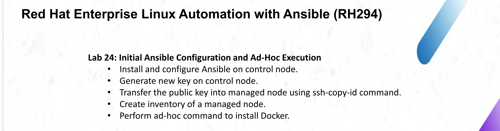

## The setup at a glance

| Role | Machine | Details |
|------|---------|---------|
| Control node | The host laptop | Ubuntu 24.04, Ansible core 2.16.3 |
| Managed node | Multipass VM `managed-node` | Ubuntu 24.04.5 LTS, 2 CPUs, 3 GB RAM, 15 GB disk, IP `10.97.0.129` |

A VM (and not a container) is used as the managed node because the next labs install Jenkins as a systemd service on it. The VM is isolated from the host: everything Ansible installs stays inside it, and it can be removed with one command.

| # | Step | Result |
|---|------|--------|
| 1 | Install Ansible on the control node | `ansible [core 2.16.3]` |
| 2 | Create the managed node | VM `managed-node` running, SSH active, passwordless `sudo` |
| 3 | Generate a new key and copy it with `ssh-copy-id` | Login with the key, no password |
| 4 | Create `ansible.cfg` and `inventory.ini` | `ansible all -m ping` returns `pong` |
| 5 | Install Docker with an ad-hoc command | `docker.io 29.1.3`, service `active` |

## Folder contents

| File | Purpose |
|------|---------|
| `ansible.cfg` | Ansible settings: inventory path, remote user, private key, privilege escalation |
| `inventory.ini` | The managed node (group `webservers`) |
| `images/` | All screenshots embedded in this report |

---

## Step 1: Install Ansible on the control node

```bash
sudo apt install -y ansible
ansible --version
```

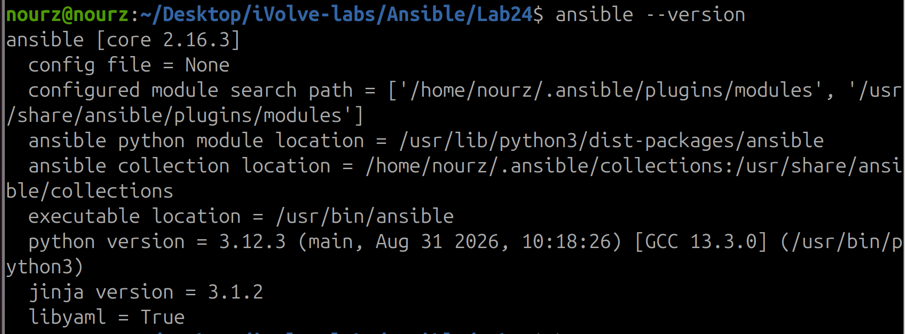

## Step 2: Create the managed node

The managed node is an Ubuntu 24.04 VM created with Multipass:

```bash
sudo snap install multipass
multipass launch 24.04 --name managed-node --cpus 2 --memory 3G --disk 15G
multipass list
```

Check that the VM has SSH running and passwordless `sudo`:

```bash
multipass exec managed-node -- bash -c 'whoami; lsb_release -d; systemctl is-active ssh; sudo -n true && echo sudo-ok'
```

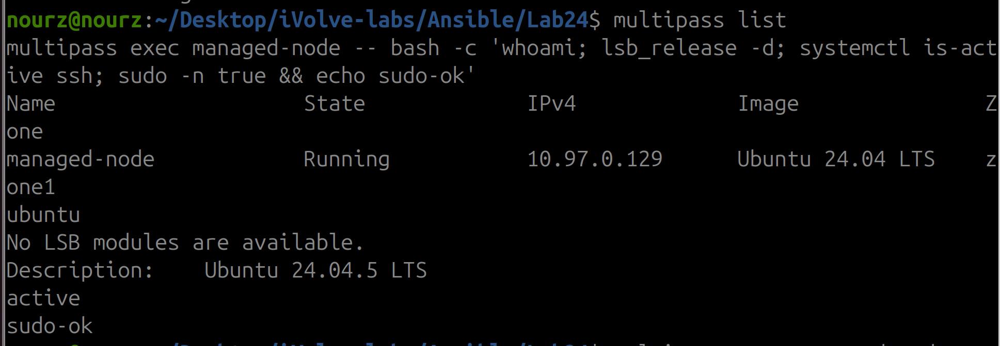

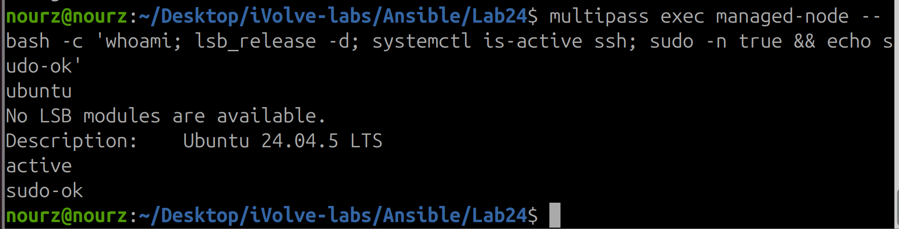

Multipass VMs only accept the Multipass key, so password login was enabled **temporarily** to copy our own key, and it is closed again in Step 3.

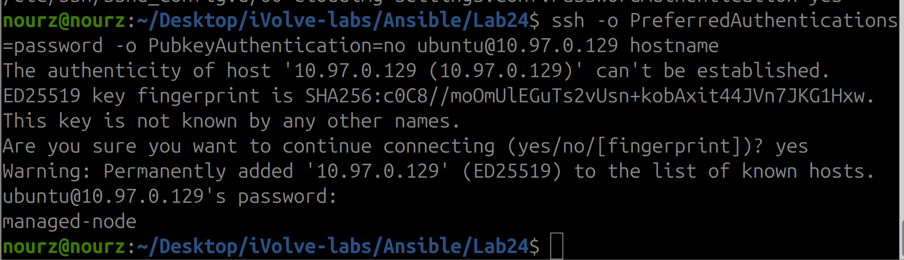

## Step 3: Generate a new key and transfer it with `ssh-copy-id`

A new key is created for Ansible (the key of the Jenkins agent from Lab 22 is not reused):

```bash
ssh-keygen -t ed25519 -f ~/.ssh/ansible_key -N "" -C "ansible-control-node"
ls -l ~/.ssh/ansible_key ~/.ssh/ansible_key.pub
```

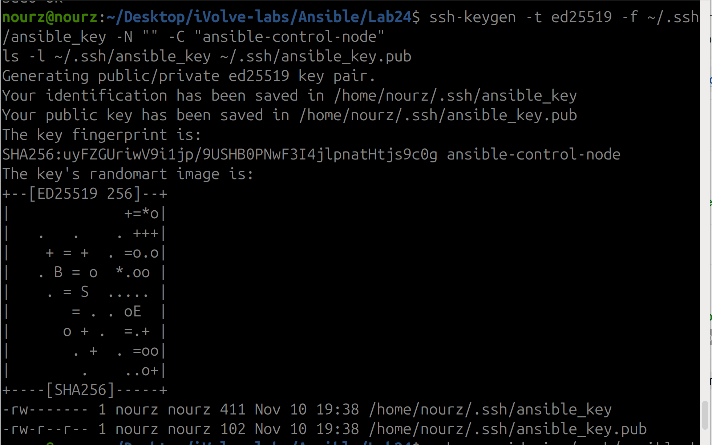

The public key is copied to the managed node with `ssh-copy-id`:

```bash
ssh-copy-id -i ~/.ssh/ansible_key.pub ubuntu@10.97.0.129
```

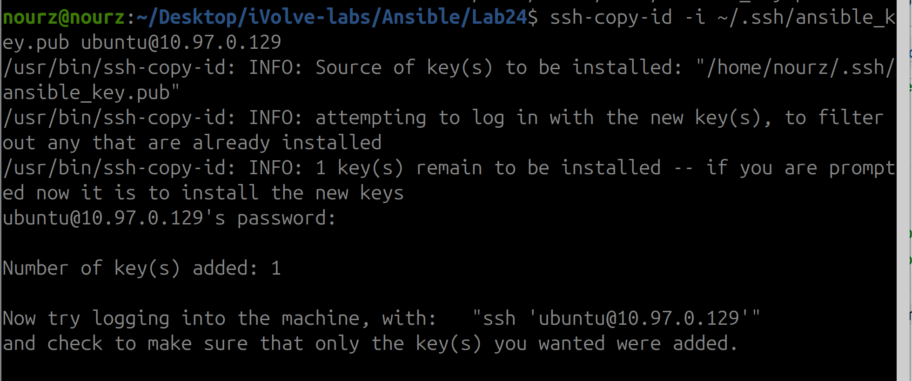

Login with the key works without a password:

```bash
ssh -i ~/.ssh/ansible_key -o PasswordAuthentication=no ubuntu@10.97.0.129 hostname
multipass exec managed-node -- cat /home/ubuntu/.ssh/authorized_keys
```

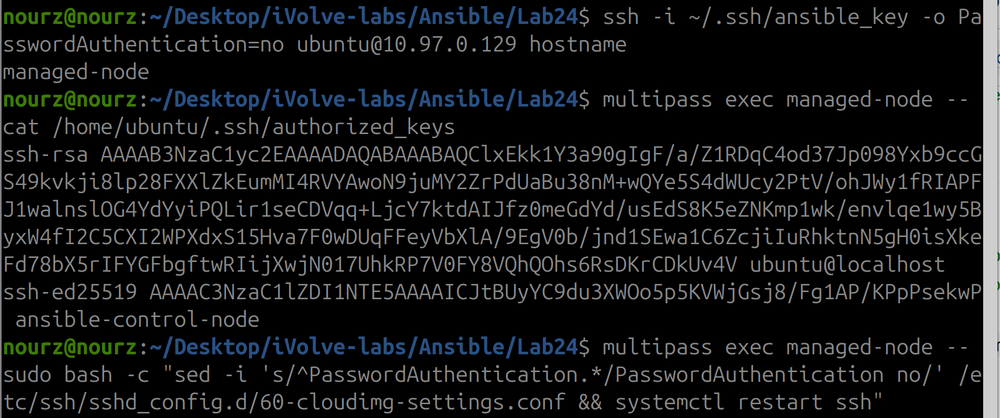

Password login is then switched off on the managed node, so only the key works:

```bash
multipass exec managed-node -- sudo bash -c "sed -i 's/^PasswordAuthentication.*/PasswordAuthentication no/' /etc/ssh/sshd_config.d/60-cloudimg-settings.conf && systemctl restart ssh"
ssh -o PreferredAuthentications=password -o PubkeyAuthentication=no ubuntu@10.97.0.129 hostname
ssh -i ~/.ssh/ansible_key ubuntu@10.97.0.129 hostname
```

The password attempt fails with `Permission denied (publickey)` and the key login still prints `managed-node`:

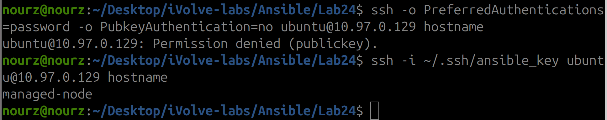

## Step 4: Configure Ansible and create the inventory

`ansible.cfg` (in the lab folder, Ansible reads it from the current directory):

```ini
[defaults]
inventory = inventory.ini
remote_user = ubuntu
private_key_file = ~/.ssh/ansible_key
host_key_checking = False

[privilege_escalation]
become = True
become_method = sudo
become_user = root
become_ask_pass = False
```

`inventory.ini` (only the VM, never the host machine):

```ini
[webservers]
10.97.0.129
```

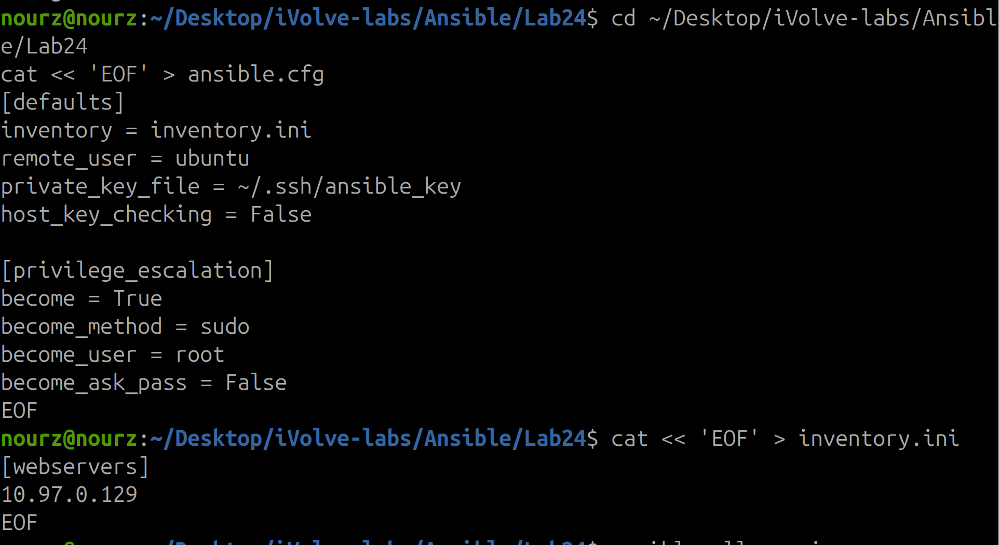

Check what Ansible sees and test the connection:

```bash
ansible-inventory --graph
ansible all -m ping
```

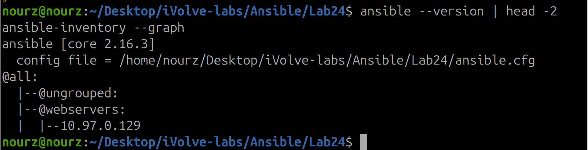

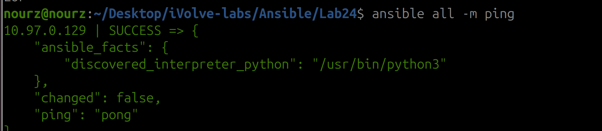

## Step 5: Install Docker with an ad-hoc command

One command installs Docker on every host of the inventory. `become = True` in `ansible.cfg` gives it root rights, so `-b` is not needed:

```bash
ansible all -m apt -a "name=docker.io state=present update_cache=yes"
```

The result is **`CHANGED`**: Ansible installed `docker.io 29.1.3` and its dependencies (`containerd`, `runc`, `bridge-utils`, `pigz`, ...). The download took 8 min 54 s (38.2 MB at 71.6 kB/s) because of a slow internet connection.

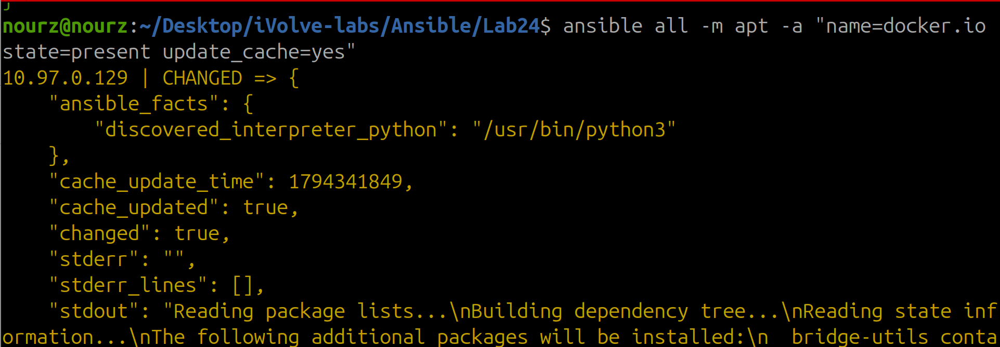

Verify the installation on the managed node:

```bash
ansible all -a "docker --version"
ansible all -a "systemctl is-active docker"
ansible all -a "docker run --rm hello-world"
ansible all -m apt -a "name=docker.io state=present"
```

```
Docker version 29.1.3, build 29.1.3-0ubuntu3~24.04.2
active
Hello from Docker!
"changed": false
```

The last command returns **`"changed": false`**: the module is **idempotent**, so running it again does nothing because Docker is already installed.

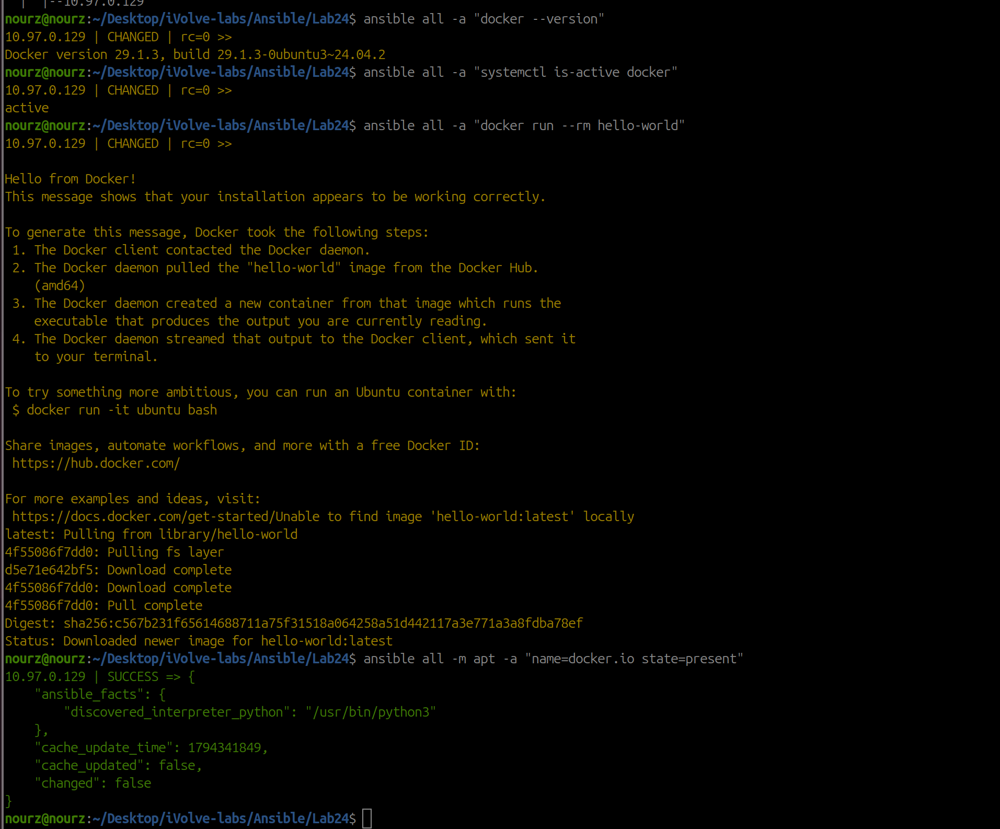

---

## Problems we hit and how we fixed them

| Problem | Symptom | Fix |
|---------|---------|-----|
| `multipass version` failed right after the install | `failed to open file ... multipass_root_cert.pem` | The Multipass service was still starting; running the command again worked |
| Multipass VMs do not accept our key | Login needs a password | Enable password login temporarily, copy the key with `ssh-copy-id`, then disable password login again |
| Slow package download | The Docker install took 8 min 54 s (about 71 kB/s) | Wait for it; the install is cached on the VM, so later runs are fast |
| Risk of changing the host by mistake | Ansible changes whatever is in the inventory | The inventory contains only the VM address (`10.97.0.x`), and the first run of every playbook uses `--check` |

## Known limitations

1. **`host_key_checking = False`** is convenient for a local VM, but a production setup should keep host key checking on.
2. **Docker comes from the Ubuntu repository** (`docker.io`), not from Docker's own repository, so the version follows Ubuntu.
3. **The user `ubuntu` is not in the `docker` group**, so Docker commands run through `become` (root).
4. **The control node and the VM are on the same laptop**; a real setup would use separate servers.
5. **The managed node is addressed by IP**. The Multipass IP can change after a restart, so `inventory.ini` may need an update.

## Cleanup

Remove the VM (everything installed on it goes with it):

```bash
multipass delete managed-node && multipass purge
```

Remove the Ansible key:

```bash
rm -f ~/.ssh/ansible_key ~/.ssh/ansible_key.pub
```

Remove Ansible from the control node:

```bash
sudo apt remove -y ansible
```

## Summary

- **Ansible 2.16.3** is installed on the control node and configured with `ansible.cfg` and `inventory.ini`.
- A **new SSH key** (`ansible_key`) was generated and copied to the managed node with `ssh-copy-id`; password login was then disabled.
- The managed node is an isolated **Multipass VM**, so nothing is changed on the host machine.
- A single **ad-hoc command** (`ansible all -m apt -a "name=docker.io state=present"`) installed Docker 29.1.3, and a second run reported `changed: false`.
- The result was verified four ways: the Docker version, the service state, `hello-world` running in a container, and the idempotent second run.
