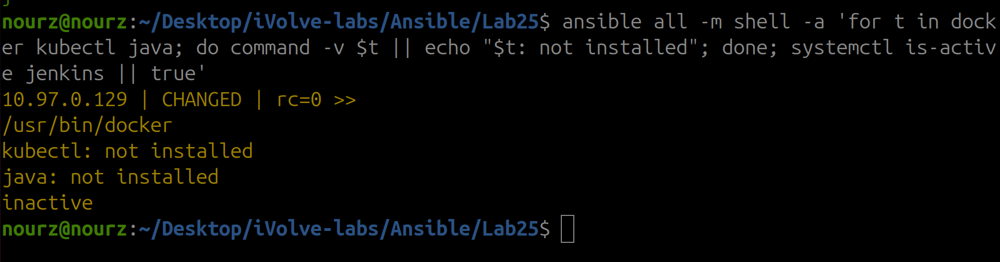
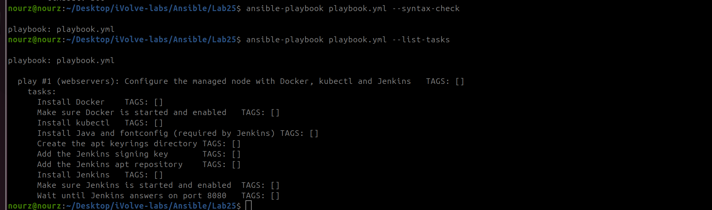
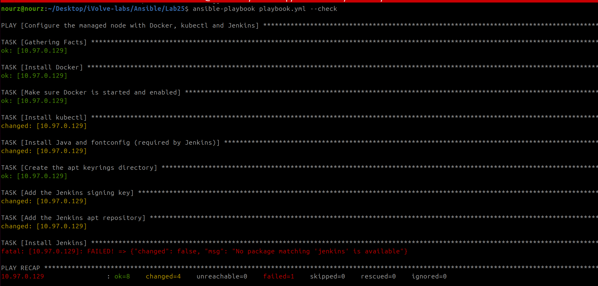
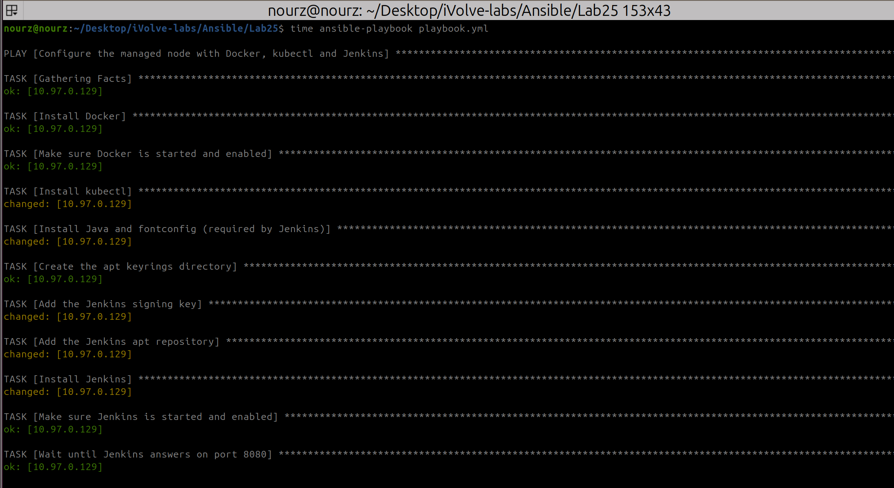
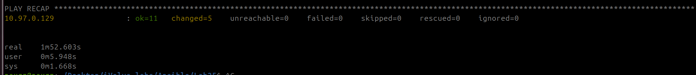
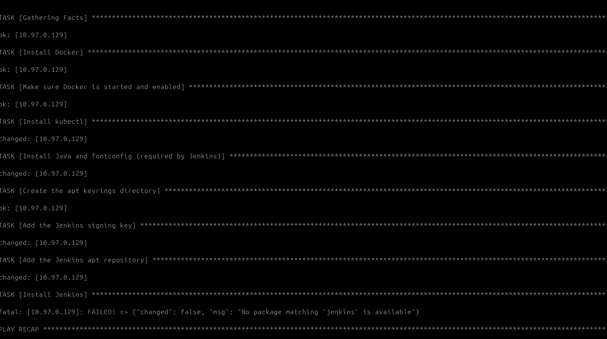
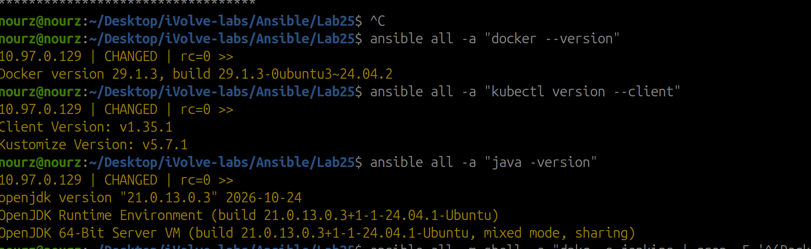
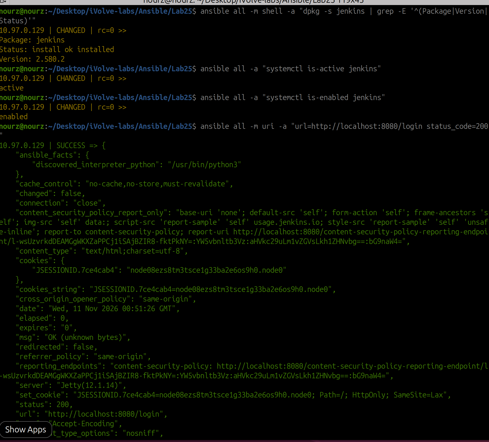

# Lab 25: Automated Web Server Configuration Using Ansible Playbooks

This lab replaces the one-line ad-hoc command of Lab 24 with an **Ansible playbook**: one YAML file that installs **Docker**, **kubectl** and **Jenkins** on the managed node and can be run again and again without breaking anything.

Everything in this report was verified end to end. The playbook ran against the Multipass VM from Lab 24 (`10.97.0.129`): the first run finished with **`ok=11 changed=5 failed=0`** in **1 min 52 s**, and the second run finished with **`changed=0`**. Every step below is backed by a screenshot from the real run.


## The playbook at a glance

| Part | Tasks | What it does |
|------|-------|--------------|
| Docker | 2 | Installs `docker.io` and makes sure the service is started and enabled |
| kubectl | 1 | Downloads the `kubectl` binary `v1.35.1` to `/usr/local/bin` and checks its SHA-256 checksum |
| Jenkins | 6 | Installs Java 21, adds the Jenkins signing key and apt repository, installs Jenkins, starts and enables the service, waits for port 8080 |

The same machines as Lab 24 are used: the control node is the host laptop and the managed node is the Multipass VM `managed-node`. The VM, the key `~/.ssh/ansible_key`, `ansible.cfg` and `inventory.ini` are reused from Lab 24. Docker was already installed there, so its task reports `ok` instead of `changed`.

## Folder contents

| File | Purpose |
|------|---------|
| `playbook.yml` | The playbook: Docker, kubectl and Jenkins |
| `ansible.cfg` | Ansible settings (copied from Lab 24) |
| `inventory.ini` | The managed node, group `webservers` (copied from Lab 24) |
| `images/` | All screenshots embedded in this report |

---

## Step 1: Prepare the lab folder

```bash
mkdir -p ~/Desktop/iVolve-labs/Ansible/Lab25/images
cd ~/Desktop/iVolve-labs/Ansible/Lab25
cp ../Lab24/ansible.cfg ../Lab24/inventory.ini .
multipass list
ansible all -m ping
```

Before the run, the managed node has Docker only. `kubectl` and `java` are missing and Jenkins is inactive:

```bash
ansible all -m shell -a 'for t in docker kubectl java; do command -v $t || echo "$t: not installed"; done; systemctl is-active jenkins || true'
```



## Step 2: Write the playbook

`playbook.yml`:

```yaml
---
- name: Configure the managed node with Docker, kubectl and Jenkins
  hosts: webservers
  become: true
  vars:
    kubectl_version: "v1.35.1"

  tasks:
    - name: Install Docker
      ansible.builtin.apt:
        name: docker.io
        state: present
        update_cache: true
        cache_valid_time: 3600

    - name: Make sure Docker is started and enabled
      ansible.builtin.service:
        name: docker
        state: started
        enabled: true

    - name: Install kubectl
      ansible.builtin.get_url:
        url: "https://dl.k8s.io/release/{{ kubectl_version }}/bin/linux/amd64/kubectl"
        dest: /usr/local/bin/kubectl
        mode: "0755"
        checksum: "sha256:https://dl.k8s.io/release/{{ kubectl_version }}/bin/linux/amd64/kubectl.sha256"
        timeout: 120

    - name: Install Java and fontconfig (required by Jenkins)
      ansible.builtin.apt:
        name:
          - fontconfig
          - openjdk-21-jre-headless
        state: present

    - name: Create the apt keyrings directory
      ansible.builtin.file:
        path: /etc/apt/keyrings
        state: directory
        mode: "0755"

    - name: Add the Jenkins signing key
      ansible.builtin.get_url:
        url: https://pkg.jenkins.io/debian-stable/jenkins.io-2026.key
        dest: /etc/apt/keyrings/jenkins-keyring.asc
        mode: "0644"
        timeout: 120

    - name: Add the Jenkins apt repository
      ansible.builtin.apt_repository:
        repo: "deb [signed-by=/etc/apt/keyrings/jenkins-keyring.asc] https://pkg.jenkins.io/debian-stable binary/"
        filename: jenkins
        state: present

    - name: Install Jenkins
      ansible.builtin.apt:
        name: jenkins
        state: present
        update_cache: true

    - name: Make sure Jenkins is started and enabled
      ansible.builtin.service:
        name: jenkins
        state: started
        enabled: true

    - name: Wait until Jenkins answers on port 8080
      ansible.builtin.wait_for:
        port: 8080
        timeout: 300
```

Notes on the choices:

- **`kubectl_version` is pinned** to `v1.35.1`, so every run installs the same version, and the download is verified against the official checksum file.
- **Jenkins needs Java first.** If Jenkins is installed before Java, the service fails to start.
- **The 2026 signing key** (`jenkins.io-2026.key`) is used. Older keys no longer work: the host machine shows the same `NO_PUBKEY` error in `apt update` when it still has the old key.

The file is checked without running it:

```bash
ansible-playbook playbook.yml --syntax-check
ansible-playbook playbook.yml --list-tasks
```




## Step 3: Dry run with `--check`

```bash
ansible-playbook playbook.yml --check
```

Check mode simulates the changes. It stops at **`Install Jenkins`** with `No package matching 'jenkins' is available`. This is expected: in check mode the Jenkins apt repository is only simulated, so the package does not exist yet. All the earlier tasks report what they would change (`kubectl`, Java, the key and the repository), and Docker is `ok`.



## Step 4: Run the playbook

```bash
time ansible-playbook playbook.yml
```

Docker's two tasks are `ok` (already installed in Lab 24). `kubectl`, Java, the signing key, the repository and Jenkins are `changed`:



```
PLAY RECAP
10.97.0.129 : ok=11  changed=5  unreachable=0  failed=0  skipped=0  rescued=0  ignored=0
real	1m52.603s
```



### Run it again

```bash
ansible-playbook playbook.yml
```

The second run reports **`changed=0`**: the playbook is **idempotent**. It describes the state we want, so Ansible changes nothing when the node is already in that state.



## Step 5: Verify the configuration on the managed node

```bash
ansible all -a "docker --version"
ansible all -a "kubectl version --client"
ansible all -a "java -version"
```

```
Docker version 29.1.3, build 29.1.3-0ubuntu3~24.04.2
Client Version: v1.35.1
Kustomize Version: v5.7.1
openjdk version "21.0.13.0.3" 2026-10-24
```



Jenkins is installed, running, enabled at boot, and answers over HTTP:

```bash
ansible all -m shell -a "dpkg -s jenkins | grep -E '^(Package|Version|Status)'"
ansible all -a "systemctl is-active jenkins"
ansible all -a "systemctl is-enabled jenkins"
ansible all -m uri -a "url=http://localhost:8080/login status_code=200"
```

```
Package: jenkins
Status: install ok installed
Version: 2.580.2
active
enabled
"status": 200
```



This Jenkins is separate from the Jenkins container used in Labs 21-23, which runs on the host at port 8081.

---

## Problems we hit and how we fixed them

| Problem | Symptom | Fix |
|---------|---------|-----|
| `--check` stops at Jenkins | `No package matching 'jenkins' is available` | Expected: in check mode the apt repository is not really added. The real run installs Jenkins normally |
| Old Jenkins signing key | Guides with the 2023 key fail with `NO_PUBKEY` | Use `jenkins.io-2026.key` and `signed-by` in the repository line |
| Ad-hoc commands print `CHANGED` | `ansible all -a "docker --version"` reports `CHANGED` for a read-only command | The `command` module cannot know whether a command changed anything, so it always reports `CHANGED`. Modules such as `apt` report the real state |
| Slow internet | The Docker install in Lab 24 took almost 9 minutes | The download in this lab was much faster; a failed run can simply be repeated because the playbook is idempotent |

## Known limitations

1. **Jenkins is only installed**, not configured: the setup wizard is not completed and no plugins or jobs are created.
2. **The kubectl version is pinned by hand** (`v1.35.1`); a new Kubernetes release needs a change of `kubectl_version`.
3. **Docker comes from the Ubuntu repository** (`docker.io`), as in Lab 24.
4. **One flat playbook.** Lab 26 splits it into roles for better reuse.
5. **Port 8080 is reachable on the VM address**, which is only visible from the host; a real server would need a firewall rule and HTTPS.

## Cleanup

The VM is reused by Lab 26, so keep it for now. To remove only what this lab installed:

```bash
ansible all -m apt -a "name=jenkins,openjdk-21-jre-headless state=absent autoremove=true"
ansible all -m file -a "path=/usr/local/bin/kubectl state=absent"
```

To remove everything, including the VM:

```bash
multipass delete managed-node && multipass purge
```

## Summary

- A single **playbook** (`playbook.yml`) installs **Docker**, **kubectl v1.35.1** and **Jenkins 2.580.2** (with Java 21) on the managed node.
- The first run took **1 min 52 s** with `ok=11 changed=5 failed=0`; the second run reported **`changed=0`**, which proves the playbook is idempotent.
- `--check` was used first as a dry run; it stops at the Jenkins install only because the repository is simulated in check mode.
- The result was verified four ways: tool versions, the Jenkins package, the service state (`active` and `enabled`), and an HTTP 200 from the login page.
