# Lab 23: Implementing a GitOps Workflow with Jenkins and Argo CD

This lab turns the Lab 22 pipeline into a **GitOps** workflow. Jenkins no longer talks to the cluster: it builds and publishes the image, writes the new image tag into the Kubernetes manifest and **pushes it to GitHub**. **Argo CD** watches that repository and applies every change to the cluster by itself.

Everything in this report was verified end to end. Argo CD runs in the `argocd` namespace of the minikube cluster (UI on `https://localhost:8443`), the Jenkins job is **`DemoApp-Lab23`** at `http://localhost:8081`, and the Argo CD Application **`ivolve`** finished **`Synced`** and **`Healthy`**. Every step below is backed by a screenshot from the real run.

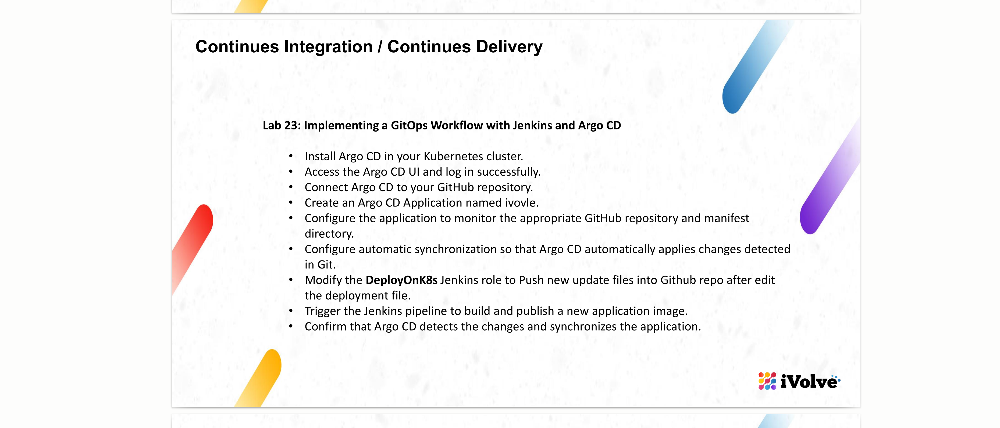

The assignment asks to install Argo CD, create an Application named `ivolve` that monitors the GitHub repository, enable automatic sync, modify the `DeployOnK8s` library step so it pushes the edited deployment file to GitHub, trigger the pipeline and confirm that Argo CD synchronizes the application. The slide spells the name `ivovle`; we used **`ivolve`**. The application repository is our fork [`neiorz/DemoApp`](https://github.com/neiorz/DemoApp) (branch `lab23`) and the library is [`neiorz/jenkins-shared-library`](https://github.com/neiorz/jenkins-shared-library).

## The workflow at a glance

```
Jenkins (agent-1) ──build/scan/push──► Docker Hub  nourz1/demo-app:<build>
        │
        └──edit k8s/deployment.yaml + git push──► GitHub (DemoApp, branch lab23, folder k8s/)
                                                        │
                                          Argo CD detects the commit
                                                        │
                                                        ▼
                                          Kubernetes cluster (namespace default)
```

| # | Component | Role |
|---|-----------|------|
| 1 | `DemoApp-Lab23` (Jenkins) | Runs `buildApp()`, `buildImage()` and `deployOnK8s()` on `agent-1` |
| 2 | `deployOnK8s()` (modified) | Edits `k8s/deployment.yaml`, commits and **pushes to GitHub** instead of running `kubectl apply` |
| 3 | GitHub `neiorz/DemoApp` (branch `lab23`, path `k8s`) | The single source of truth for the cluster state |
| 4 | Argo CD Application `ivolve` | Watches `lab23/k8s` and syncs it to the `default` namespace automatically |

The image tag is the Jenkins build number, so the first build of the new job produces **`nourz1/demo-app:1`**.

## Folder contents

| File | Purpose |
|------|---------|
| `Jenkinsfile` | The pipeline of the `lab23` branch (the same file as Lab 22; the change is inside the library) |
| `vars/deployOnK8s.groovy` | The modified shared-library step: edit the manifest, commit and push to GitHub |
| `k8s/deployment.yaml` | The Deployment that Argo CD watches (2 replicas, `containerPort: 8080`) |
| `k8s/service.yaml` | A ClusterIP Service `demo-app-svc` for the application |
| `images/` | All screenshots embedded in this report |

`buildApp` and `buildImage` are unchanged from Lab 22.

---

## Step 1: Install Argo CD

```bash
kubectl create namespace argocd
kubectl apply -n argocd --server-side --force-conflicts -f https://raw.githubusercontent.com/argoproj/argo-cd/stable/manifests/install.yaml
kubectl get pods -n argocd -w
```

`--server-side` is needed because some Argo CD CRDs are too large for a normal `kubectl apply`. All seven pods reach `Running 1/1`:

```bash
kubectl get pods -n argocd
kubectl get svc -n argocd
```

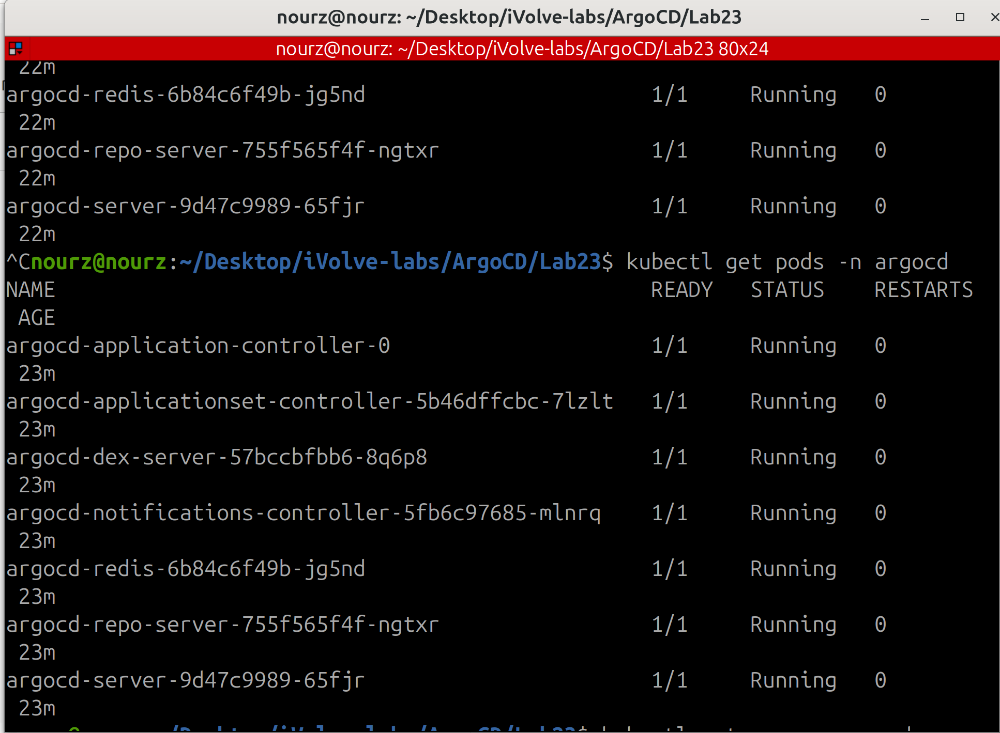

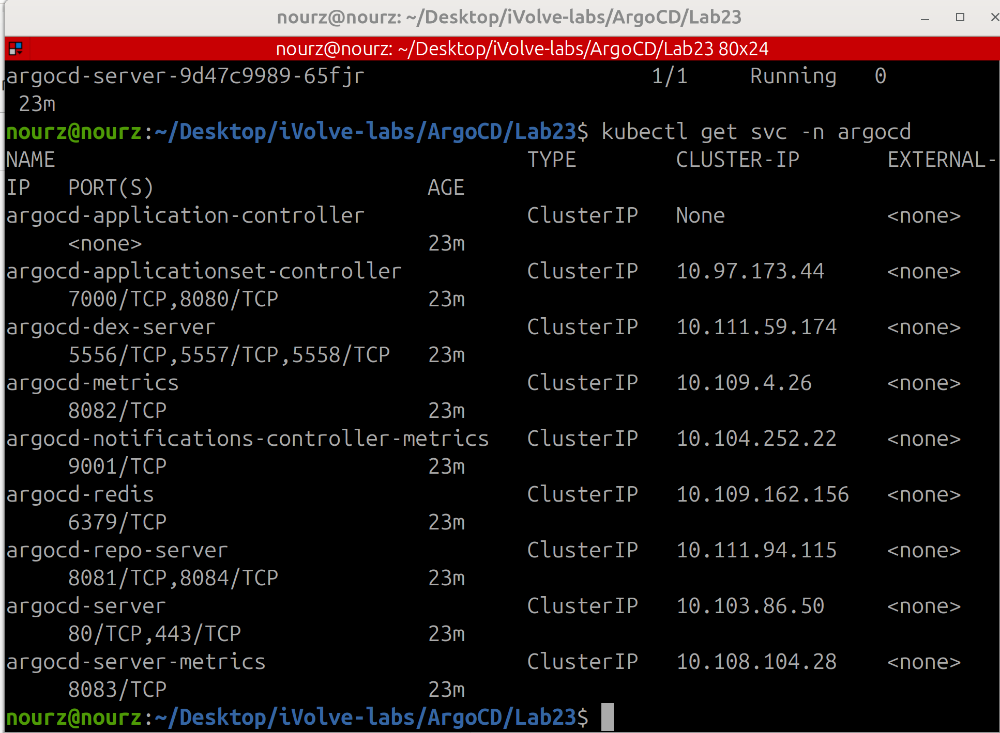

## Step 2: Access the Argo CD UI

The `argocd-server` service is a `ClusterIP`, so it is reached with a port-forward. Jenkins already uses port 8081, so Argo CD uses **8443**. Keep this terminal open:

```bash
kubectl port-forward svc/argocd-server -n argocd 8443:443
```

Get the initial admin password in a second terminal:

```bash
kubectl -n argocd get secret argocd-initial-admin-secret -o jsonpath="{.data.password}" | base64 -d; echo
```

Open `https://localhost:8443` (accept the self-signed certificate warning) and log in with user **`admin`** and that password.

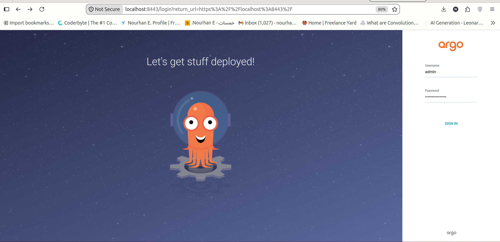

After login the **Applications** page is empty:

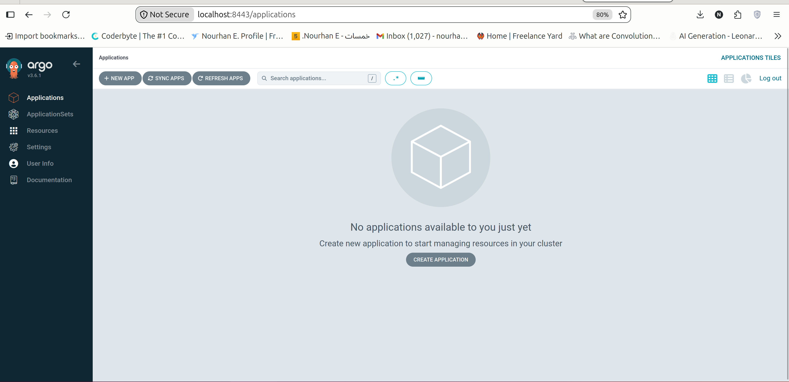

## Step 3: Prepare the manifests in GitHub

Argo CD watches a folder of YAML files in Git. A new branch `lab23` of `neiorz/DemoApp` holds a `k8s/` folder, so `main` (Lab 21) and `lab22` (Lab 22) stay untouched. The same commit fixes two limitations of the previous labs: `containerPort` is now `8080`, and a Service is added.

```bash
cd ~/Documents/DemoApp/DemoApp
git checkout -b lab23
mkdir -p k8s
git mv deployment.yaml k8s/deployment.yaml
sed -i 's/containerPort: 7070/containerPort: 8080/' k8s/deployment.yaml
```

`k8s/service.yaml`:

```yaml
apiVersion: v1
kind: Service
metadata:
  name: demo-app-svc
spec:
  type: ClusterIP
  selector:
    app: demo-app
  ports:
  - port: 80
    targetPort: 8080
```

```bash
git add k8s
git commit -m "Lab23: move manifests to k8s/ and add service"
git push -u origin lab23
```

The Deployment created by Lab 22 with `kubectl apply` is removed, so that Argo CD creates it from Git:

```bash
kubectl delete deployment demo-app-deployment
```

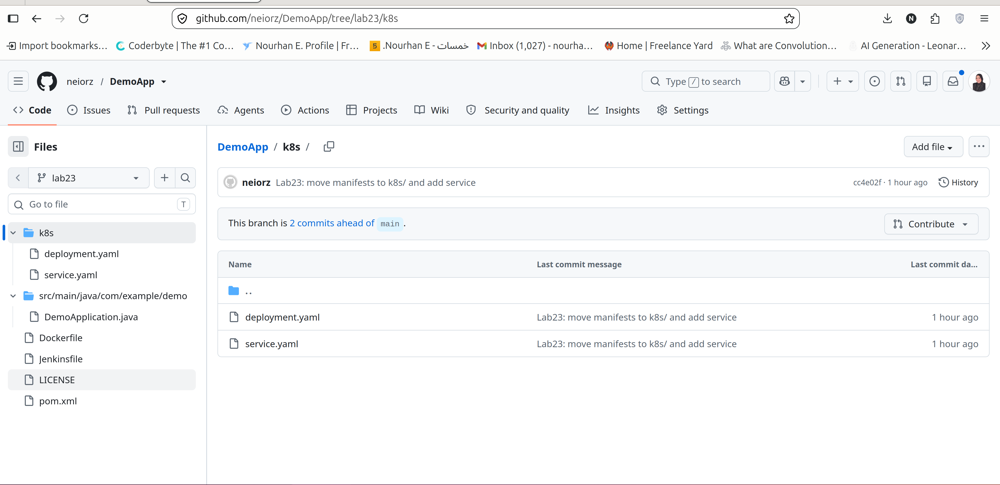

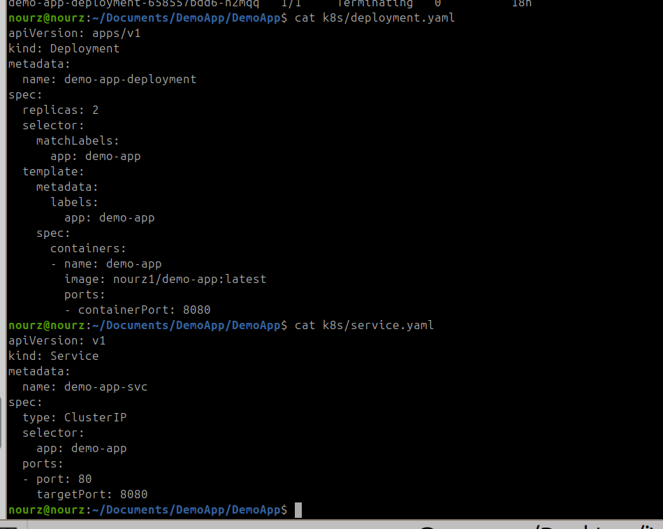

## Step 4: Connect Argo CD to the GitHub repository

In the UI: **Settings → Repositories → + CONNECT REPO**:

| Field | Value |
|-------|-------|
| Connection method | VIA HTTPS |
| Type | `git` |
| Project | `default` |
| Repository URL | `https://github.com/neiorz/DemoApp.git` |
| Username / Password | empty (the repository is public) |

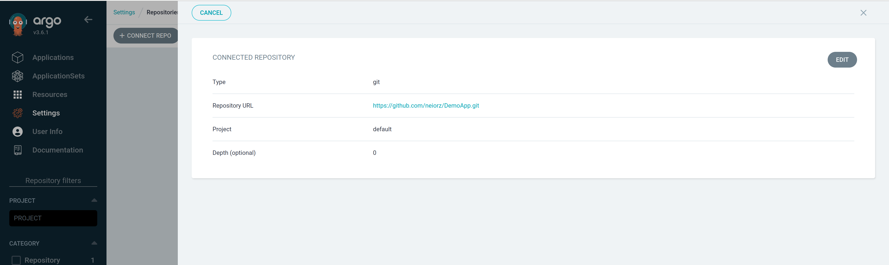

The repository appears with **Connection Status: Successful**:

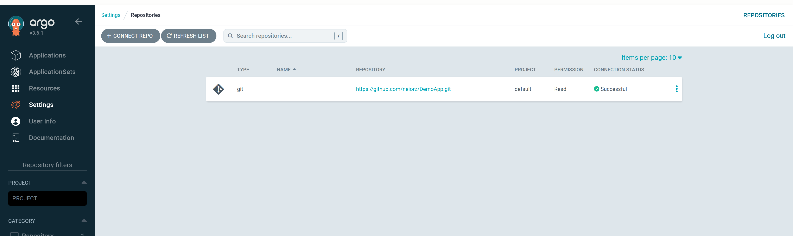

## Step 5: Create the `ivolve` Application with automatic sync

**Applications → + NEW APP**:

| Section | Field | Value |
|---------|-------|-------|
| General | Application Name | `ivolve` |
| General | Project Name | `default` |
| General | Sync Policy | **Automatic** (Prune Resources and Self Heal enabled) |
| Source | Repository URL | `https://github.com/neiorz/DemoApp.git` |
| Source | Revision | `lab23` |
| Source | Path | `k8s` |
| Destination | Cluster URL | `https://kubernetes.default.svc` |
| Destination | Namespace | `default` |


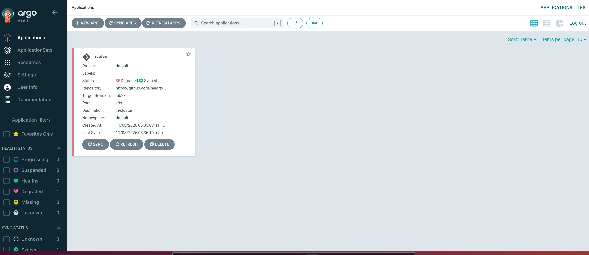

Argo CD immediately syncs the manifests from Git. The resource tree shows the Service, the Deployment, the ReplicaSet and two pods:

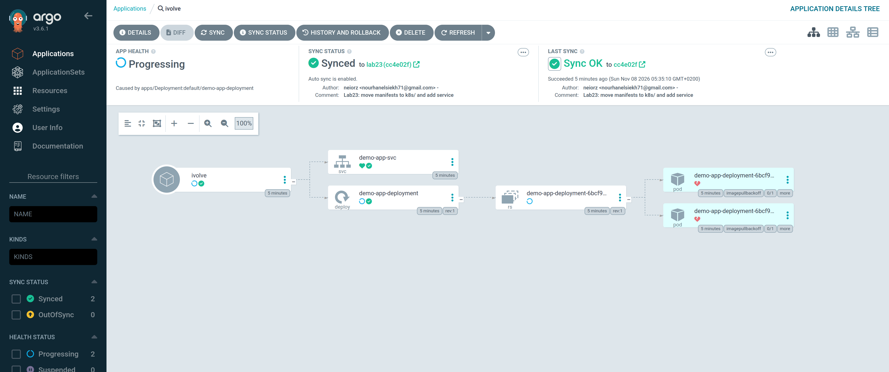

At this point the pods are in **`ImagePullBackOff`**: the manifest still says `nourz1/demo-app:latest` and no such tag exists on Docker Hub. Argo CD reports the application as **Synced** (Git and cluster agree) but **Progressing**, and later **Degraded**. This is expected and is the "before" picture of the workflow; the pipeline fixes it in Step 8.

```bash
kubectl get pods
kubectl get svc
kubectl get applications -n argocd
```

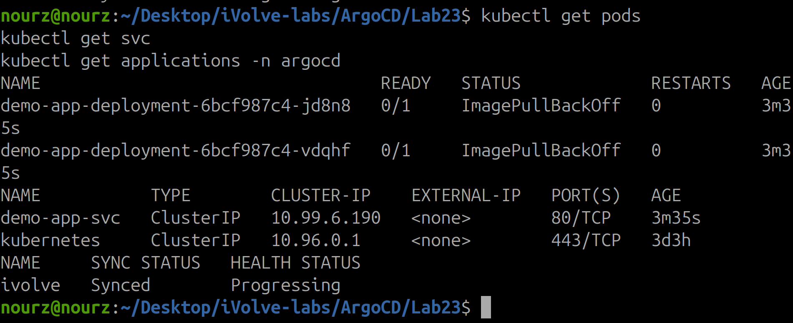

## Step 6: Give Jenkins a GitHub credential

The modified library step pushes to GitHub, and the Jenkins container has no GitHub SSH key, so it uses a **Personal Access Token** over HTTPS.

**1. Token.** GitHub → **Settings → Developer settings → Personal access tokens → Fine-grained tokens → Generate new token**:

| Field | Value |
|-------|-------|
| Token name | `jenkins-lab23` |
| Repository access | Only select repositories → `neiorz/DemoApp` |
| Repository permissions → Contents | Read and write |

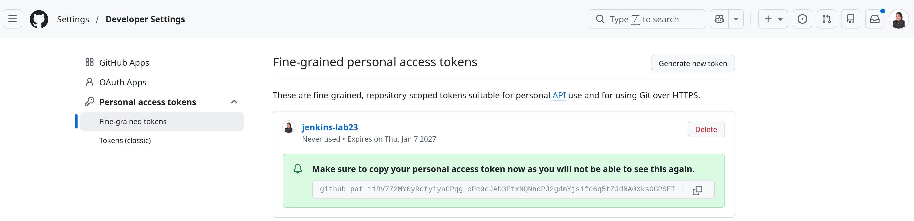

**2. Credential.** **Manage Jenkins → Credentials → System → Global credentials → Add Credentials**:

- **Kind:** Username with password
- **Username:** `neiorz`
- **Password:** the token
- **ID:** `github-credentials`

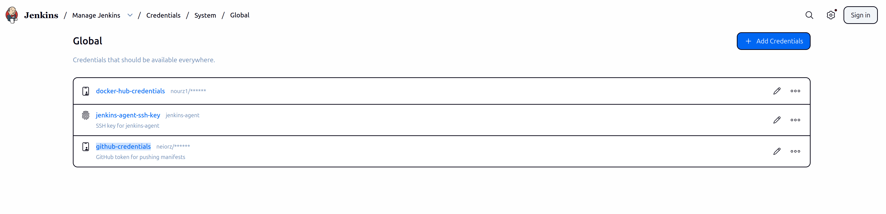

The ID must be exactly `github-credentials`, because the library step uses it. The agent also needs `git`, which it already has (`git version 2.43.0`).

## Step 7: Modify the `DeployOnK8s` library step

The step used to run `kubectl apply`. It now edits the manifest and pushes it to GitHub; Argo CD does the deployment. Jenkins checks the repository out in a detached HEAD state, so the push target is `HEAD:lab23`.

`vars/deployOnK8s.groovy`:

```groovy
def call(String imageName, String imageTag, String deploymentFile = 'k8s/deployment.yaml', String branch = 'lab23') {
    echo "Updating image in ${deploymentFile}"
    sh "sed -i 's|image:.*|image: ${imageName}:${imageTag}|g' ${deploymentFile}"

    echo "Pushing the updated manifest to GitHub (branch ${branch})"
    withCredentials([usernamePassword(credentialsId: 'github-credentials',
                                      usernameVariable: 'GIT_USER',
                                      passwordVariable: 'GIT_PASS')]) {
        sh """
            git config user.email 'jenkins@ivolve.com'
            git config user.name 'Jenkins CI'
            git add ${deploymentFile}
            git commit -m 'Update image tag to ${imageTag}' || true
            REPO=\$(git config --get remote.origin.url | sed 's|https://||')
            git push https://\${GIT_USER}:\${GIT_PASS}@\$REPO HEAD:${branch}
        """
    }
    echo "Argo CD will detect the change and sync the cluster"
}
```

Push it to the library repository:

```bash
cd ~/Desktop/jenkins-shared-library
git add vars/deployOnK8s.groovy
git commit -m "deployOnK8s: push updated manifest to GitHub for Argo CD (GitOps)"
git push origin main
```

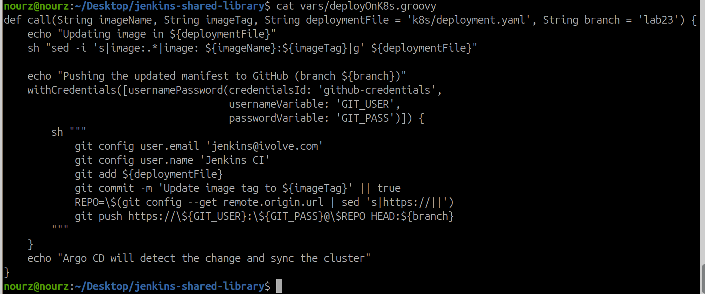

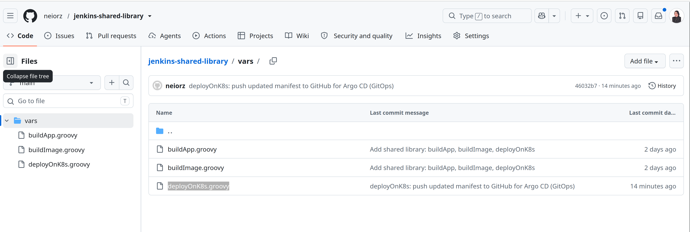

The `Jenkinsfile` does not change: the stages still call `buildApp()`, `buildImage()` and `deployOnK8s()`. That is the benefit of the shared library.

## Step 8: Create the job and run the pipeline

A new job keeps Lab 22 intact (the old job would now push to GitHub as well, because it shares the library). **New Item → Pipeline**, name **`DemoApp-Lab23`**:

| Field | Value |
|-------|-------|
| Definition | Pipeline script from SCM |
| SCM | Git |
| Repository URL | `https://github.com/neiorz/DemoApp.git` |
| Branch Specifier | `*/lab23` |
| Script Path | `Jenkinsfile` |
| Lightweight checkout | on |

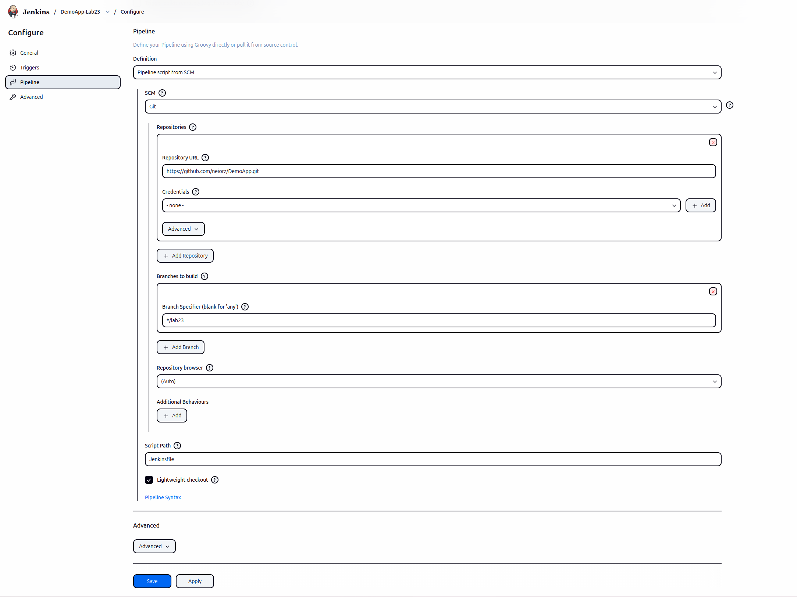

Press **Build Now**. The build runs on `agent-1` and finishes green:

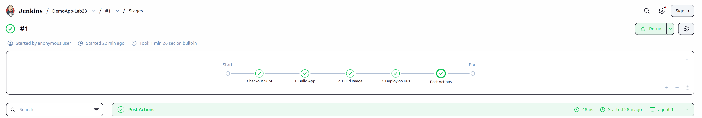

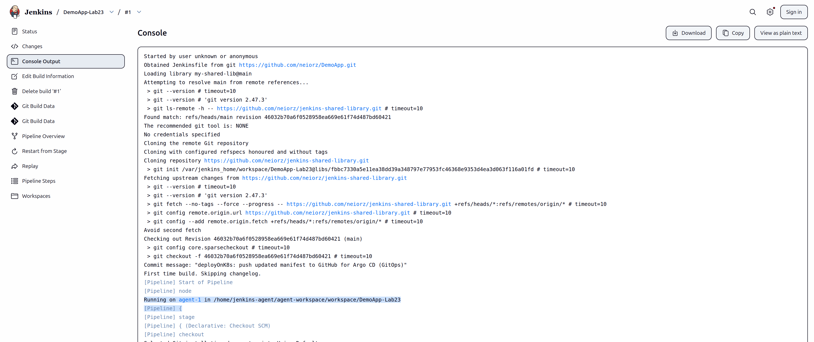

In the **Deploy on K8s** stage there is no `kubectl apply` any more. The step edits the manifest, commits and pushes (the token is masked by Jenkins):

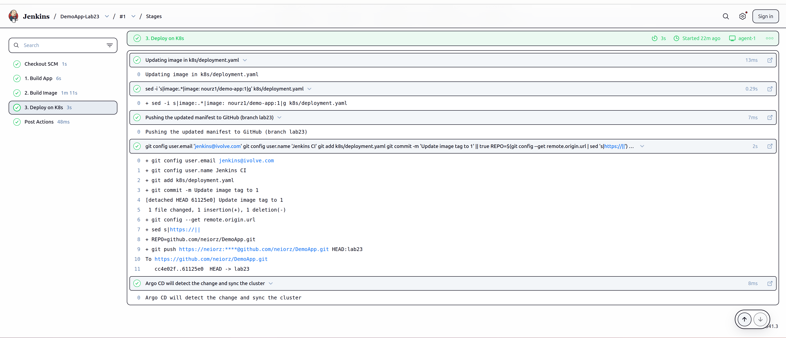

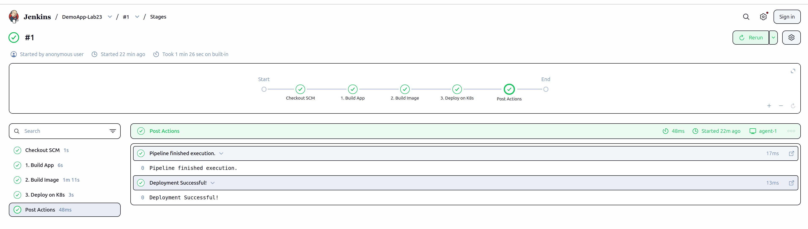

## Step 9: Confirm that Argo CD detects the change and syncs

**1. GitHub.** Jenkins pushed a new commit to branch `lab23` and the image line changed from `latest` to `nourz1/demo-app:1`:

```bash
cd ~/Documents/DemoApp/DemoApp
git checkout lab23
git pull origin lab23
git log --oneline -3
grep image: k8s/deployment.yaml
```

```
61125e0 Update image tag to 1
cc4e02f Lab23: move manifests to k8s/ and add service
9b0e797 Lab22: Jenkinsfile using shared library and agent-1
        image: nourz1/demo-app:1
```

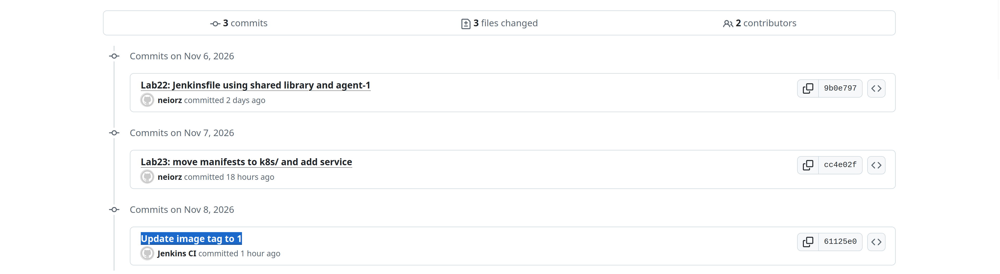

**2. Argo CD.** Argo CD detects the new commit (it polls Git about every 3 minutes; **REFRESH** forces an immediate check), applies it, replaces the broken pods and the application turns from **Degraded** to **Healthy**:

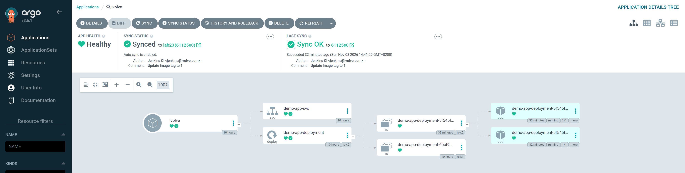


**3. The cluster:**

```bash
kubectl get pods
kubectl get deployment demo-app-deployment -o jsonpath='{.spec.template.spec.containers[0].image}{"\n"}'
kubectl get applications -n argocd
```

```
NAME                                   READY   STATUS    RESTARTS   AGE
demo-app-deployment-5f545fbd7b-l5rxb   1/1     Running   0          31m
demo-app-deployment-5f545fbd7b-ww8vw   1/1     Running   0          30m
nourz1/demo-app:1
NAME     SYNC STATUS   HEALTH STATUS
ivolve   Synced        Healthy
```

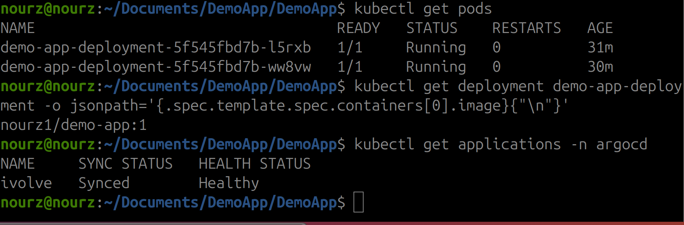

**4. Docker Hub:** the repository [`nourz1/demo-app`](https://hub.docker.com/r/nourz1/demo-app) carries tag **`1`**.

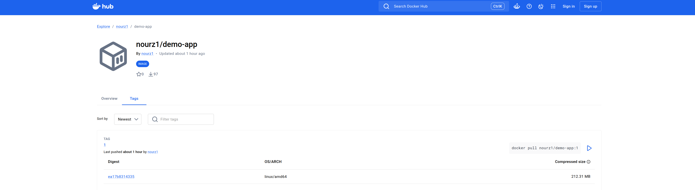

**5. The application** (through the new Service):

```bash
kubectl port-forward svc/demo-app-svc 18080:80
curl http://127.0.0.1:18080/
```

```
Hello from Dockerized Spring Boot!
```

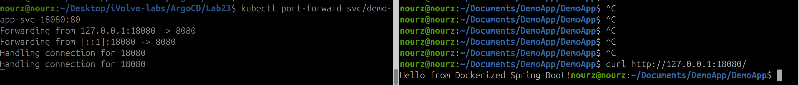

---

## Problems we hit and how we fixed them

| Problem | Symptom | Fix |
|---------|---------|-----|
| The `k8s/` commit landed on `lab22` | `git push -u origin lab23` failed with `src refspec lab23 does not match any`, and `lab22` was "ahead by 1 commit" | `git checkout -b lab23` (takes the commit with it), then `git branch -f lab22 origin/lab22` to restore `lab22`, then push `lab23` |
| Pods in `ImagePullBackOff` right after the Application was created | Application `Synced` but `Progressing`, later `Degraded` | Expected: the manifest pointed at `nourz1/demo-app:latest`, which does not exist. The pipeline pushed a real tag and Argo CD healed the application |
| Argo CD UI on port 8081 would clash with Jenkins | Jenkins already listens on `8081` | Port-forward Argo CD to `8443` |
| Argo CD manifests are large | A normal `kubectl apply` can fail on the big CRDs | Install with `--server-side --force-conflicts` |
| Jenkins checks out a detached HEAD | A plain `git push` has no branch to push to | Push explicitly with `HEAD:lab23` |
| The Jenkins container has no GitHub SSH key | SSH push is impossible | Push over HTTPS with a Personal Access Token stored as the `github-credentials` credential |

## Known limitations

1. **The token is part of the push URL** inside the `sh` block. Jenkins masks it in the log, but a production setup would use a credential helper or a deploy key.
2. **Argo CD polls Git** about every 3 minutes; a GitHub webhook would make the sync immediate.
3. **`sed` replaces every `image:` line** of the manifest, which is fine for one container but not for a multi-container Deployment.
4. **The library step defaults to the `lab23` branch.** A reusable library would take the branch and manifest path as pipeline parameters.
5. **The Jenkins job shares the library with `DemoApp-Lab22`**, so running the old job now also pushes to GitHub.
6. **The Trivy scan does not block** (`--exit-code 0`); use `--exit-code 1` for a real gate.
7. **The Argo CD UI is reached with `kubectl port-forward`** and a self-signed certificate; there is no Ingress.

## Cleanup

Remove the Argo CD Application (this also deletes the Deployment and the Service it created):

```bash
kubectl delete application ivolve -n argocd
```

Remove Argo CD:

```bash
kubectl delete namespace argocd
```

Delete the `github-credentials` credential in Jenkins and revoke the `jenkins-lab23` token on GitHub (**Settings → Developer settings → Personal access tokens**).

## Summary

- **Argo CD** is installed in the cluster, reachable on `https://localhost:8443`, and connected to `neiorz/DemoApp`.
- The Application **`ivolve`** watches branch `lab23`, folder `k8s`, with **automatic sync** (prune and self-heal).
- The shared-library step **`deployOnK8s`** now edits the manifest and **pushes it to GitHub** instead of calling `kubectl`, so Git is the single source of truth.
- Running the Jenkins job **`DemoApp-Lab23`** built and published `nourz1/demo-app:1` and pushed the commit `Update image tag to 1`; Argo CD detected it and moved the application from **Degraded** to **Synced / Healthy** with two running pods.
- The result was verified five ways: the Jenkins commit on GitHub, the Argo CD UI, the pods and image in the cluster, the Docker Hub tag and the application answering `Hello from Dockerized Spring Boot!`.
