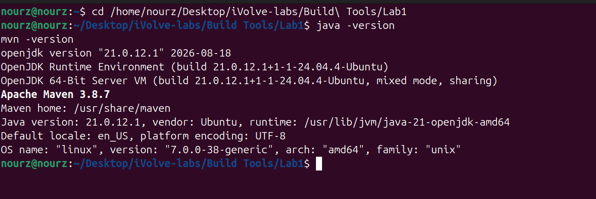
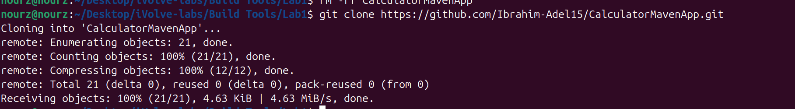
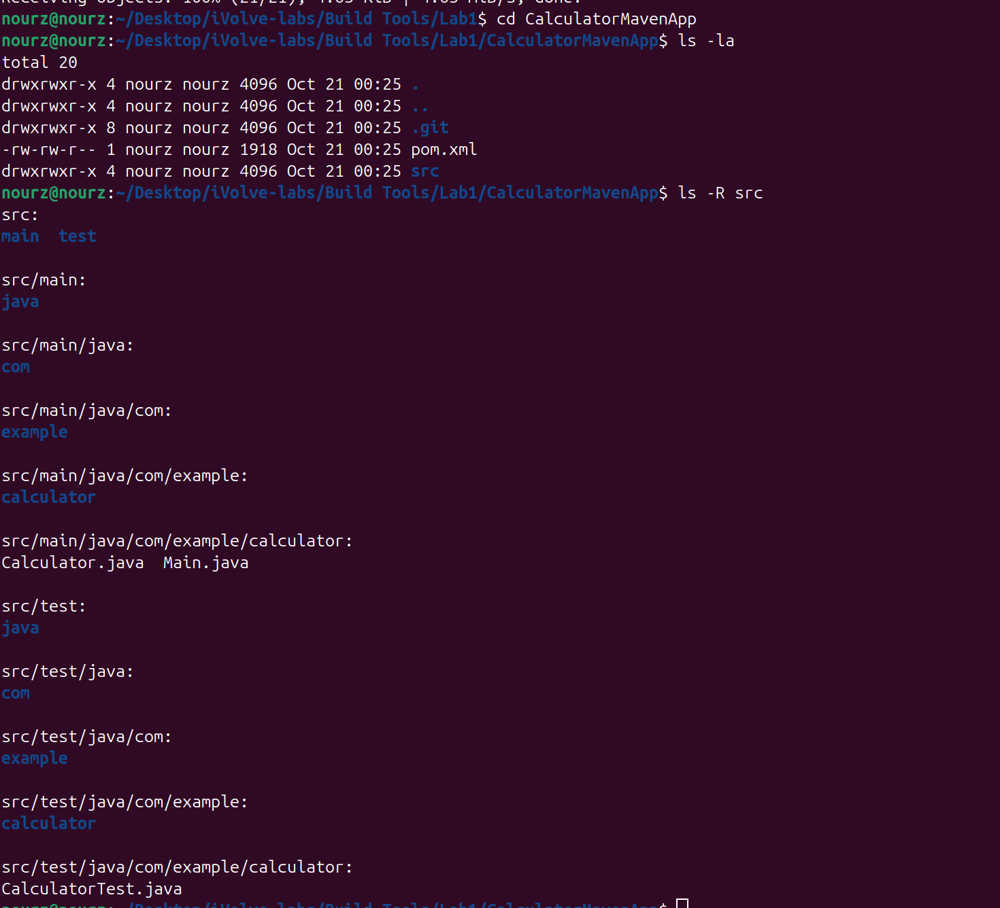
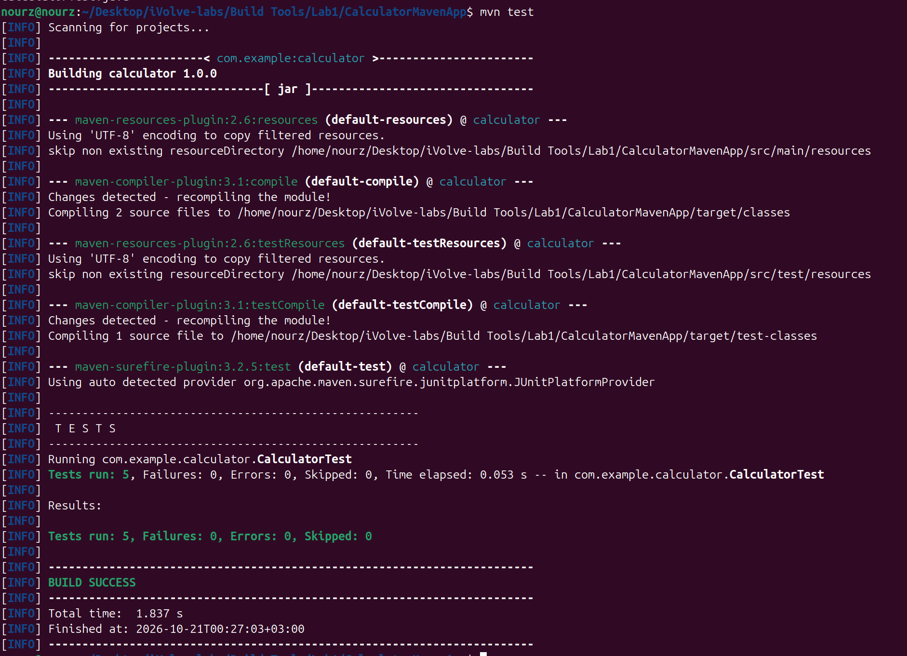
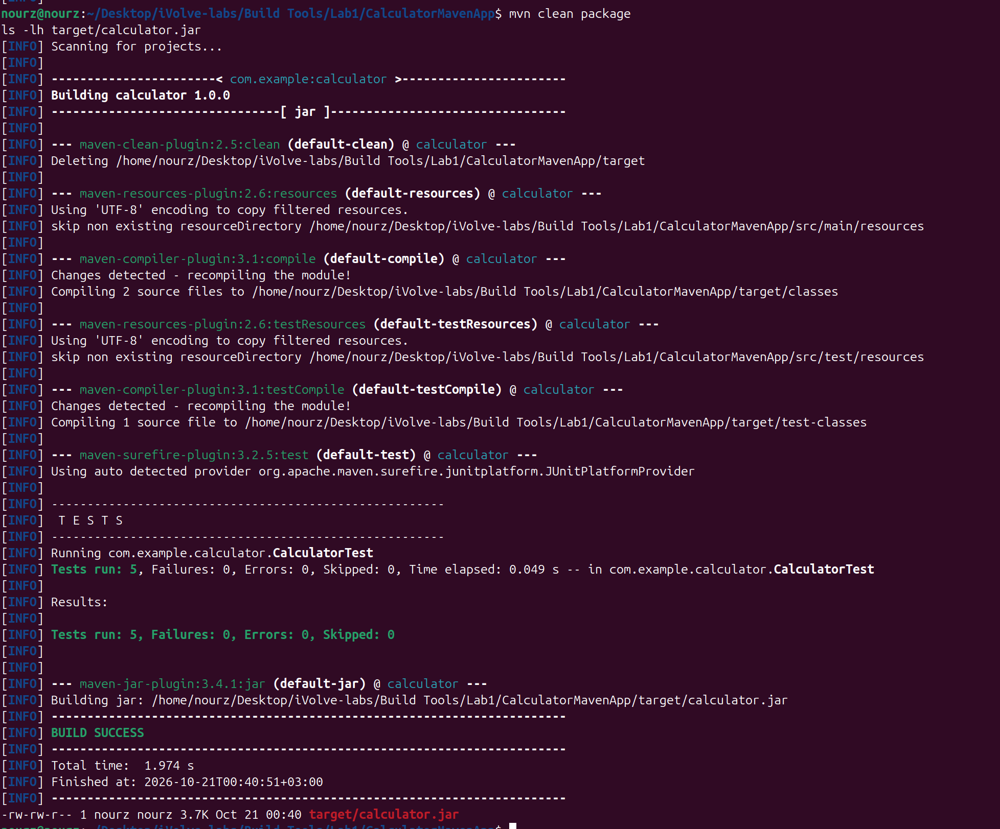
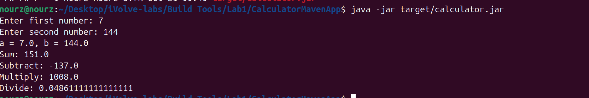
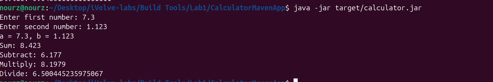

# Lab 1: Building and Packaging a Java Application with Maven

- **Source code:** https://github.com/Ibrahim-Adel15/CalculatorMavenApp.git (cloned into this folder: `CalculatorMavenApp/`)

## Objective

Learn how to use **Apache Maven** to test, build, and package a Java application into an executable JAR file (`target/calculator.jar`), then run and verify it.

## Lab Tasks

1. Install Java and Maven.
2. Clone the source code.
3. Run the unit tests.
4. Build the app (generate artifact in `target/calculator.jar`).
5. Run the app.
6. Verify the app is working.

---

## Step 1: Install Java and Maven

```bash
cd /home/nourz/Desktop/iVolve-labs/Build\ Tools/Lab1
java -version
mvn -version
```



OpenJDK 21.0.12.1 and Apache Maven 3.8.7 are installed on this machine (Maven home `/usr/share/maven`, Java runtime `/usr/lib/jvm/java-21-openjdk-amd64`). The app targets Java 17, and Java 21 runs it without problems.

## Step 2: Clone the Source Code

```bash
git clone https://github.com/Ibrahim-Adel15/CalculatorMavenApp.git
```



I deleted the old copy first so the clone was really fresh: 21 objects, 4.63 KiB received.

Then I looked at what is inside:

```bash
cd CalculatorMavenApp
ls -la
ls -R src
```



`pom.xml` plus `src/` with `main` and `test`. The important parts of the `pom.xml`:

- `<finalName>calculator</finalName>` → the artifact is built as `target/calculator.jar`.
- `maven-surefire-plugin:3.2.5` runs the 5 JUnit tests in the `test` phase.
- `maven-jar-plugin:3.4.1` sets `Main-Class: com.example.calculator.Main` → the jar can be started with `java -jar`.

## Step 3: Run the Unit Tests

```bash
mvn test
```



`Tests run: 5, Failures: 0, Errors: 0, Skipped: 0` and BUILD SUCCESS in 1.837 s (the tests themselves took 0.053 s). The five tests are `testSum`, `testSubtract`, `testMultiply`, `testDivide`, `testDivideByZeroThrowsException`.

## Step 4: Build the App (Generate the Artifact)

```bash
mvn clean package
ls -lh target/calculator.jar
```



My first try failed: right after `mvn test` I ran `java -jar target/calculator.jar` and got `Error: Unable to access jarfile target/calculator.jar` — `mvn test` only compiles and tests, it never reaches the `package` phase where the jar is created.

After `mvn clean package` the tests ran again (0.049 s), `maven-jar-plugin` built the jar, BUILD SUCCESS in 1.974 s, and `ls -lh` shows `target/calculator.jar` at 3.7K.

## Step 5: Run the App

```bash
java -jar target/calculator.jar
```



It asks for two numbers. I entered 7 and 144: Sum 151.0, Subtract -137.0, Multiply 1008.0, Divide 0.04861111111111111.

## Step 6: Verify the App Is Working

```bash
java -jar target/calculator.jar
```



Second run with decimals, 7.3 and 1.123: Sum 8.423, Subtract 6.177, Multiply 8.1979, Divide 6.500445235975067 — all correct, so the app is working.
