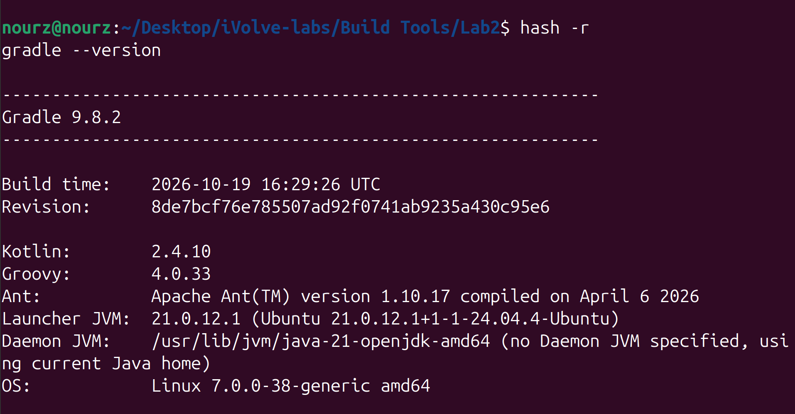
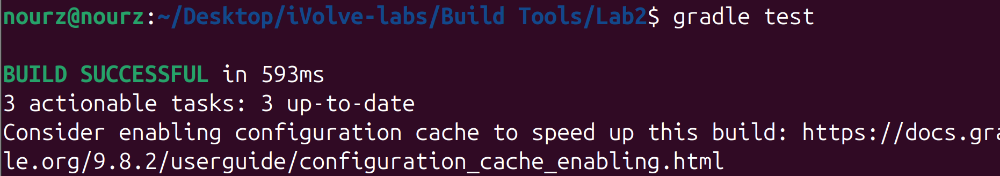
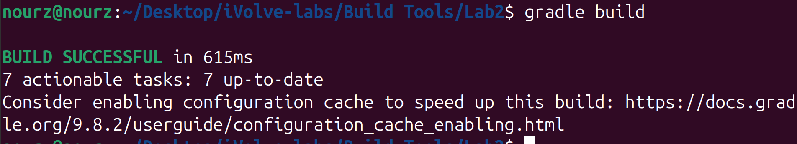
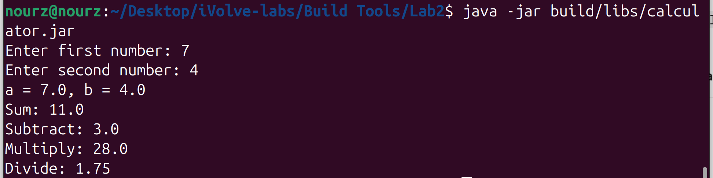

# Lab 2: Building and Packaging a Java Application with Gradle

- **App:** Calculator 


## Objective

Learn how to use **Gradle** to test, build, and package a Java application into an executable JAR file (`build/libs/calculator.jar`), then run and verify it.

## Lab Tasks

1. Install Gradle.
2. Clone the source code.
3. Run the unit tests.
4. Build the app (generate artifact in `build/libs/calculator.jar`).
5. Run the app.
6. Verify the app is working.

---

## ⚠️ Troubleshooting: "Could not find method java()"

If `gradle test` fails with:

```text
* Where:
Build file '.../build.gradle' line: 9
* What went wrong:
A problem occurred evaluating root project 'calculator'.
> Could not find method java() for arguments [...] on root project 'calculator' of type org.gradle.api.Project.
```

**Cause:** I installed **Gradle 4.4.1** (the old version shipped by Ubuntu's `apt`). The `build.gradle` uses modern syntax that old Gradle doesn't understand:

| Syntax in build.gradle | Requires |
|---|---|
| `java { toolchain { ... } }` | Gradle 6.7+ |
| `application { mainClass = ... }` | Gradle 8.0+ |
| `platform('org.junit:junit-bom:...')` | Gradle 5+ |

**Fix:** install a current Gradle (9.8.2 here)

## Step 1: Install Gradle

```bash
gradle --version
```

Verified: **Gradle 9.8.2**, running on OpenJDK 21. (The project targets Java **17** via toolchains; JDK 17 is installed at `/usr/lib/jvm/java-17-openjdk-amd64` and auto-detected by Gradle.)

`hash -r` clears bash's cached command path, and `gradle --version` confirms the new version is active:



## Step 2: Get the Source Code

The app source is included in this folder (`src/`, `build.gradle`, `settings.gradle`). It was originally cloned from:

```bash
git clone https://github.com/Ibrahim-Adel15/CalculatorGradleApp.git
```

Key points from `build.gradle`:
- Plugins: `java`, `application` (`mainClass = com.example.calculator.Main`).
- Java **toolchain** pinned to language version **17**.
- JUnit 5 via `org.junit:junit-bom:5.10.2`, tests run with `useJUnitPlatform()`.
- `jar { archiveBaseName = 'calculator'; archiveVersion = '' }` → artifact is named `calculator.jar`, with `Main-Class` in the manifest.

## Step 3: Run Unit Tests

```bash
gradle test
```

```text
> Task :compileJava
> Task :compileTestJava
> Task :test

BUILD SUCCESSFUL in 18s
```



Test report (`build/test-results/test/TEST-com.example.calculator.CalculatorTest.xml`): **tests="5" failures="0" errors="0"** 

## Step 4: Build the App (Generate the Artifact)

```bash
gradle build
```

```text
BUILD SUCCESSFUL in 615 ms
```



`build` = `check` (which runs the tests) + `jar`. Verify the artifact:

```bash
ls -lh build/libs/
```

```text
-rw-rw-r-- 1 nourz nourz 2.3K Oct 20 20:18 build/libs/calculator.jar
```

Manifest:

```text
Manifest-Version: 1.0
Main-Class: com.example.calculator.Main
```

### Gradle Wrapper

The wrapper (`gradlew`, `gradlew.bat`, `gradle/wrapper/`) was generated with:

```bash
gradle wrapper --gradle-version 9.8.2
```

It lets anyone build the project with the exact same Gradle version without installing anything:

```bash
./gradlew build     # downloads Gradle 9.8.2 on first use
```

## Step 5: Run the App

```bash
java -jar build/libs/calculator.jar
```

## Step 6: Verify the App Is Working

Input `10` and `5`:

```text
Enter first number: Enter second number: a = 10.0, b = 5.0
Sum: 15.0
Subtract: 5.0
Multiply: 50.0
Divide: 2.0
```

Input `3.5` and `2.5`:

```text
a = 3.5, b = 2.5
Sum: 6.0
Subtract: 1.0
Multiply: 8.75
Divide: 1.4
```

Running the packaged jar with inputs `7` and `4`:



```text
Enter first number: 7
Enter second number: 4
a = 7.0, b = 4.0
Sum: 11.0
Subtract: 3.0
Multiply: 28.0
Divide: 1.75
```

All results correct → **app verified working** 

---

## Summary

| Task | Command | Result |
|------|---------|--------|
| Install Gradle | `gradle --version` | Gradle 9.8.2 (replaced apt's 4.4.1) |
| Get source | included in this folder (from CalculatorGradleApp) | |
| Run unit tests | `gradle test` | 5/5 tests passed |
| Build app | `gradle build` | `build/libs/calculator.jar` generated  |
| Run app | `java -jar build/libs/calculator.jar` | Runs |
| Verify app | enter `10` and `5` | Sum 15.0, Sub 5.0, Mul 50.0, Div 2.0 |

## Maven vs Gradle (Lab 1 vs Lab 2)

| | Lab 1 (Maven) | Lab 2 (Gradle) |
|---|---|---|
| Config file | `pom.xml` (XML) | `build.gradle` (Groovy DSL) |
| Run tests | `mvn test` | `gradle test` |
| Package | `mvn clean package` | `gradle build` |
| Artifact path | `target/calculator.jar` | `build/libs/calculator.jar` |
| Language level | `<maven.compiler.target>17` | `java { toolchain { 17 } }` |
