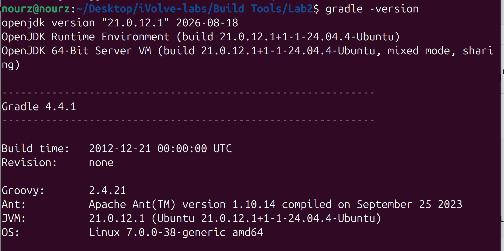
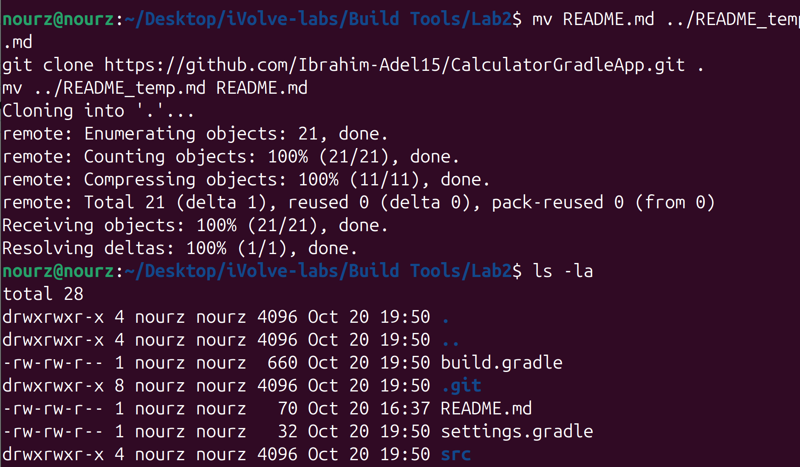
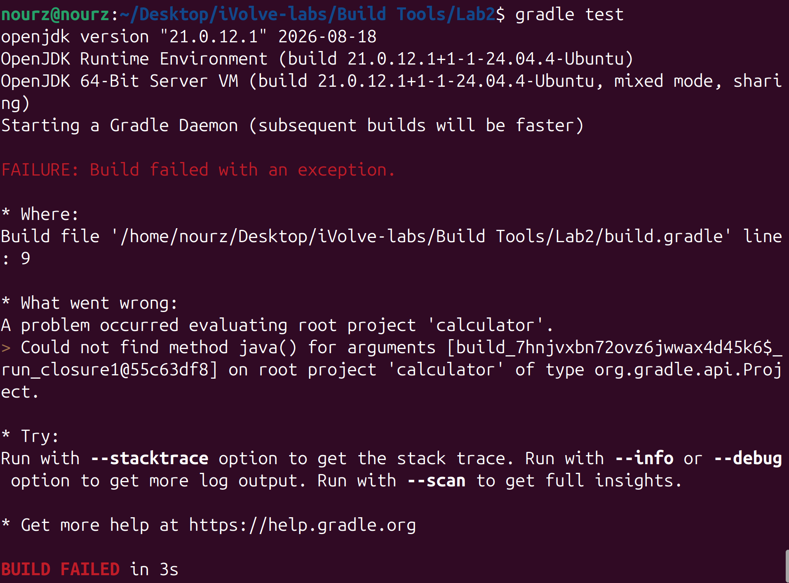

# Lab 2: Building and Packaging a Java Application with Gradle

- **App:** Calculator
- **Source code:** https://github.com/Ibrahim-Adel15/CalculatorGradleApp.git (cloned directly into this folder)

## Objective

Build and package the calculator Java application with Gradle, producing a runnable JAR file at `build/libs/calculator.jar`, then run it and verify it works. The same app was built with Maven in Lab 1.

## Lab Tasks

1. Install Gradle.
2. Clone the source code.
3. Run the unit tests.
4. Build the app (generate artifact in `build/libs/calculator.jar`).
5. Run the app.
6. Verify the app is working.

---

## Step 1: Install Gradle

I checked the installed version first:

```bash
gradle -version
```



I had **Gradle 4.4.1** installed from Ubuntu's apt (build time 2012), which is too old for this project. The `build.gradle` uses:

- `java { toolchain { ... } }` — needs Gradle 6.7 or newer
- `application { mainClass = ... }` — needs Gradle 8.0 or newer
- `platform('org.junit:junit-bom:5.10.2')` — needs Gradle 5 or newer

So I installed the current version, Gradle 9.8.2, in my home directory (no sudo needed):

```bash
curl -sL -o /tmp/gradle.zip https://services.gradle.org/distributions/gradle-9.8.2-bin.zip
unzip -q /tmp/gradle.zip -d ~/.local/share/
ln -sf ~/.local/share/gradle-9.8.2/bin/gradle ~/.local/bin/gradle
```

`~/.local/bin` comes before `/usr/bin` in my PATH, so this shadows the old apt version. My open terminal still ran the old one because bash caches command locations, so I cleared the cache with `hash -r` and checked again:


`gradle --version` now reports Gradle 9.8.2, running on OpenJDK 21. The project itself targets Java 17 through toolchains, and JDK 17 is installed at `/usr/lib/jvm/java-17-openjdk-amd64`, which Gradle finds automatically.

## Step 2: Clone the Source Code

I moved my README out of the folder temporarily, cloned the app directly into Lab2, then moved the README back:

```bash
mv README.md ../README_temp.md
git clone https://github.com/Ibrahim-Adel15/CalculatorGradleApp.git .
mv ../README_temp.md README.md
```



After cloning, the folder contains `build.gradle`, `settings.gradle` and `src/` — the app source lives directly in this Lab2 folder.

## Step 3: Run the Unit Tests

My first attempt used the old Gradle and it failed:



The error points to line 9 of `build.gradle`, the `java { toolchain { ... } }` block — exactly the old-version problem described in Step 1.

After installing Gradle 9.8.2 and running `hash -r`, the tests passed:


```text
> Task :compileJava
> Task :compileTestJava
> Task :test

BUILD SUCCESSFUL in 593 ms
```

The JUnit 5 report at `build/test-results/test/TEST-com.example.calculator.CalculatorTest.xml` shows `tests="5" failures="0" errors="0"`: testSum, testSubtract, testMultiply, testDivide and testDivideByZeroThrowsException all pass.

## Step 4: Build the App (Generate the Artifact)

```bash
gradle build
```


```text
BUILD SUCCESSFUL in 615 ms
```

`build` runs the checks (including the tests) and then packages the jar. The artifact is at `build/libs/calculator.jar`:

```text
-rw-rw-r-- 1 nourz nourz 2.3K build/libs/calculator.jar
```

The jar plugin set the main class in the manifest, so the jar is directly runnable:

```text
Manifest-Version: 1.0
Main-Class: com.example.calculator.Main
```

## Step 5: Run the App

```bash
java -jar build/libs/calculator.jar
```

The app is an interactive CLI that asks for two numbers.

## Step 6: Verify the App Is Working

I entered 7 and 4:


7+4=11, 7-4=3, 7*4=28, 7/4=1.75 — all results are correct, so the packaged app works.

---

## Summary

| Task | Command | Result |
|------|---------|--------|
| Install Gradle | `gradle --version` | Gradle 9.8.2 (replaced apt's 4.4.1) |
| Clone source | `git clone ...CalculatorGradleApp.git .` | Cloned into this folder |
| Run unit tests | `gradle test` | 5/5 tests passed |
| Build app | `gradle build` | `build/libs/calculator.jar` generated |
| Run app | `java -jar build/libs/calculator.jar` | Runs |
| Verify app | enter `7` and `4` | Sum 11.0, Sub 3.0, Mul 28.0, Div 1.75 |

## Extra Notes

- Gradle Wrapper: `gradle wrapper --gradle-version 9.8.2` created `gradlew` and `gradle/wrapper/` in this folder. With `./gradlew build`, anyone can build the project with the same Gradle version without installing anything.
- `build/` and `.gradle/` are ignored by the local `.gitignore` so build output does not get committed.
- Lab 1 vs Lab 2: Maven puts the artifact in `target/calculator.jar` (`mvn clean package`), Gradle puts it in `build/libs/calculator.jar` (`gradle build`).
