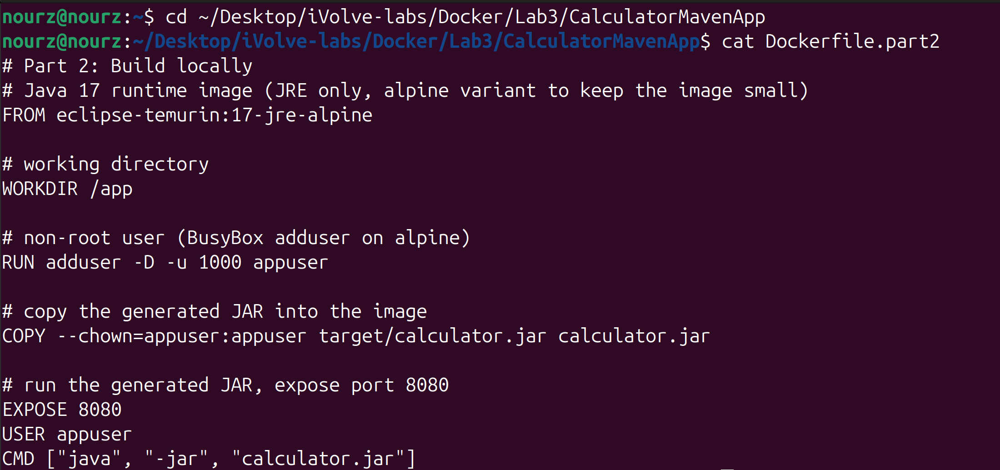
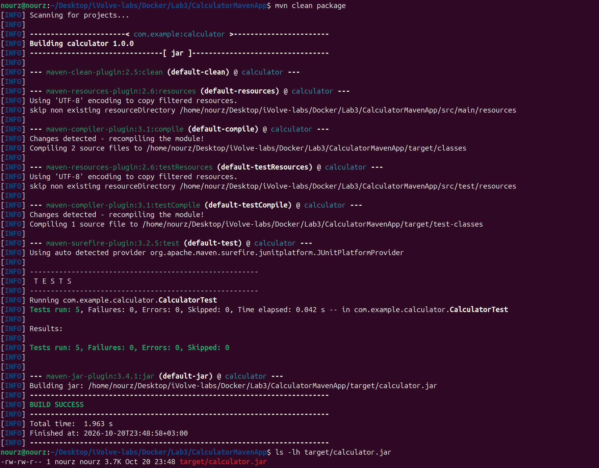
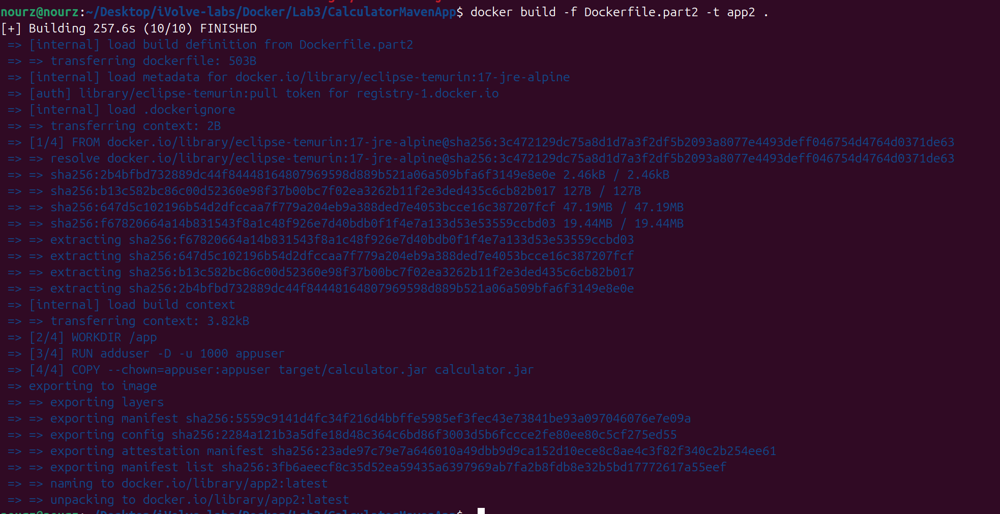
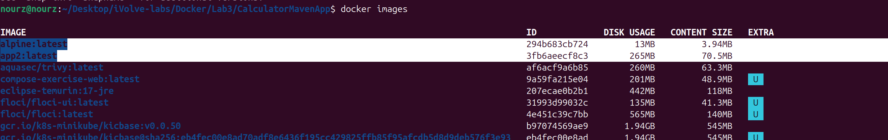
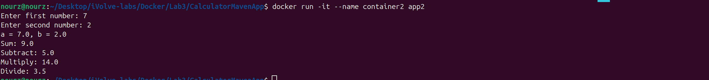
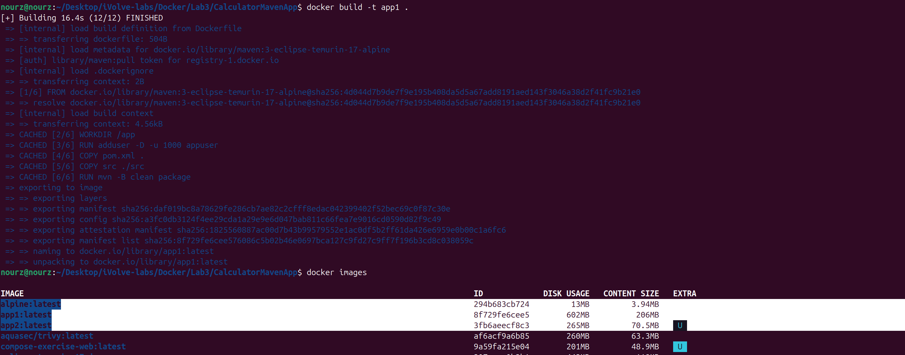
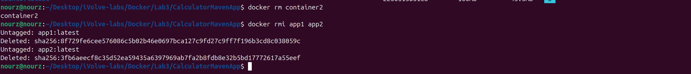

# Lab 3: Creating a Docker Image for a Java Application

- **App:** Calculator
- **Source code:** https://github.com/Ibrahim-Adel15/CalculatorMavenApp.git (cloned into this folder: `CalculatorMavenApp/`)

## Objective

Containerize the calculator Java application with Docker in two different ways (build inside Docker vs. build locally), then compare the resulting image sizes.

## Lab Tasks

### Part 1: Build Inside Docker

- [x] Write a Dockerfile using a Maven image with Java 17.
- [x] Create a working directory and a non-root user.
- [x] Copy the source code and build the application using `mvn package`.
- [x] Run the generated JAR file and expose port 8080.
- [x] Build an image named `app1` and note its size.
- [x] Run `container1`, verify the application, then delete the container and image.

### Part 2: Build Locally

- [x] Build the application locally using Maven.
- [x] Write a Dockerfile using a Java 17 runtime image.
- [x] Create a working directory and a non-root user.
- [x] Copy the generated JAR file into the image and expose port 8080.
- [x] Build an image named `app2` and note its size.
- [x] Run `container2`, verify the application, then delete the container and image.

### Bonus

- [x] Compare the image sizes and explain the differences between the two approaches.

---

## Part 1: Build Inside Docker

### Step 1: Project Folder and Dockerfile

I cloned the app into `Docker/Lab3/CalculatorMavenApp` and wrote the Dockerfile at the project root, so the build context holds `pom.xml`, `src/` and the Dockerfile together:


The Dockerfile — Maven image with Java 17, alpine variant to keep the base small:


```dockerfile
# Part 1: Build inside Docker
# Maven image with Java 17, alpine variant to keep the image small
FROM maven:3-eclipse-temurin-17-alpine

# working directory
WORKDIR /app

# non-root user (BusyBox adduser on alpine)
RUN adduser -D -u 1000 appuser

# copy the source code and build the application
COPY pom.xml .
COPY src ./src
RUN mvn -B clean package

# run the generated JAR, expose port 8080
EXPOSE 8080
USER appuser
CMD ["java", "-jar", "target/calculator.jar"]
```

### Step 2: Build the Image as app1

```bash
docker build -t app1 .
```


The first build took 94.7s in total: pulling the `maven:3-eclipse-temurin-17-alpine` base image was 68.1s of it, and the `mvn -B clean package` layer took 23.3s. The output shows all six steps in order: `WORKDIR /app`, `RUN adduser`, both `COPY` steps, the Maven build, then exporting to the image.

### Step 3: Note the Size

```bash
docker images
```


`app1` was created with **DISK USAGE 602 MB / CONTENT SIZE 206 MB** (Docker 29 shows both columns). I noted these numbers for the bonus comparison against `app2`.

### Step 4: Run container1 and Verify the Application

```bash
docker run -it --name container1 app1
```


At startup the Maven image entrypoint prints two warnings — it runs as the non-root `appuser` and cannot write `/root/.m2/copy_reference_file.log` ("Permission denied ... Carrying on ..."). It does not affect the application; it is the base image's setup script continuing past an unwritable directory.

I entered 7 and 6 and all results are correct: Sum 13.0, Subtract 1.0, Multiply 42.0, Divide 1.1666666666666667. The container stopped when the application finished.

### Step 5: Delete the Container and the Image

```bash
docker rm container1
docker rmi app1
```


`container1` was removed, then `app1:latest` was untagged and its layers deleted (the deleted layer ID `27bc5269dd34...` matches the image ID from Step 3).

---

## Part 2: Build Locally

### Step 1: The Part 2 Dockerfile

```bash
cd ~/Desktop/iVolve-labs/Docker/Lab3/CalculatorMavenApp
cat Dockerfile.part2
```



```dockerfile
# Part 2: Build locally
# Java 17 runtime image (JRE only, alpine variant to keep the image small)
FROM eclipse-temurin:17-jre-alpine

# working directory
WORKDIR /app

# non-root user (BusyBox adduser on alpine)
RUN adduser -D -u 1000 appuser

# copy the generated JAR into the image
COPY --chown=appuser:appuser target/calculator.jar calculator.jar

# run the generated JAR, expose port 8080
EXPOSE 8080
USER appuser
CMD ["java", "-jar", "calculator.jar"]
```

Only a JRE this time — no Maven, no compiler. Same working directory, same non-root user, and only the jar gets copied in.

### Step 2: Build the Application on My Machine First

```bash
mvn clean package
ls -lh target/calculator.jar
```



5 tests passed, no failures, BUILD SUCCESS in 1.963 s. The dependencies were already in `~/.m2` from Lab 1, so it was fast. The jar is 3.7K.

### Step 3: Build the Image as app2

```bash
docker build -f Dockerfile.part2 -t app2 .
```



Only 4 build steps this time, because the Maven build is not inside the image anymore. It still took 257.6s — the base image had to be downloaded first, and that took most of the time. Longer than part 1 (94.7s), which surprised me.

### Step 4: Note the Size

```bash
docker images
```



`app2`: **DISK USAGE 265 MB / CONTENT SIZE 70.5 MB**. Much smaller than `app1` (602 MB / 206 MB). Noted for the bonus.

### Step 5: Run container2 and Verify the Application

```bash
docker run -it --name container2 app2
```



I entered 7 and 2: Sum 9.0, Subtract 5.0, Multiply 14.0, Divide 3.5 — all correct. No warnings at the start this time, because the runtime image has no Maven entrypoint like in part 1.

### Step 6: Rebuild app1 to See Both Sizes Together

```bash
docker build -t app1 .
docker images
```



The rebuild took only 16.4s because every build layer shows CACHED. The image ID is different from part 1, because Docker exported it again, but nothing was rebuilt. Now both rows are in one screenshot: `app1` 602 MB / 206 MB, `app2` 265 MB / 70.5 MB.

### Step 7: Delete the Container and Both Images

```bash
docker rm container2
docker rmi app1 app2
```



`container2` removed, then both images untagged and deleted.

---

## Bonus: Why app1 is Bigger Than app2

|  | app1 (part 1) | app2 (part 2) |
|---|---|---|
| Base image | `maven:3-eclipse-temurin-17-alpine` | `eclipse-temurin:17-jre-alpine` |
| Inside the image | Maven + full JDK + source + downloaded dependencies + jar | only the JRE + the jar |
| Where the build happens | inside the image (`mvn package` in the Dockerfile) | on my machine, only the jar is copied |
| DISK USAGE | 602 MB | 265 MB |
| CONTENT SIZE | 206 MB | 70.5 MB |

The jar itself is the same in both images. The difference is everything else around it:

- `app1` must be able to build the app, so its base image carries Maven and the whole JDK, and the `mvn package` step downloads all the dependencies inside the image. All of that is saved in the layers.
- `app2` only has to run the jar, so its base image is just a JRE (no Maven, no javac) and the only thing added is the 3.7K jar. The build and the dependencies stayed on my machine.

So `app2` ends up 337 MB smaller on disk (135.5 MB less content). To run the app that is enough. `app1` is like having the whole build machine inside the image.
