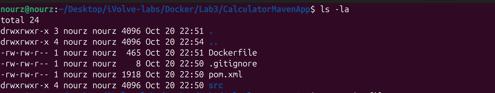
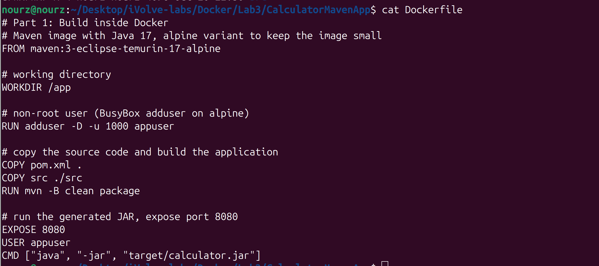
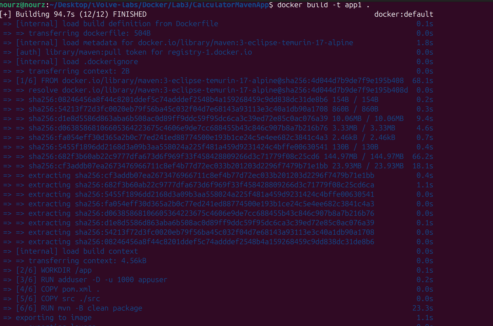
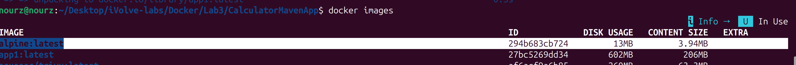
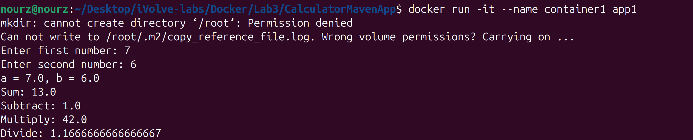
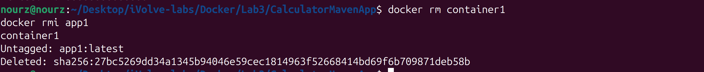

# Lab 3: Creating a Docker Image for a Java Application

- **App:** Calculator
- **Source code:** https://github.com/Ibrahim-Adel15/CalculatorMavenApp.git (cloned into this folder: `CalculatorMavenApp/`)

## Objective

Containerize the calculator Java application with Docker in two different ways (build inside Docker vs. build locally), then compare the resulting image sizes.

## Lab Tasks

### Part 1: Build Inside Docker

- [x] Write a Dockerfile using a Maven image with Java 17.
- [x] Create a working directory and a non-root user.
- [x] Copy the source code and build the application using `mvn package`.
- [x] Run the generated JAR file and expose port 8080.
- [x] Build an image named `app1` and note its size.
- [x] Run `container1`, verify the application, then delete the container and image.

### Part 2: Build Locally

- [ ] Build the application locally using Maven.
- [ ] Write a Dockerfile using a Java 17 runtime image.
- [ ] Create a working directory and a non-root user.
- [ ] Copy the generated JAR file into the image and expose port 8080.
- [ ] Build an image named `app2` and note its size.
- [ ] Run `container2`, verify the application, then delete the container and image.

### Bonus

- [ ] Compare the image sizes and explain the differences between the two approaches.

---

## Part 1: Build Inside Docker

### Step 1: Project Folder and Dockerfile

I cloned the app into `Docker/Lab3/CalculatorMavenApp` and wrote the Dockerfile at the project root, so the build context holds `pom.xml`, `src/` and the Dockerfile together:



The Dockerfile — Maven image with Java 17, alpine variant to keep the base small:



```dockerfile
# Part 1: Build inside Docker
# Maven image with Java 17, alpine variant to keep the image small
FROM maven:3-eclipse-temurin-17-alpine

# working directory
WORKDIR /app

# non-root user (BusyBox adduser on alpine)
RUN adduser -D -u 1000 appuser

# copy the source code and build the application
COPY pom.xml .
COPY src ./src
RUN mvn -B clean package

# run the generated JAR, expose port 8080
EXPOSE 8080
USER appuser
CMD ["java", "-jar", "target/calculator.jar"]
```

### Step 2: Build the Image as app1

```bash
docker build -t app1 .
```



The first build took 94.7s in total: pulling the `maven:3-eclipse-temurin-17-alpine` base image was 68.1s of it, and the `mvn -B clean package` layer took 23.3s. The output shows all six steps in order: `WORKDIR /app`, `RUN adduser`, both `COPY` steps, the Maven build, then exporting to the image.

### Step 3: Note the Size

```bash
docker images
```



`app1` was created with **DISK USAGE 602 MB / CONTENT SIZE 206 MB** (Docker 29 shows both columns). I noted these numbers for the bonus comparison against `app2`.

### Step 4: Run container1 and Verify the Application

```bash
docker run -it --name container1 app1
```



At startup the Maven image entrypoint prints two warnings — it runs as the non-root `appuser` and cannot write `/root/.m2/copy_reference_file.log` ("Permission denied ... Carrying on ..."). It does not affect the application; it is the base image's setup script continuing past an unwritable directory.

I entered 7 and 6 and all results are correct: Sum 13.0, Subtract 1.0, Multiply 42.0, Divide 1.1666666666666667. The container stopped when the application finished.

### Step 5: Delete the Container and the Image

```bash
docker rm container1
docker rmi app1
```



`container1` was removed, then `app1:latest` was untagged and its layers deleted (the deleted layer ID `27bc5269dd34...` matches the image ID from Step 3).

---

## Part 2: Build Locally

Tasks above are next: build the jar on the host with Maven, then package it into a Java 17 runtime-only image (`Dockerfile.part2`, already in `CalculatorMavenApp/`). Steps and screenshots to be added after the run.

## Bonus

Pending both recorded sizes — the comparison of `app1` (build tools inside the image) against `app2` (runtime only) goes here.
