# Lab 4: Docker Image Optimization and Export/Load

- **Source code:** https://github.com/Ibrahim-Adel15/ImageOptimization-.git (cloned into this folder: `ImageOptimization-/`)
- **App:** Spring Boot (Java 17), one HTTP endpoint on port 8080.

## Objective

Take a Docker image that carries its whole build environment, cut it down with a multi-stage build that runs as a non-root user, compare the sizes, then move the image out of Docker and back in with `docker save` / `docker load`.

## Lab Tasks

- [x] Clone the application code from https://github.com/Ibrahim-Adel15/ImageOptimization-.git. Build an image from the existing Dockerfile with name `image1`.
- [x] Note the image size and run a container named `container1` from `image1`.
- [x] Verify that the application is working, then stop and delete the container.
- [x] Write a multi-stage Dockerfile and configure the application to run as a non-root user.
- [x] Build the optimized image as `image2` and compare its size with `image1`.
- [x] Run a container named `container2` from `image2` and verify that the application is working and running as a non-root user.
- [x] Stop and delete `container2`.
- [x] Save `image2` as a TAR file named `lab-image.tar`.
- [x] Delete `image2` from the local Docker host.
- [x] Load the image from `image2.tar` and verify that it has been restored.
- [x] Verify the loaded image exists in the local Docker host.

Note: the slide says `lab-image.tar` when saving and `image2.tar` when loading — it is one file, so it is `lab-image.tar` everywhere below.

---

## Build image1 From the Existing Dockerfile

```bash
cd ~/Desktop/iVolve-labs/Docker/Lab4/ImageOptimization-
ls -la
cat Dockerfile
```

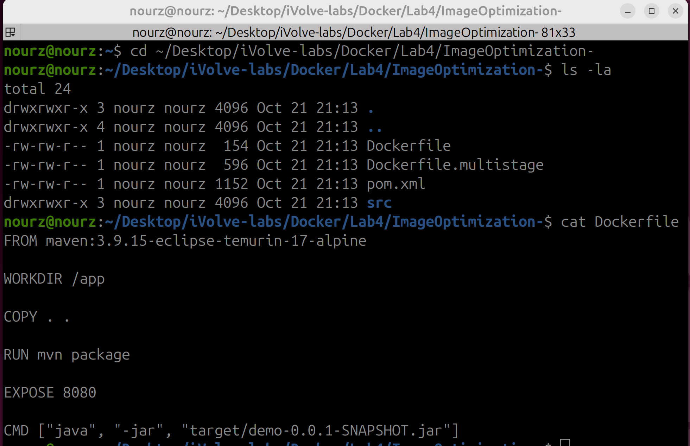

The provided Dockerfile does everything inside the image: Maven base, `COPY . .`, `RUN mvn package`, and there is no `USER` line — so whatever runs from it runs as root.

```bash
docker build -t image1 .
```

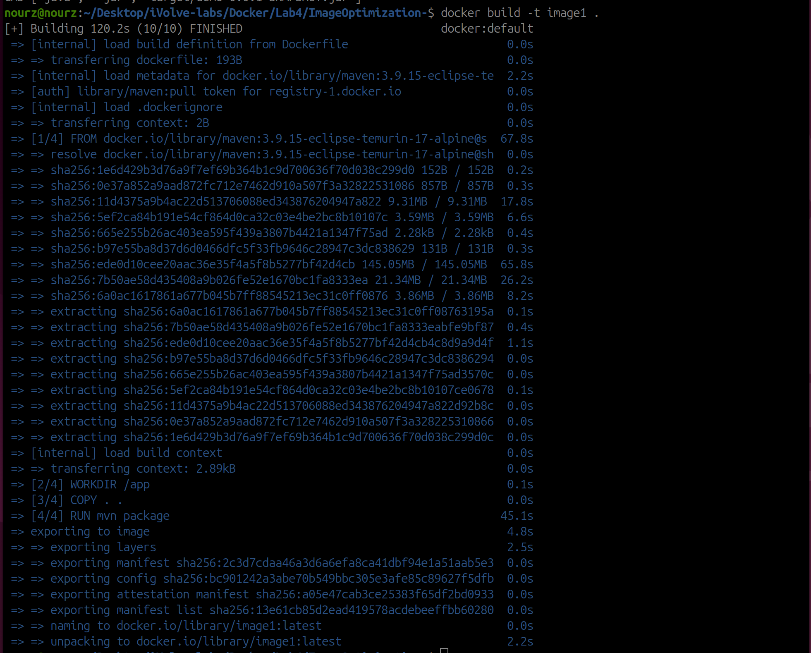

120.2s in total: pulling the Maven base took 67.8s (the 145 MB layer alone was 65.8s) and `RUN mvn package` took 45.1s.

## Note the Size and Run container1

```bash
docker images image1
```

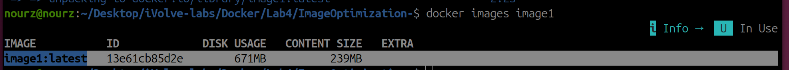

`image1:latest`, ID `13e61cb85d2e`: **671 MB disk usage / 239 MB content size**. Noted for the comparison later.

```bash
docker run -d --name container1 -p 8080:8080 image1
docker start container1
docker exec container1 id
```

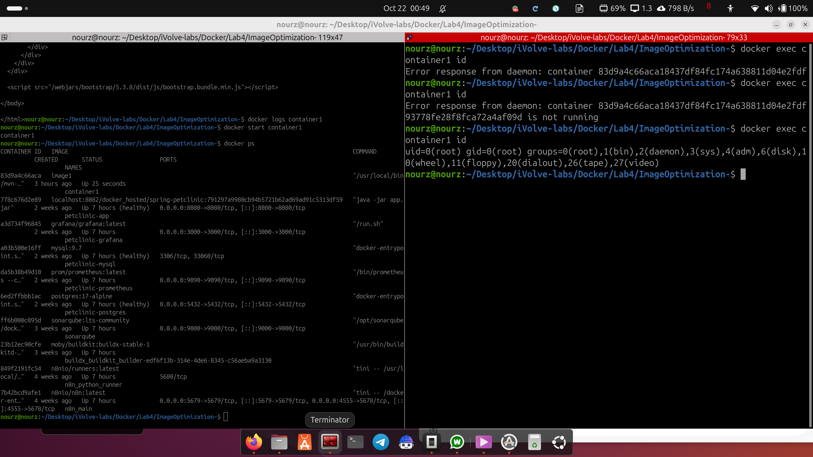

First tries went wrong: `docker exec container1 id` answered `container ... is not running`, and my `curl localhost:8080` came back as an HTML page from a different app — port 8080 was already taken on my machine (the next section). After `docker start container1` the exec worked and `id` answered:

`uid=0(root) gid=0(root)`

That is the point of this task: `image1` runs as root.

## Stop and Delete container1

```bash
docker stop container1
docker rm container1
```

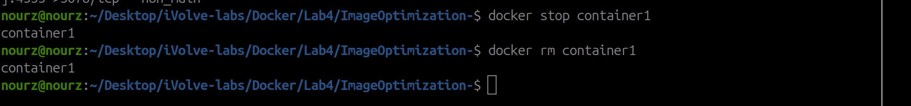

Both commands answered `container1`.

## Write the Multi-Stage Dockerfile

```bash
cat Dockerfile.multistage
```

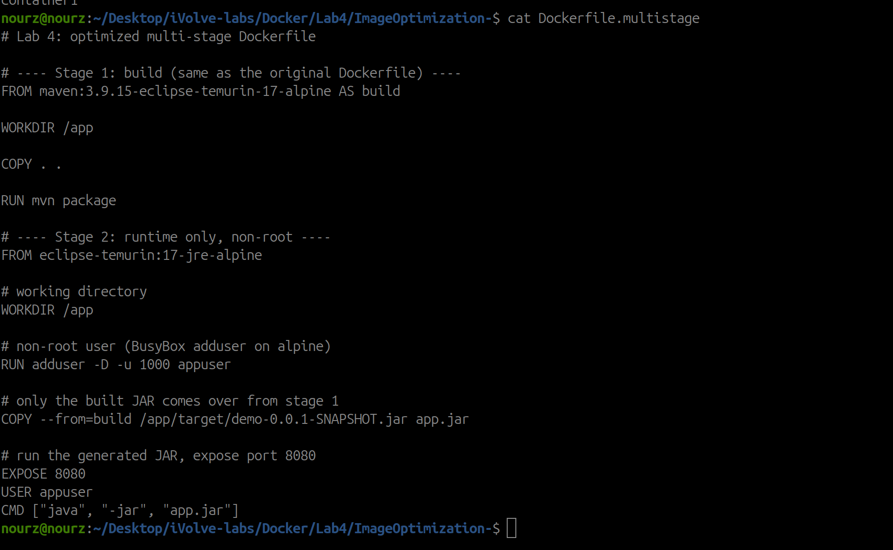

Two stages: stage 1 is the original build on `maven:3.9.15-eclipse-temurin-17-alpine` (named `AS build`), stage 2 starts fresh from `eclipse-temurin:17-jre-alpine`, creates `appuser`, takes only the jar with `COPY --from=build`, then switches `USER appuser`. The build tools never reach stage 2.

## Build image2 and Compare

```bash
docker build -f Dockerfile.multistage -t image2 .
```

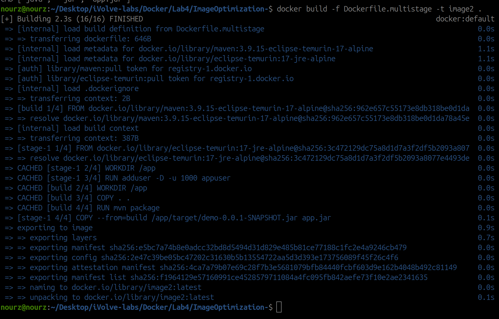

**2.3s (16/16)** — every stage-1 line shows `CACHED` because they are the same instructions as the image1 build; only the new stage-2 lines actually ran. The image1 build took 120.2s.

```bash
docker images
```

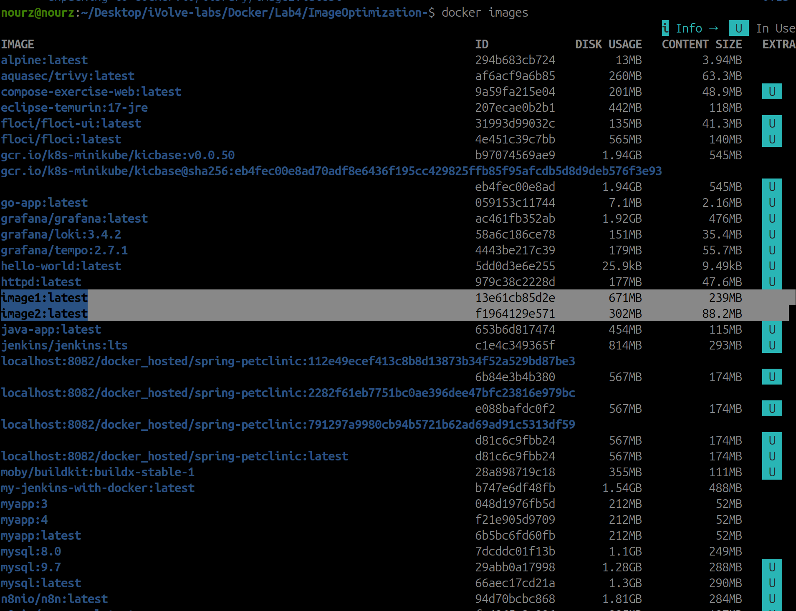

| | image1 | image2 |
|---|---|---|
| DISK USAGE | 671 MB | 302 MB |
| CONTENT SIZE | 239 MB | 88.2 MB |
| ID | 13e61cb85d2e | f1964129e571 |

369 MB less on disk, and the content size dropped to 88.2 MB — about a third of image1. What disappeared is the Maven + JDK build environment that image1 kept in its layers; image2 only has the JRE and the jar.

## Troubleshooting: Port 8080 Was Already Taken

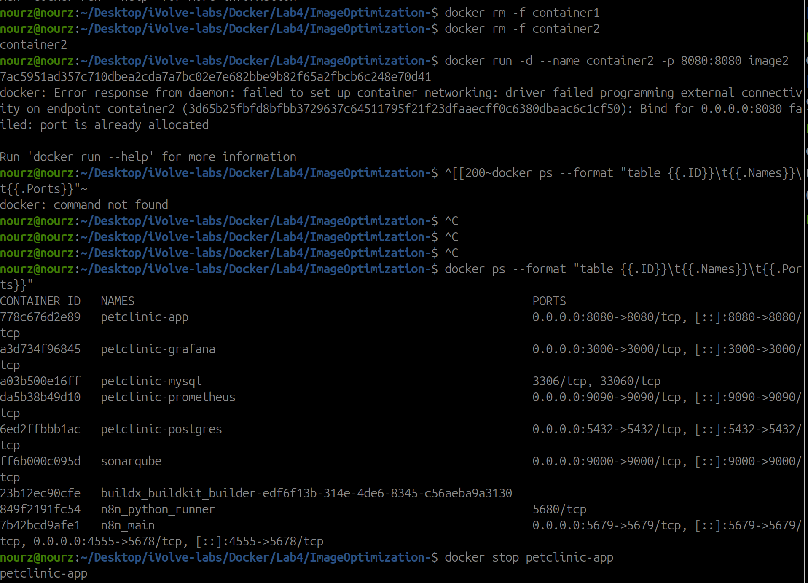

Running container2 with `-p 8080:8080` failed with `Bind for 0.0.0.0:8080 failed: port is already allocated`. I listed the containers with `docker ps --format ...` and found `petclinic-app`, another container of mine that had been sitting on 0.0.0.0:8080 for 7 hours. I ran `docker stop petclinic-app` and the port was free. That also explains the wrong HTML page in the container1 screenshot — the curl was answering from that other app.

## Run container2: Working and Non-Root

```bash
docker run -d --name container2 -p 8080:8080 image2
docker exec container2 id
curl http://localhost:8080
```

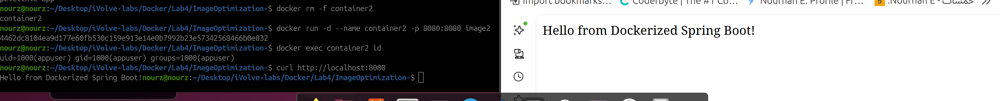

With the port free it worked directly: `id` answered **`uid=1000(appuser) gid=1000(appuser) groups=1000(appuser)`** — running as a non-root user as required — and `curl` returned **`Hello from Dockerized Spring Boot!`**. I opened the same URL in the browser too, and the page answered with the same line.

## Stop and Delete container2

```bash
docker stop container2
docker rm container2
```

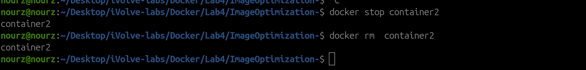

`container2` stopped, then removed.

## Save image2 as a TAR

```bash
docker save -o lab-image.tar image2
ls -lh lab-image.tar
```

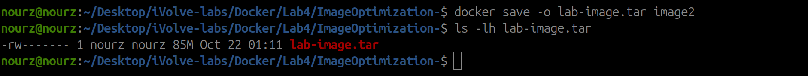

The file is **85M** — this is why it is in `.gitignore`, it must not end up in the repository.

## Delete image2 From the Docker Host

```bash
docker rmi image2
```

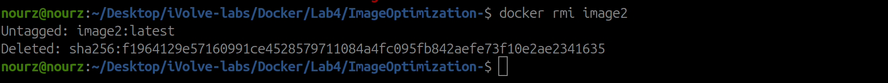

`Untagged: image2:latest`, then `Deleted: sha256:f1964129e571...2341635` — the same ID that was in the comparison table.

## Load the Image Back and Verify It

```bash
docker load -i lab-image.tar
```

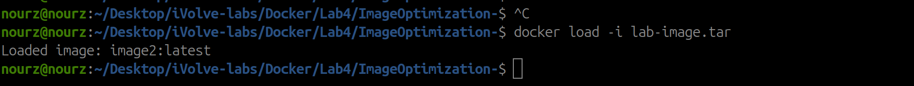

`Loaded image: image2:latest`.

```bash
docker images
```

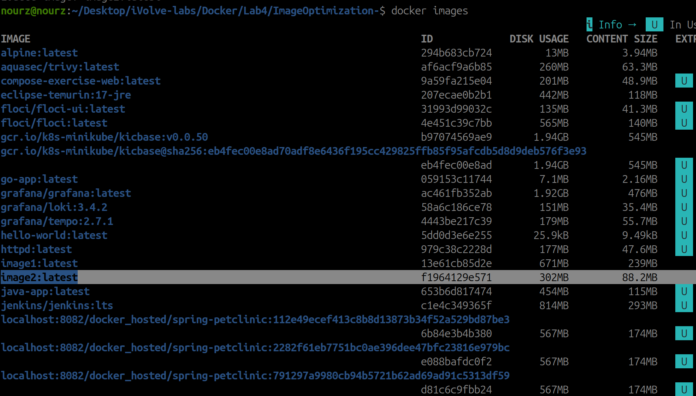

`image2:latest` is back with ID **`f1964129e571`** — the same ID as before the delete, same 302 MB / 88.2 MB. The image went out to the TAR and came back unchanged.
