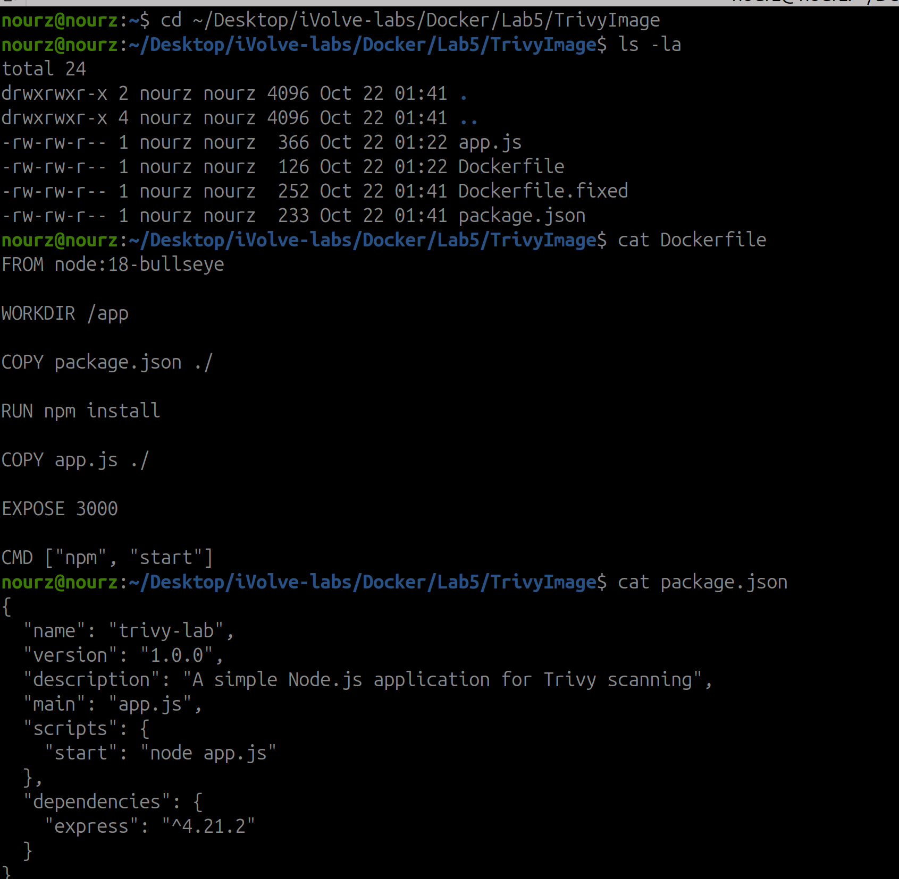
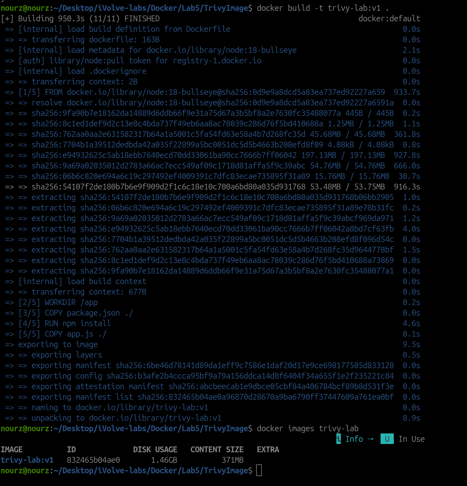
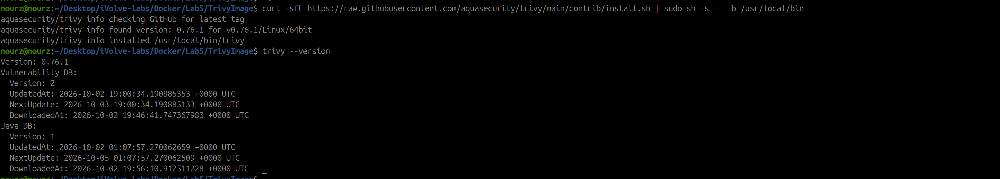
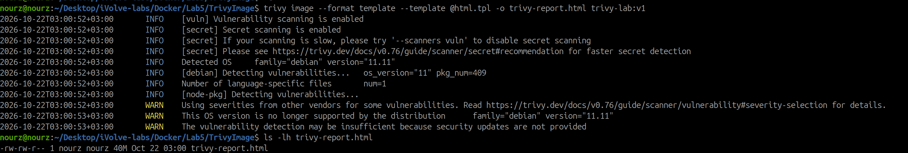
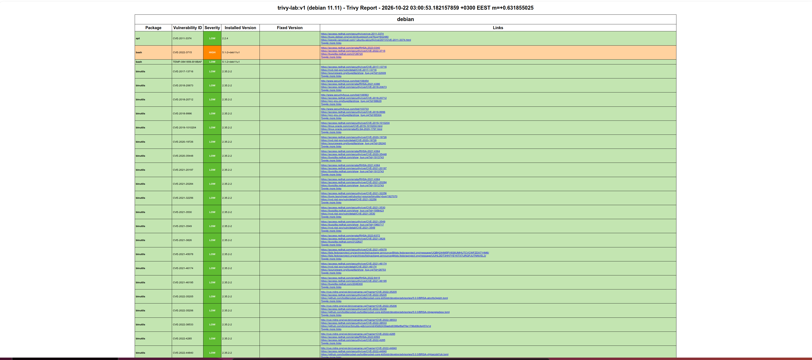
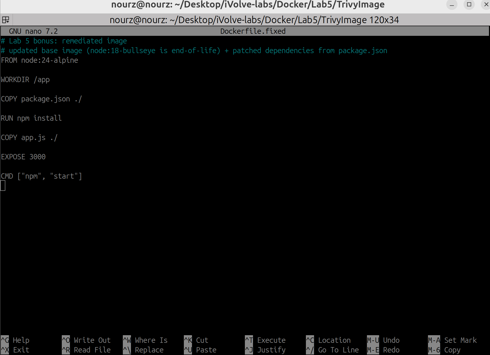
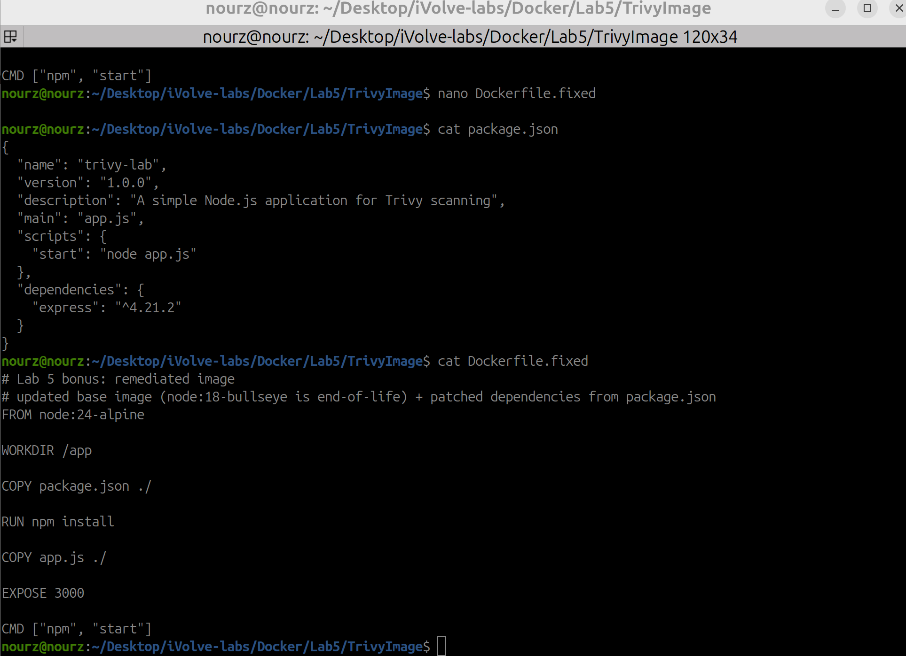
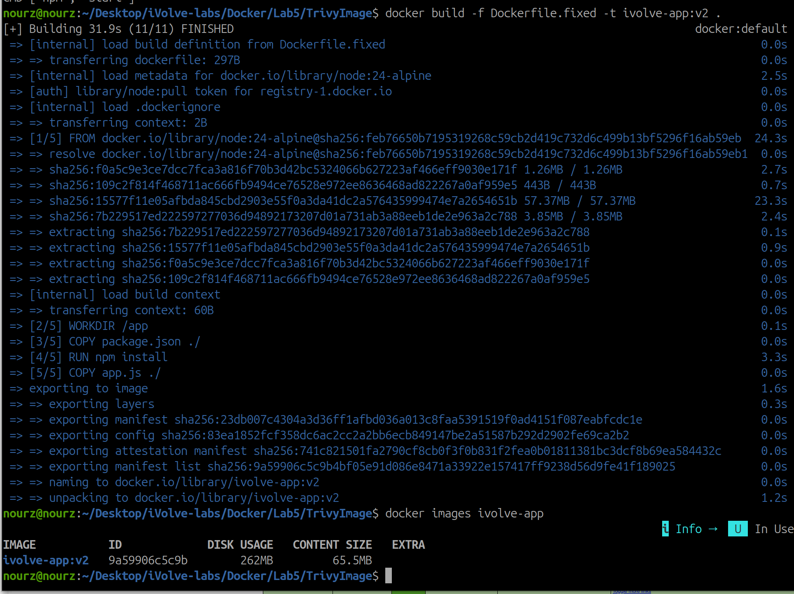
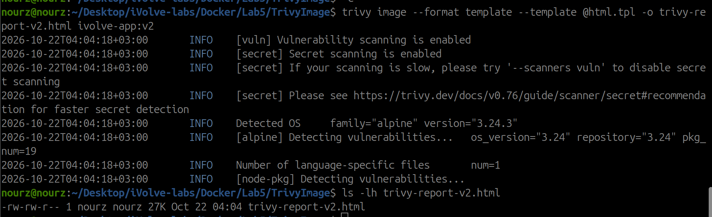
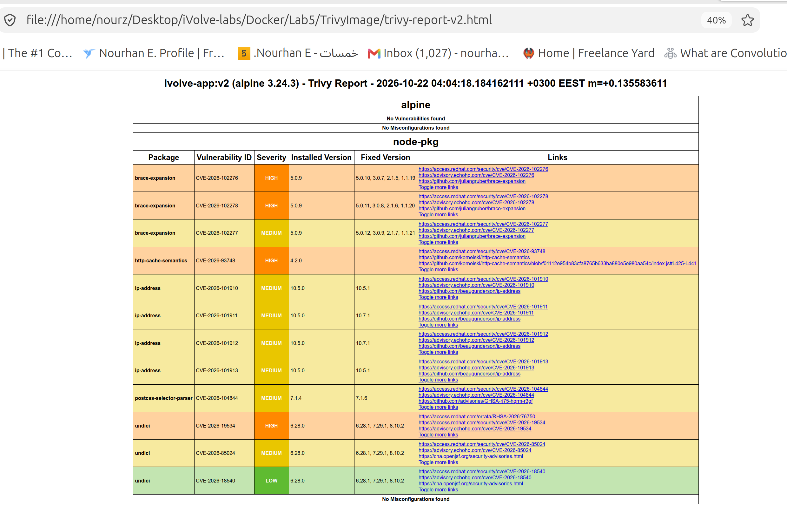

# Lab 5: Docker Image Vulnerability Scanning with Trivy

- **Source code:** https://github.com/Ibrahim-Adel15/TrivyImage.git (cloned into this folder: `TrivyImage/`)
- **App:** Node.js (Express) on port 3000.

## Objective

Scan the image the lab gives me with Trivy (full scan, HIGH/CRITICAL only, HTML report), then fix what it finds and rescan to prove the image is clean where fixes exist.

## Lab Tasks

- [x] Clone the application and Dockerfile from https://github.com/Ibrahim-Adel15/TrivyImage.git.
- [x] Build a Docker image from the provided Dockerfile and tag it `trivy-lab:v1`.
- [x] Install Trivy and verify the installation.
- [x] Scan the Docker image for vulnerabilities and review the scan results.
- [x] Scan the image to identify only HIGH and CRITICAL vulnerabilities.
- [x] Generate an HTML vulnerability report and review the identified security issues.

### Bonus: Vulnerability Remediation

- [x] Investigate the detected HIGH and CRITICAL vulnerabilities.
- [x] Fix the identified issues by updating the vulnerable base image and application dependencies, where applicable.
- [x] Rebuild the Docker image and tag it as `ivolve-app:v2`.
- [x] Rescan the updated image and generate a new HTML report to verify the remediation.
- [x] Ensure that no HIGH or CRITICAL vulnerabilities remain, where fixes are available.

---

## The Provided Files

```bash
cd ~/Desktop/iVolve-labs/Docker/Lab5/TrivyImage
ls -la
cat Dockerfile
cat package.json
```



The provided Dockerfile builds from `node:18-bullseye` — old Debian 11 with an end-of-life Node 18 on top. That base is where most of the findings come from later.

## Build trivy-lab:v1

```bash
docker build -t trivy-lab:v1 .
docker images trivy-lab
```



950.3s, almost all of it pulling the `node:18-bullseye` layers. The result: `trivy-lab:v1`, **1.46GB disk usage / 371MB content size**.

## Install Trivy and Verify

```bash
curl -sfL https://raw.githubusercontent.com/aquasecurity/trivy/main/contrib/install.sh | sudo sh -s -- -b /usr/local/bin
trivy --version
```



The script found **0.76.1** and installed it to `/usr/local/bin/trivy`. `trivy --version` confirms the version and shows the vulnerability database it is using.

## The HTML Report: my first try failed, and I fixed it

I ran the report step with `trivy image --format html -o trivy-report.html trivy-lab:v1` and Trivy killed it with:

`FATAL ... invalid argument "html" for "--format" flag: must be one of ["table" "json" "template" ...]`

So 0.76.1 simply does not ship an `html` flag. I went to Trivy's own contrib templates, took `html.tpl` (it sits in this folder now, next to the Dockerfiles), and ran the scan as a template instead — the `@` in `@html.tpl` is how you tell Trivy "this is a file path". Reinstalling did nothing, this is what actually worked:

```bash
trivy image --format template --template @html.tpl -o trivy-report.html trivy-lab:v1
ls -lh trivy-report.html
```



A **40MB** report for v1 — Trivy scanned 409 Debian packages plus the node dependencies. Every HTML report in this lab was generated with this exact command pattern: `--format template --template @html.tpl`.

Before the report I had already run the plain scans: `trivy image trivy-lab:v1` for everything, and `trivy image --severity HIGH,CRITICAL trivy-lab:v1` for just the serious rows — the report below is where I reviewed them.

## Review the v1 Report

```bash
firefox --new-tab "file:///home/nourz/Desktop/iVolve-labs/Docker/Lab5/TrivyImage/trivy-report.html"
```



The page title says `trivy-lab:v1 (debian 11.11) - Trivy Report`. The debian table is a wall of rows: `bash CVE-2022-3715` in HIGH, then page after page of binutils/glibc entries, and further down the npm toolchain findings (`tar`, `pacote`, `sigstore`...). This is the image with everything the lab wants fixed.

## Bonus: The Fix, How I Made It

I went through the HIGH/CRITICAL rows above and made two changes. The base image change I did in `Dockerfile.fixed`, right there in nano:



```bash
cat package.json
cat Dockerfile.fixed
```



- **Base image:** `FROM node:18-bullseye` became `FROM node:24-alpine` — a supported Node on a current Alpine instead of EOL Debian 11. This single line is what removes the whole debian table.
- **Application dependency:** express, the app's only dependency, moved from `4.18.2` to the patched `^4.21.2` in `package.json`.

## Rebuild as ivolve-app:v2

```bash
docker build -f Dockerfile.fixed -t ivolve-app:v2 .
docker images ivolve-app
```



31.9s, and `ivolve-app:v2` came out at **262MB disk usage / 65.5MB content size** against v1's 1.46GB / 371MB. Nice side effect, but the scan is what matters:

## Rescan v2 and Generate the New Report

```bash
trivy image --format template --template @html.tpl -o trivy-report-v2.html ivolve-app:v2
ls -lh trivy-report-v2.html
```



Trivy now reports `family="alpine" version="3.24.3"` with `pkg_num=19`, and the report file is **27K** where v1's was 40M.

## Review v2: What Remains and Why It Is Allowed to Remain

```bash
firefox --new-tab "file:///home/nourz/Desktop/iVolve-labs/Docker/Lab5/TrivyImage/trivy-report-v2.html"
```



The page says it plainly:

- **alpine: No Vulnerabilities found** (and no misconfigurations) — the operating system layer is clean.
- **node-pkg:** a short table is left — `brace-expansion` (HIGH x2), `undici` (HIGH), `http-cache-semantics` (HIGH). These are not my app's packages, they are the npm that ships inside the base image itself. `http-cache-semantics` has **no fixed version at all** (empty Fixed Version cell), and the fixes for the others (5.0.10, 6.28.1) are not in the npm bundled with `node:24-alpine` yet. That is exactly the task's "where fixes are available" — the express tree the app actually uses comes back clean.

So the before/after is: v1 = 40MB of findings on an end-of-life Debian, v2 = 27K with a clean OS layer and only base-image tooling rows left for which no in-image fix exists yet.
