# Lab 6: Docker Environment Variables and Resource Management

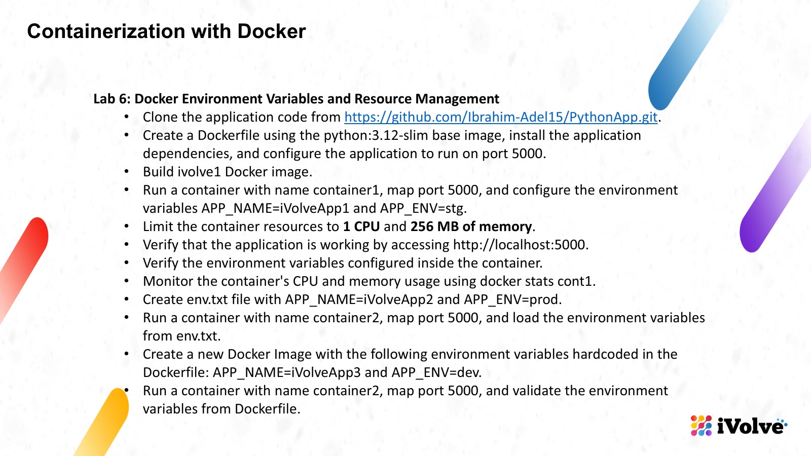

- **Source code:** https://github.com/Ibrahim-Adel15/PythonApp.git (cloned into this folder: `PythonApp/`)
- **App:** Flask, port 5000. It refuses to start without `APP_NAME` and `APP_ENV`, and prints both back as JSON on `/`.

## Objective

Run the same Python app three ways
- environment variables passed on the run command
- an env file
- variables baked into the image
while capping the container at 1 CPU and 256 MB, and verify each variation.

---

## The Application

```bash
cd ~/Desktop/iVolve-labs/Docker/Lab6/PythonApp
ls -la
cat app.py
cat requirements.txt
```

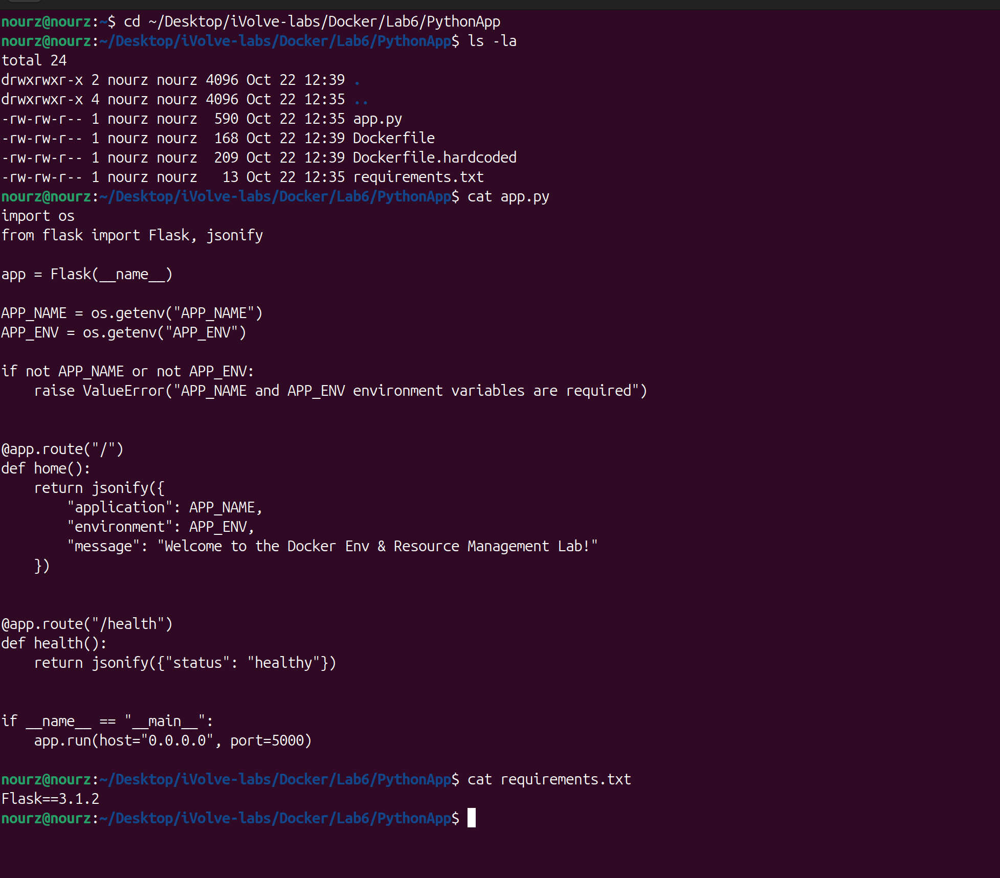

The app reads `APP_NAME` and `APP_ENV` on startup and raises `ValueError` if either is missing — that is what makes this lab's three injection methods easy to tell apart, because the answer always comes back in the response. Dependencies are just `Flask==3.1.2`.

## The Dockerfile

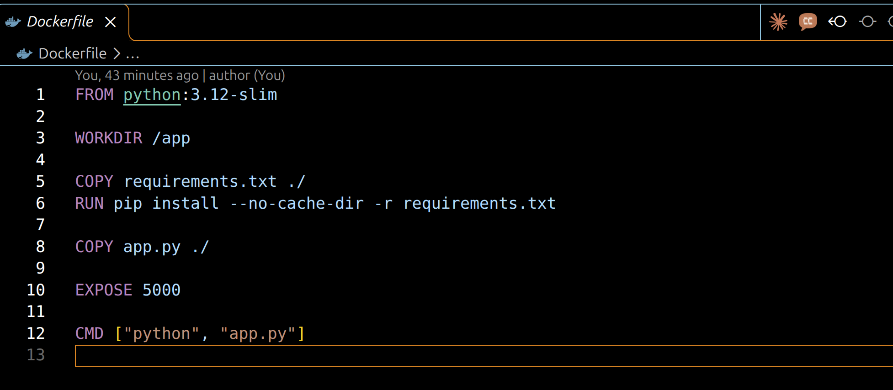

`python:3.12-slim` base, dependencies installed from `requirements.txt`, `EXPOSE 5000`, `CMD ["python", "app.py"]` — the app itself already binds `0.0.0.0:5000`.

## Build ivolve1

```bash
docker build -t ivolve1 .
docker images ivolve1
```

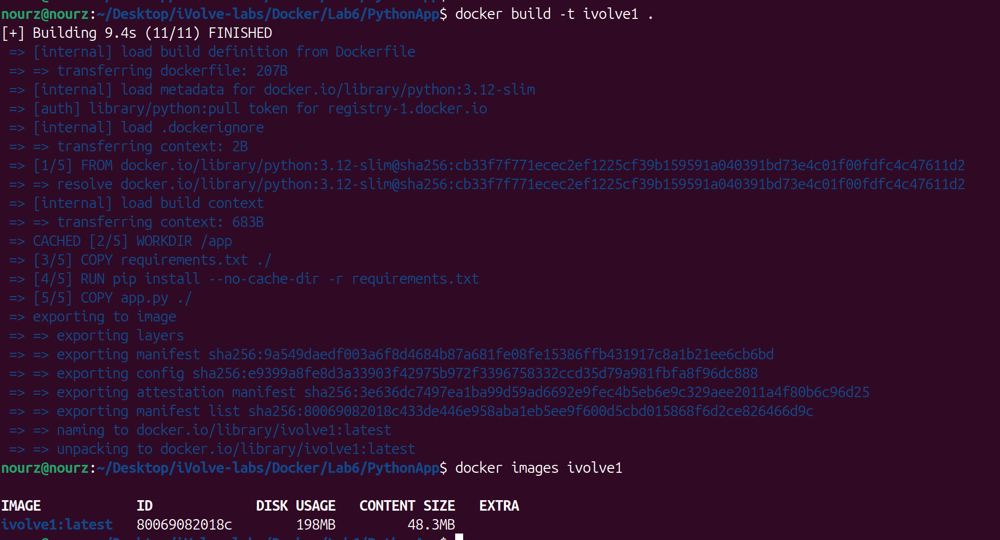

**9.4s (11/11)**, result `ivolve1:latest` — ID `80069082018c`, **198MB disk usage / 48.3MB content size**.

## Run container1: env vars on the command line, with the limits

```bash
docker run -d --name container1 -p 5000:5000 -e APP_NAME=iVolveApp1 -e APP_ENV=stg --cpus=1 -m=256m ivolve1
```

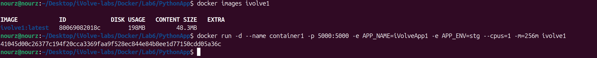

Both environment variables (`-e` twice) and both resource limits (`--cpus=1 -m=256m`) have to be on the run line — a container's limits cannot be added after it is started. Container ID `41045d00c263...`.

## Verify the Application

```bash
sleep 3
curl http://localhost:5000
```

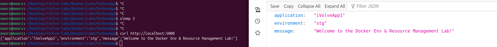

`curl` returned `{"application":"iVolveApp1","environment":"stg","message":"Welcome to the Docker Env & Resource Management Lab!"}` and I opened `http://localhost:5000` in the browser too — same JSON, coming from the variables I passed on the run command.

## Verify the Variables Inside the Container

```bash
docker exec container1 env | grep APP_
```

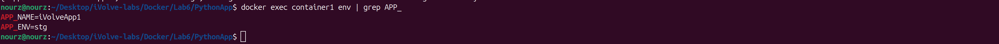

`APP_NAME=iVolveApp1` and `APP_ENV=stg`, straight from the container's environment.

## Monitor CPU and Memory

```bash
docker stats container1
```

Screenshot while it runs, then Ctrl+C to leave it.

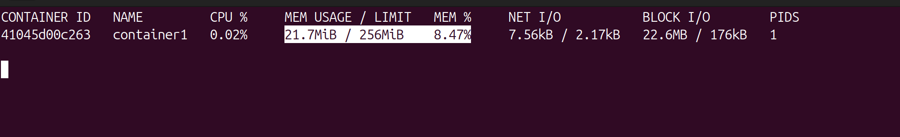

The MEM USAGE / LIMIT column shows **21.7MiB / 256MiB** — the limit from the run line is real. (The slide writes `docker stats cont1`; the container's actual name is `container1`, so that is the command I ran.)

## Create env.txt

```bash
printf 'APP_NAME=iVolveApp2\nAPP_ENV=prod\n' > env.txt
cat env.txt
```

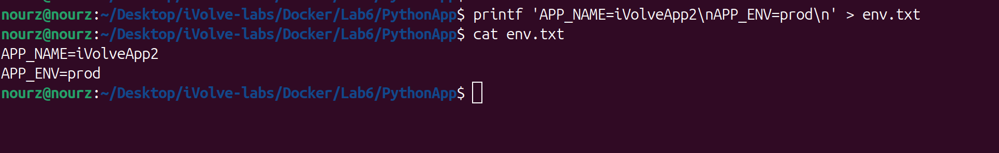

## Run container2: variables from the File

```bash
docker stop container1
docker run -d --name container2 -p 5000:5000 --env-file env.txt ivolve1
sleep 3
curl http://localhost:5000
docker exec container2 env | grep APP_
```

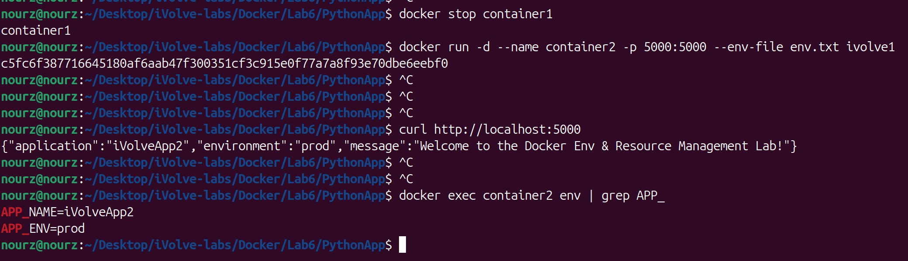

`container1` stopped first — only one container can hold port 5000 at a time, same situation as Lab 4. Then `--env-file env.txt` did the same job the `-e` flags did: `curl` came back with `"application":"iVolveApp2","environment":"prod"` and `docker exec ... env` agrees.

## The Dockerfile with Hardcoded Variables

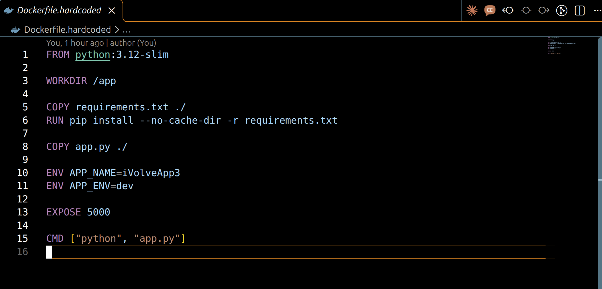

Same Dockerfile plus two lines: `ENV APP_NAME=iVolveApp3` and `ENV APP_ENV=dev` — the variables now live in the image itself.

## Build the Second Image

```bash
docker build -f Dockerfile.hardcoded -t ivolve2 .
docker images ivolve2
```

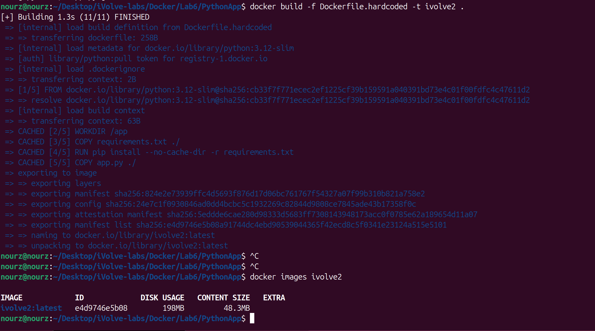

**1.3s (11/11)** — steps 2 through 5 all show `CACHED` because they are the identical layers as `ivolve1`; only the new `ENV` lines were added. The slide gives no name for this image, so I tagged it `ivolve2`: ID `e4d9746e5b08`, **198MB / 48.3MB**.

## Run container2 from the New Image and Validate

```bash
docker stop container2
docker rm container2
docker run -d --name container2 -p 5000:5000 ivolve2
sleep 3
curl http://localhost:5000
docker exec container2 env | grep APP_
```

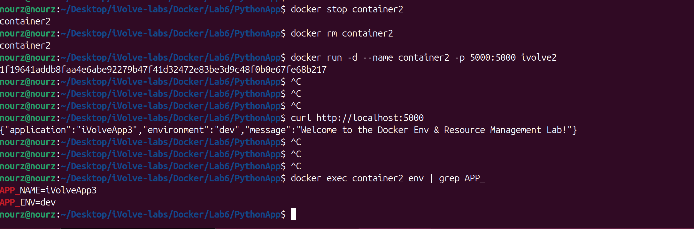

The old `container2` stopped and removed so the name and port were free (the slide reuses the name container2), then the new one started with **no flags at all** — and `curl` still answered `{"application":"iVolveApp3","environment":"dev",...}`, confirmed again by `docker exec container2 env`.

---

Same image content, three injection methods: `-e` flags gave `iVolveApp1`/`stg`, `--env-file` gave `iVolveApp2`/`prod`, and the Dockerfile `ENV` lines gave `iVolveApp3`/`dev` — with the container held at 1 CPU and 256 MB the whole time, as `docker stats` shows.
