# Lab 7: Multi-Network Microservices, Volumes, and Bind Mounts

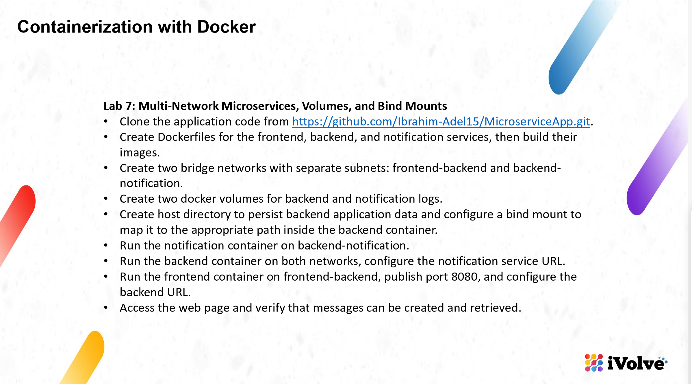

- **Source code:** https://github.com/Ibrahim-Adel15/MicroserviceApp.git (cloned into this folder: `MicroserviceApp/`)
- **Services:** frontend (port 3000, needs `BACKEND_URL`), backend (port 5000, needs `NOTIFICATION_URL`, stores `messages.json`), notification (port 5001, writes `notification.log`).

## Objective

Run the three services with only the connections they are supposed to have: frontend reaches backend over one bridge network, notification only sits with the backend on another, and the backend alone belongs to both — the bridge between them. Logs live in two docker volumes, the backend's message file lives in a folder on my machine through a bind mount.

---

## The Application

```bash
cd ~/Desktop/iVolve-labs/Docker/Lab7
find MicroserviceApp -type f | sort
```

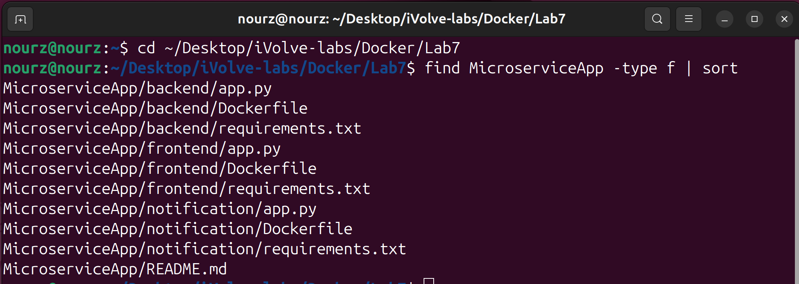

Three folders, one service each: `app.py`, `requirements.txt`, and a Dockerfile that came with the repo.

## The Three Dockerfiles

The Dockerfiles ship in the repo — I opened each one before building:

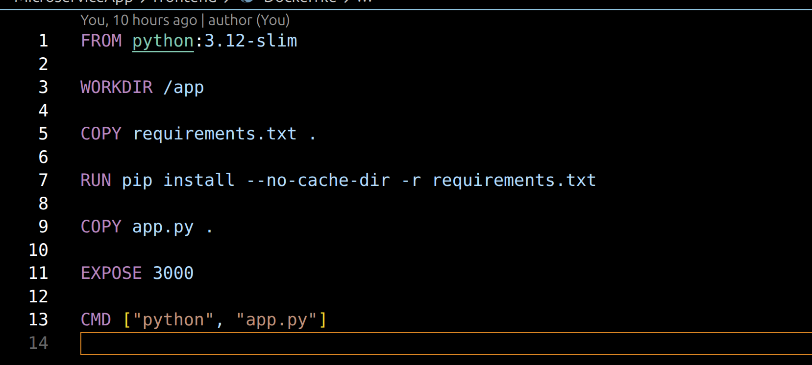

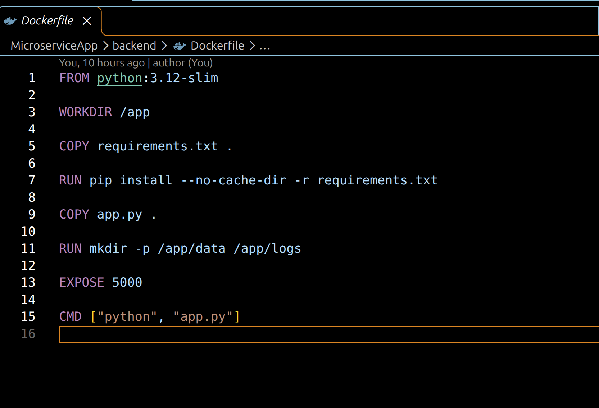

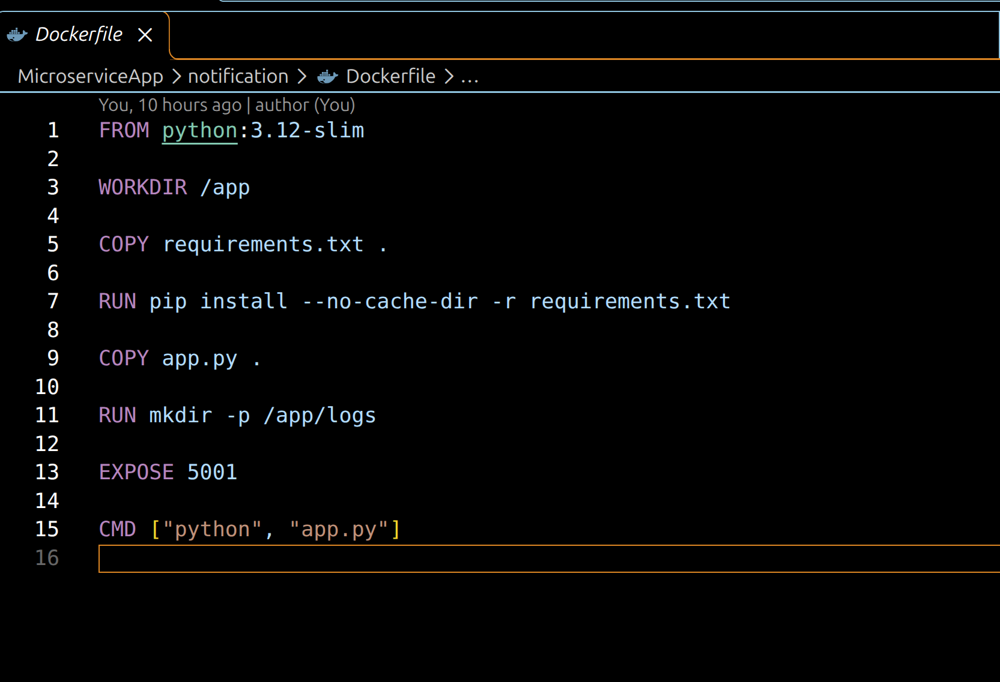

All three follow the same pattern: `python:3.12-slim`, install `requirements.txt`, `COPY app.py`, `CMD ["python", "app.py"]`. The backend creates `/app/data` and `/app/logs`, the notification only `/app/logs` — exactly the paths the bind mount and the volumes will take over later.

## Build the Images

```bash
docker build -t frontend ./MicroserviceApp/frontend
docker build -t backend ./MicroserviceApp/backend
```

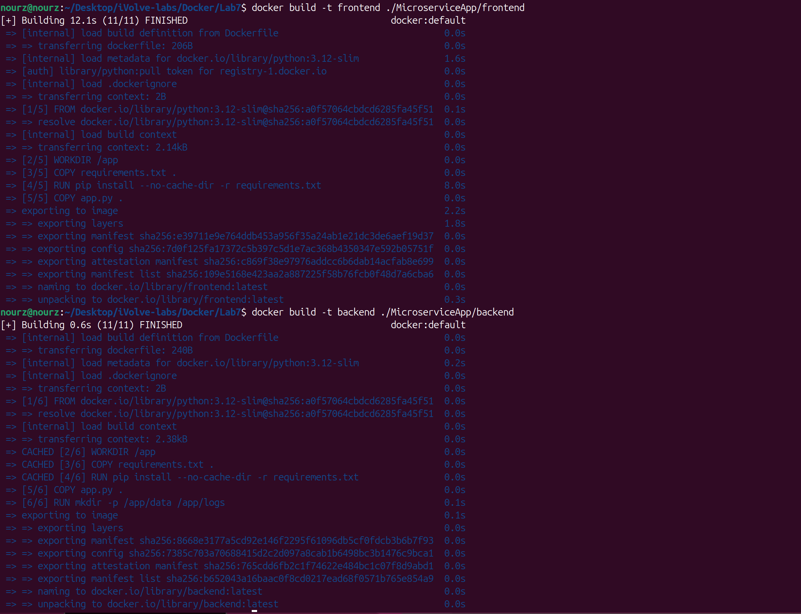

```bash
docker build -t notification ./MicroserviceApp/notification
docker images | grep -E "frontend|backend|notification"
```

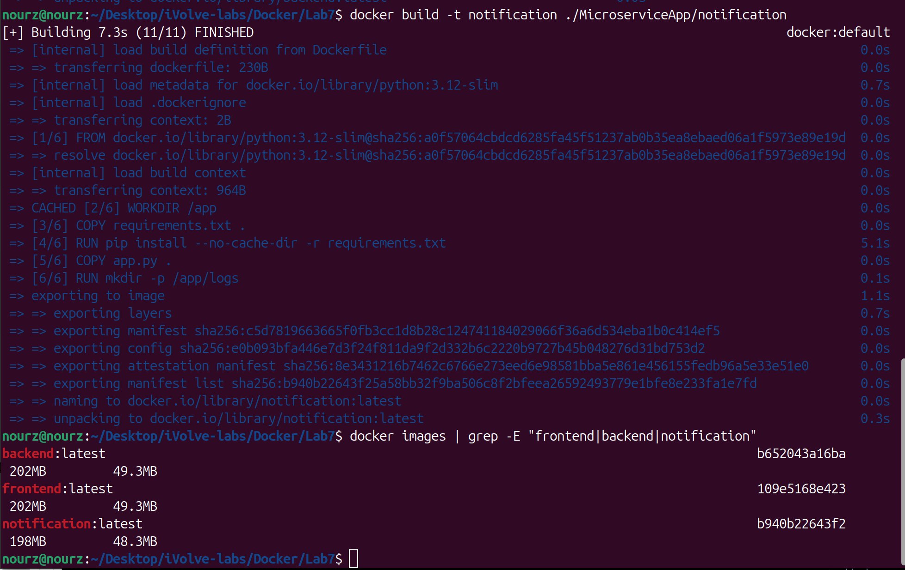

- **frontend: 12.1s (11/11)**, pip install took 8.0s.
- **backend: 0.6s (11/11)** — `COPY requirements.txt` and the whole `pip install` step show `CACHED` because the requirements file is identical to the frontend's, so Docker reused those layers. Only `COPY app.py` and the `mkdir` step were new.
- **notification: 7.3s (11/11)** — its requirements only contain Flask, so pip had its own layer to build (5.1s).

`docker images`: `frontend` `109e5168e423` 202MB/49.3MB, `backend` `b652043a16ba` 202MB/49.3MB, `notification` `b940b22643f2` 198MB/48.3MB.

## The Two Networks

```bash
docker network create --driver bridge --subnet 172.23.0.0/24 frontend-backend
docker network create --driver bridge --subnet 172.24.0.0/24 backend-notification
docker network ls | grep -E "frontend-backend|backend-notification"
```

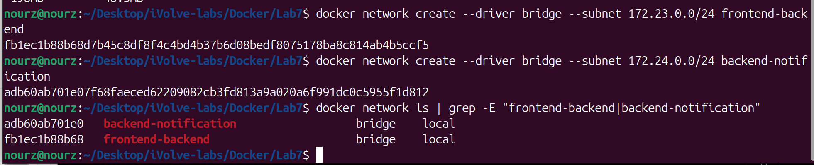

Two bridge networks, each with its own subnet — I picked `172.23.0.0/24` and `172.24.0.0/24` because my other docker networks already use 172.17 through 172.22.

## The Two Log Volumes

```bash
docker volume create backend-logs
docker volume create notification-logs
docker volume ls | grep -E "backend-logs|notification-logs"
```

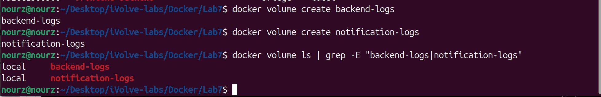

## Run notification

```bash
docker run -d --name notification --network backend-notification -v notification-logs:/app/logs notification
```

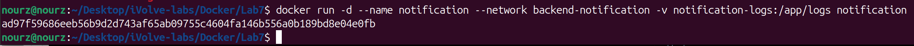

Container ID `ad97f59686ee...`, started on `backend-notification` with `notification-logs` mounted at `/app/logs` — where the app writes `notification.log`.

## Run backend: both networks, the URL, the volume, the bind mount

```bash
mkdir -p backend_data
docker run -d --name backend --network backend-notification -e NOTIFICATION_URL=http://notification:5001/notify -v backend-logs:/app/logs -v "$(pwd)/backend_data:/app/data" backend
docker network connect frontend-backend backend
```

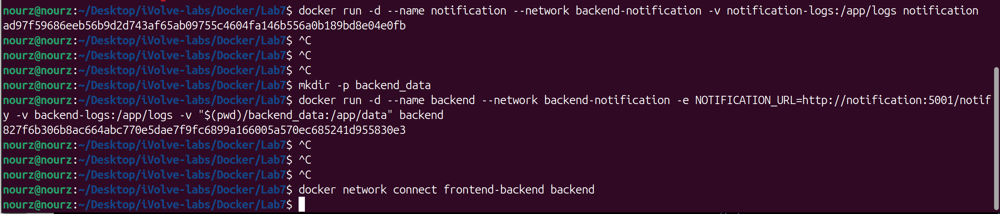

Container ID `827f6b306b8a...`. One run line carries three things: the notification URL the backend calls, the `backend-logs` volume on `/app/logs`, and the bind mount `"$(pwd)/backend_data:/app/data"` — my local `backend_data/` folder becomes the place where `messages.json` is stored. Then `docker network connect frontend-backend backend` puts the same container on the second network; a container can join a network after it starts, so it ended up on both.

## Run frontend on port 8080

```bash
docker run -d --name frontend --network frontend-backend -p 8080:3000 -e BACKEND_URL=http://backend:5000 frontend
docker ps --filter "name=frontend" --filter "name=backend" --filter "name=notification"
```

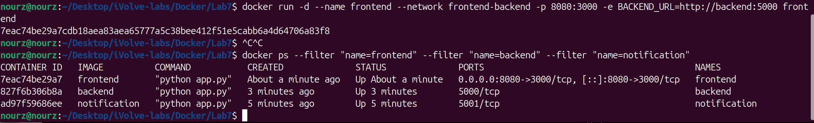

`BACKEND_URL=http://backend:5000` — `backend` resolves by name because both containers share the `frontend-backend` network. In `docker ps`: frontend publishes `0.0.0.0:8080->3000/tcp`, while backend and notification show only `5000/tcp` and `5001/tcp` — nothing is exposed to my machine except the frontend, by design.

## The Web Page

```bash
firefox http://localhost:8080
```

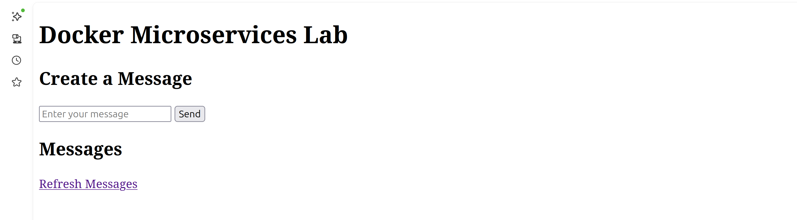

The page loads with an empty list and no red error — that alone means frontend reached backend across the network. I typed `Hello nour`, pressed Send:


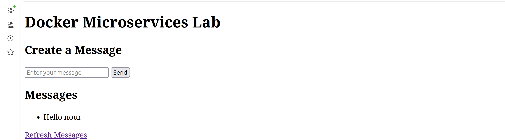

The message shows up in the list: created (POST through frontend to backend) and retrieved (GET back), so the whole chain works.

## The File on My Machine

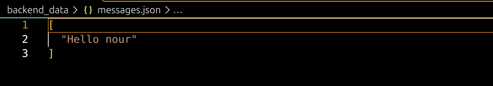

`backend_data/messages.json` now exists **on my computer**, outside docker, with `["Hello nour"]` inside — the bind mount wrote the container's `/app/data` straight into my folder. It is in `.gitignore`, it is runtime data, not part of the repo.

## The Logs in the Volumes

```bash
docker exec backend tail -3 /app/logs/backend.log
docker exec notification tail -3 /app/logs/notification.log
```

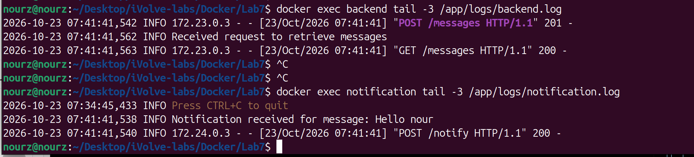

Both log files live on the volumes, not on the containers' own filesystems. And the source IPs tell the network story on their own:

- `backend.log`: `"POST /messages" 201` and `"GET /messages" 200` both came from **172.23.0.3** — that's the frontend, over `frontend-backend`.
- `notification.log`: `Notification received for message: Hello nour` and `"POST /notify" 200` came from **172.24.0.3** — that's the backend, over `backend-notification`.

Same backend container, two networks, two different addresses.

## Which Container Sits Where

```bash
docker network inspect frontend-backend backend-notification | grep -E '"Name"|"Subnet"'
```

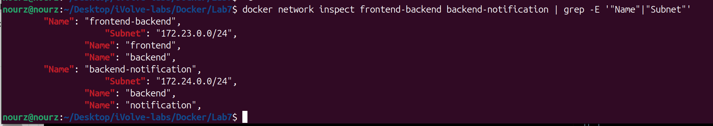

Exactly the topology the lab asked for: `frontend-backend` (`172.23.0.0/24`) holds **frontend + backend**, `backend-notification` (`172.24.0.0/24`) holds **backend + notification**, and backend is the only container in both — frontend can never reach notification directly.

---

One page, one message, three networks facts: messages created and retrieved in the browser, `messages.json` persisted on my host through the bind mount, both logs written into their volumes — with every hop visible in the container IPs above.
