# Lab 8: Containerized Node.js and MySQL Stack Using Docker Compose

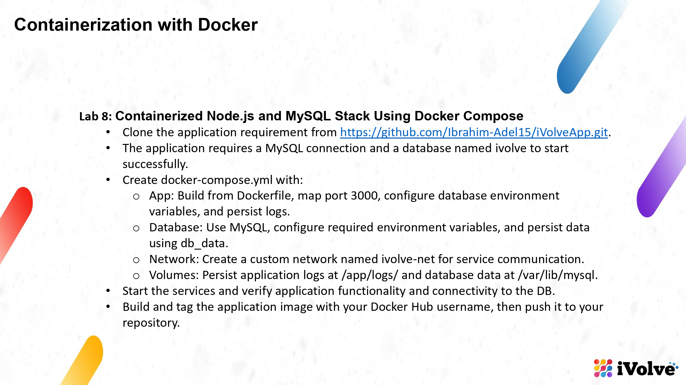

- **Source code:** https://github.com/Ibrahim-Adel15/iVolveApp.git (cloned into this folder: `iVolveApp/`)
- **Stack:** Node.js/Express app on port 3000 + MySQL 8, wired together with `docker-compose.yml`
- **Docker Hub:** `nourz1/ivolve-app`

## Objective

One compose file to run the application and its database together: the app builds from its Dockerfile, both services join a custom network, the logs live in a volume, the MySQL files live in `db_data` — and the finished image ends up in my Docker Hub repository.

---

## The Application

```bash
cd ~/Desktop/iVolve-labs/Docker/Lab8
find iVolveApp -type f | sort
cat iVolveApp/package.json
```

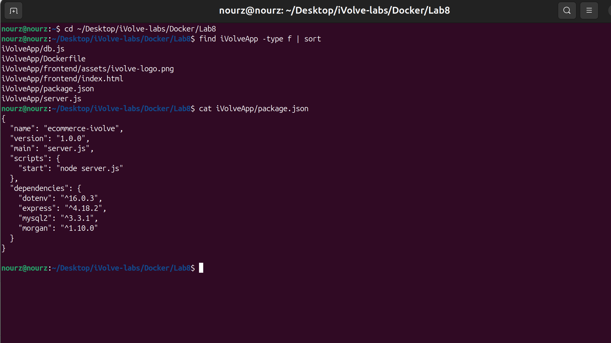

An Express app called `ecommerce-ivolve` (express, mysql2, morgan, dotenv). What it demands from its environment:

```bash
grep -n "DB_\|'ivolve'" iVolveApp/server.js
```

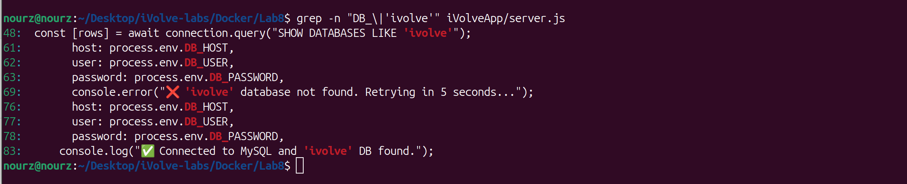

Three rules are written into the code: the connection is built from `DB_HOST`/`DB_USER`/`DB_PASSWORD`, a database literally named `ivolve` must exist before the app is satisfied (it retries every 5 seconds until it finds it), and only then does it start listening on port 3000. It also writes request logs to `/app/logs/access.log` through morgan.

## The Dockerfile

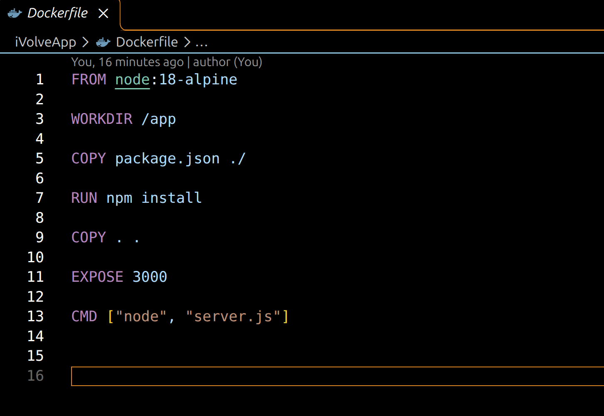

Came with the repo: `node:18-alpine`, `npm install`, `EXPOSE 3000`, `CMD ["node", "server.js"]`.

## The Compose File

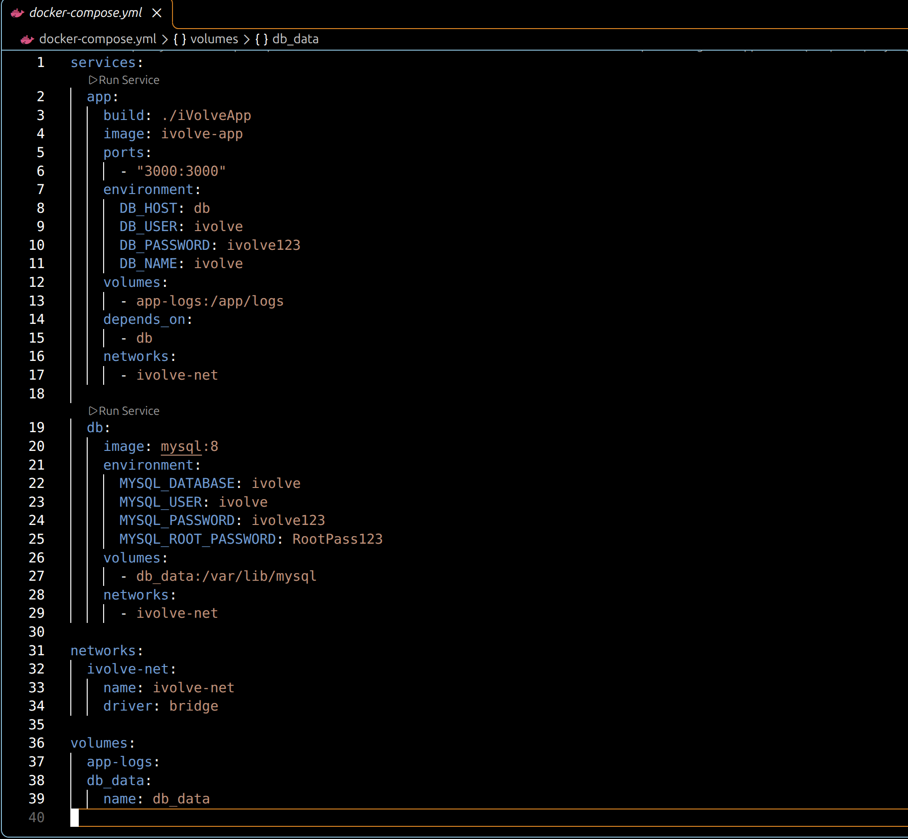

What I put in `docker-compose.yml`, piece by piece:

- **app** — builds from `./iVolveApp` and is tagged `ivolve-app`, publishes `3000:3000`, receives the database variables with `DB_HOST: db` (the other service's hostname), mounts `app-logs` on `/app/logs`, `depends_on: db`, joins `ivolve-net`.
- **db** — `mysql:8` with `MYSQL_DATABASE: ivolve` (this is what creates the database the app waits for), user `ivolve`/`ivolve123`, a root password, and `db_data` mounted on `/var/lib/mysql`.
- **network** — `ivolve-net` with `name: ivolve-net`, so the network in docker is called exactly that, bridge driver.
- **volumes** — `app-logs` for the logs, `db_data` for the database, with `name: db_data` for the same exact-name reason.

## Start the Stack

```bash
docker compose up -d
docker compose ps
```

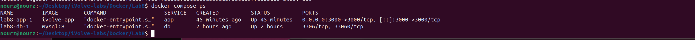

Both containers Up. Only the app publishes a port to my machine (`0.0.0.0:3000->3000/tcp`); the database shows just `3306/tcp, 33060/tcp` — it stays inside the compose network where nobody else can reach it.

## The App Finds the Database

```bash
docker compose logs app --tail=8
```

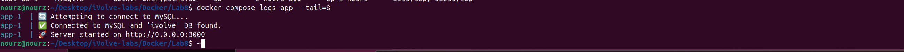

The app really does wait for its database: it attempted the connection, found `ivolve` (the MySQL container created it from `MYSQL_DATABASE` on first boot), and only after that announced that the server started on port 3000.

## Verify: Functionality and DB Connectivity

```bash
curl http://localhost:3000/health
docker compose exec db mysql -uivolve -pivolve123 -e "SHOW DATABASES LIKE 'ivolve';"
```

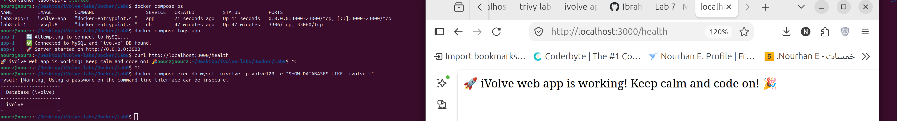

`/health` runs a query through the app's own MySQL connection, so its answer means app-to-database works end to end — and I opened the same URL in the browser. From the database side, `SHOW DATABASES LIKE 'ivolve';` comes back with exactly one row: `ivolve`. (The password warning from the mysql client is normal.)

## The Web Page

```bash
firefox http://localhost:3000
```

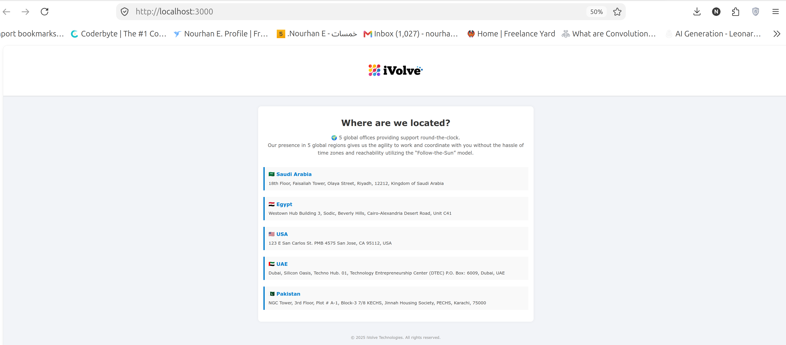

The page the container serves on port 3000 — the iVolve logo and the five office locations.

## Logs and Data, Both Persisted

```bash
docker compose exec app tail -3 /app/logs/access.log
docker volume ls | grep -E "db_data|app-logs"
```

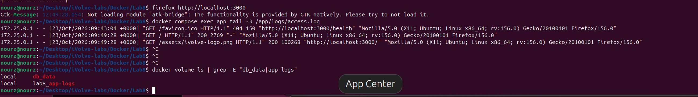

morgan recorded my browser's requests — arriving from `172.25.0.1`, my host through the published port — into `/app/logs/access.log`, which lives on the `lab8_app-logs` volume rather than in the container's own filesystem. And `docker volume ls` shows **db_data** holding MySQL's files at `/var/lib/mysql`, sitting next to the logs volume.

## The Network

```bash
docker network inspect ivolve-net --format '{{.Name}} {{range .IPAM.Config}}{{.Subnet}}{{end}}'
docker compose exec app ping -c 2 db
```

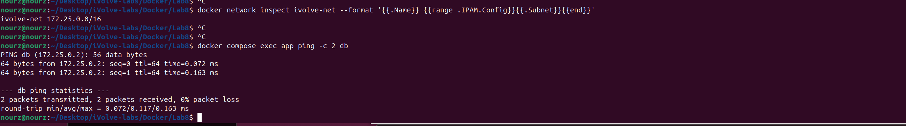

One custom network: `ivolve-net` on `172.25.0.0/16`, with both containers attached. From inside the app container, `db` resolves to `172.25.0.2` and answers ping with 0% packet loss — that name resolution is exactly what the app's `DB_HOST: db` relies on.

## Tag and Push to Docker Hub

```bash
docker tag ivolve-app nourz1/ivolve-app
docker images | grep ivolve
docker push nourz1/ivolve-app
```

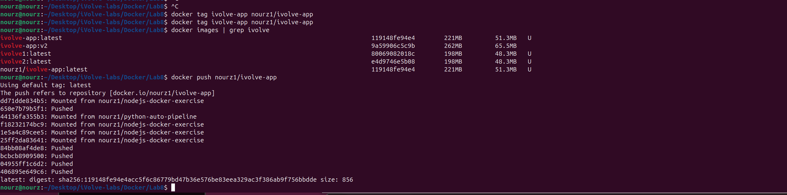

`docker tag` prints nothing when it works — the proof is in `docker images`: `nourz1/ivolve-app:latest` and `ivolve-app:latest` carry the same image ID `119148fe94e4`. The push reused layers I already had in Docker Hub from my earlier images and ended with `latest: digest: sha256:119148fe94e4...`.

## The Repository on Docker Hub

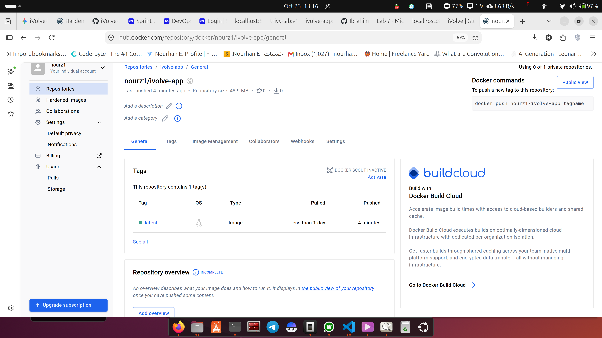

`hub.docker.com/r/nourz1/ivolve-app` — public, one tag (`latest`), pushed minutes earlier. Anyone can get it with `docker pull nourz1/ivolve-app`.

---

One file turned a Node app and a MySQL server into a running product: compose built the image, `MYSQL_DATABASE` satisfied the app's hard requirement on the `ivolve` database, the custom network supplied the `db` hostname, the two volumes kept the logs and the database files outside the containers — and the same image now lives on my Docker Hub as `nourz1/ivolve-app`.
