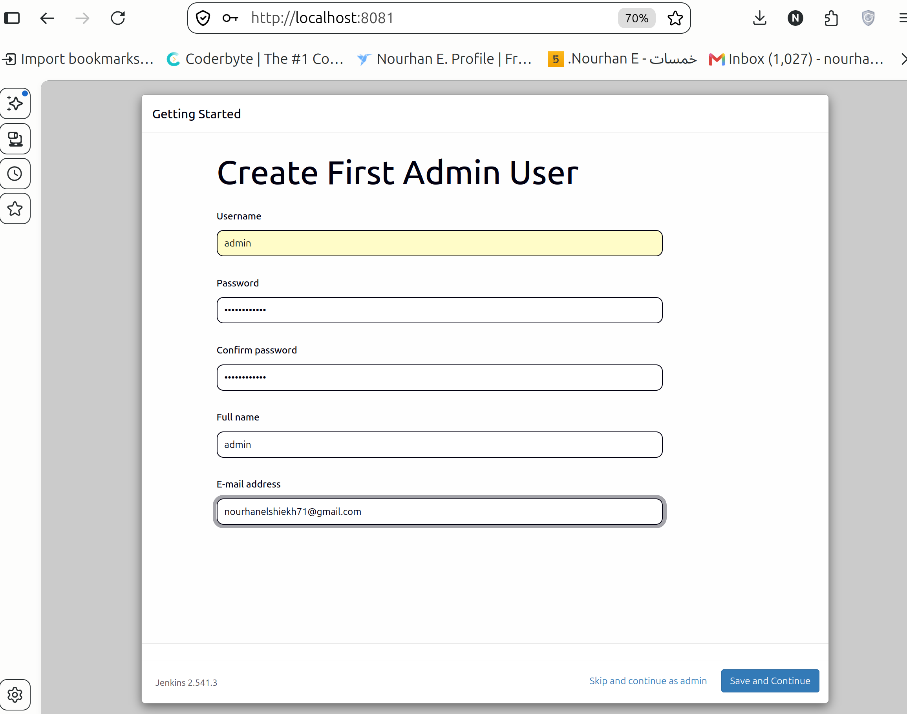
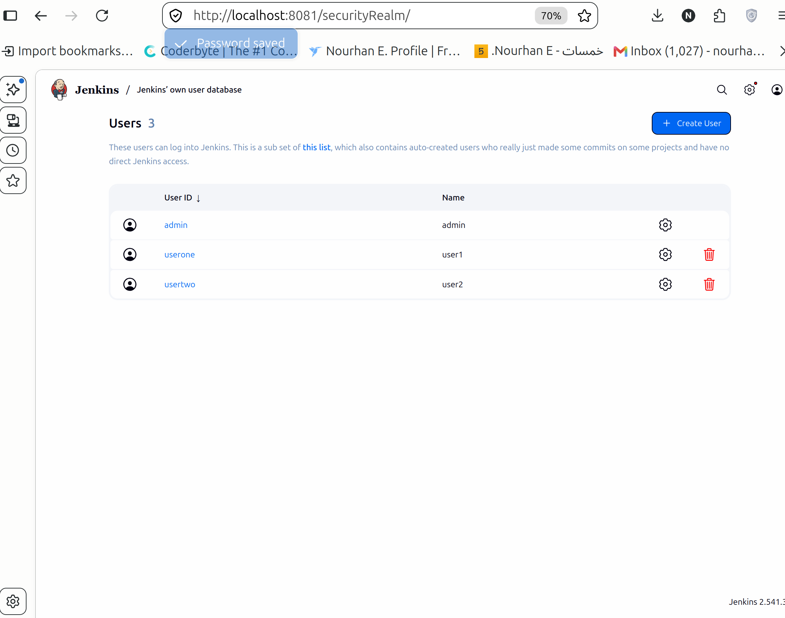
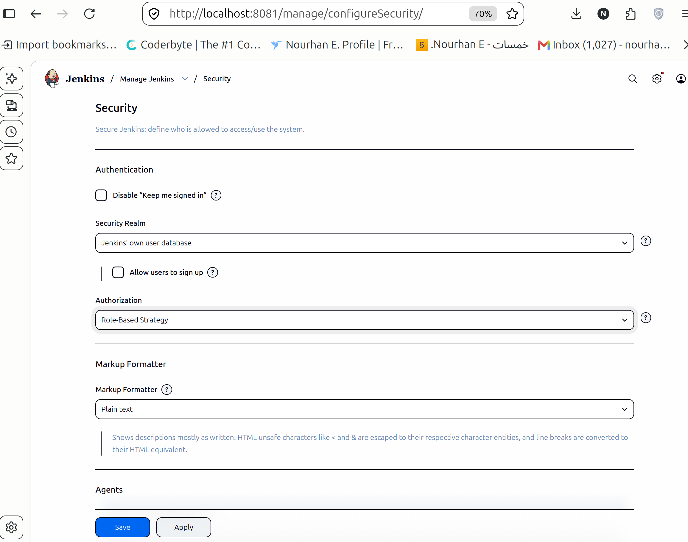
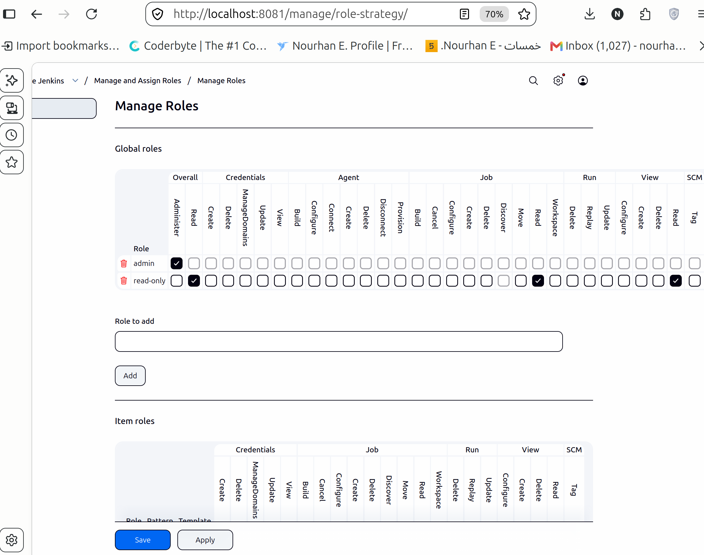
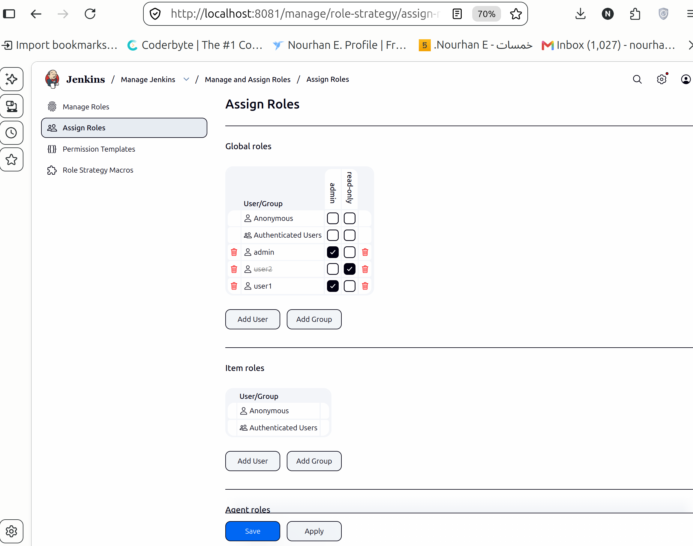

# Lab 20: Role-Based Authorization in Jenkins

This is the first Jenkins lab of the track, and it is about who is allowed to do what. Two accounts are created, two roles are defined, and each account is bound to one of them: an admin who can manage the instance, and a read-only user who can look at it without changing anything.

## Objective

- Create `user1` and `user2` in Jenkins.
- Assign the admin role to `user1`.
- Assign the read-only role to `user2`.

## Folder contents

| File | Purpose |
|------|---------|
| `install.sh` | Starts Jenkins in Docker, installs the role-strategy plugin and prints the initial admin password |

## 1. The Jenkins instance



Jenkins runs as a single container on the local machine, version 2.541.3, and it listens on `localhost:8081` because port 8080 was already taken. The setup wizard is at the step where the first administrator is created: username `admin`, a password, the full name `admin` and an email address.

Behind the wizard, `install.sh` already did two things that matter for this lab: it started the container with a named volume for `/var/jenkins_home`, and it installed the `role-strategy` plugin with `jenkins-plugin-cli`. That is why the authorization strategy in the next steps is available at all.

The initial admin password, needed before this page appears, is read from the container:

```bash
docker exec jenkins cat /var/jenkins_home/secrets/initialAdminPassword
```

## 2. Two test users



`Manage Jenkins` then `Security` then `Users` lists the accounts that can log in. There are three: the `admin` created by the wizard, and two accounts created with the `Create User` button.

The table has two columns that are easy to confuse. `User ID` is the login name, and `Name` is the full name shown in the interface. The two test accounts were created with the IDs `userone` and `usertwo` and the full names `user1` and `user2`. The role assignment table in section 5 lists the accounts by their display names, which is why both spellings appear in this report; the account that is called `userone` there is the one that shows up as `user1` in the assignment.

Both accounts were given a password on the same form. Nothing else is needed from this page; the account settings behind the gear icon are only for changing passwords or full names.

## 3. The authorization strategy



`Manage Jenkins` then `Security` opens the global security configuration. Two things are set here:

- `Security Realm: Jenkins' own user database`, with `Allow users to sign up` left unchecked, so accounts only exist when an administrator creates them.
- `Authorization: Role-Based Strategy`, which is the plugin's strategy replacing the default `Logged-in users can do anything`.

The order matters and it is worth explaining, because the plugin hides its own menu entry while the strategy is inactive. `Manage and Assign Roles` only appears under `Manage Jenkins` after `Role-Based Strategy` has been selected and saved; if you go looking for it first, it is simply not there.

This is also the moment where an administrator can lock themselves out. The safe habit is to copy the configuration file before saving:

```bash
docker exec jenkins cp /var/jenkins_home/config.xml /var/jenkins_home/config.xml.bak
```

If the interface ever answers `Access Denied` after a change, the copy is restored into the container and Jenkins is restarted.

## 4. The two roles



`Manage Jenkins` then `Manage and Assign Roles` then `Manage Roles` defines the global roles. The screenshot shows two rows in the `Global roles` table.

| Role | Permissions |
|------|-------------|
| `admin` | Only `Overall/Administrator` is checked. That permission implies every other permission in Jenkins, so nothing else needs a tick. |
| `read-only` | `Overall/Read`, `Job/Read` and `View/Read`. |

The read-only set is the minimum that still produces a usable interface: `Overall/Read` lets the account see the dashboard, `Job/Read` lets it open the jobs, and `View/Read` lets it see the default view that lists them. Without the two job-level permissions the account would log in to an empty page and collect `Access Denied` errors while browsing.

The `Item roles` table below the global one is not used here. Global roles already cover every job, so a pattern-based item role would only repeat the same permissions.

## 5. Assigning the roles



`Assign Roles` is the second half of the same page. The table is users against roles, and the three tick marks are the whole lab:

- `admin` has `admin`
- `user1` has `admin`
- `user2` has `read-only`

`Anonymous` and `Authenticated Users` have no roles at all, which means an unauthenticated visitor sees nothing and a logged-in account without an assignment also sees nothing. That is the intended default: access is granted per account, not to everyone who can log in.

The assignment is saved with the `Save` button at the bottom, and the menu on the left of the page (`Manage Roles`, `Assign Roles`, `Permission Templates`, `Role Strategy Macros`) is the plugin's own navigation once the strategy is active.

## 6. The login test

The last step is to check the result from the outside, with the two accounts instead of the admin session:

1. Log out and log in as `user1`. The left menu contains `Manage Jenkins` and `New Item`, and the configuration pages open normally. This is the admin role in action.
2. Log out and log in as `user2`. The dashboard and the job list are readable, but `Manage Jenkins` and `New Item` are gone. Opening `http://localhost:8081/manage` directly returns `Access Denied` with HTTP 403, because `Overall/Administrator` is not part of the read-only role.

The difference between the two sessions is the whole point of the lab: the same Jenkins, the same URL, two different sets of permissions.

## Problems and notes

- The role-strategy plugin does not show `Manage and Assign Roles` until `Role-Based Strategy` is the active authorization strategy, so the strategy has to be enabled before the roles can be defined. The reverse order is not possible from the UI.
- Enabling the strategy before any role is assigned is the classic lockout path. The backup of `config.xml` before the change, and the restore command in section 3, are cheap insurance.
- `Role-Based Strategy` is not the same as `Matrix Authorization Strategy`, which is bundled with Jenkins and assigns permissions per user without roles. The lab asks for roles, so it uses the plugin.
- Jenkins 2.541 groups the entries of `Manage Jenkins` into cards, and the page has a search box. `Users` is inside the `Security` card, and the URL is `/securityRealm/`; `Manage and Assign Roles` is at `/manage/role-strategy/`.
- The `read-only` role cannot configure jobs, start builds or change credentials; `Job/Read` only allows reading. A user who needs to trigger builds would need `Job/Build` added to the role, which this lab does not grant.
- The container keeps its state in the `jenkins_home` volume. Removing the container without removing the volume leaves the users and roles in place for the next start; `docker rm -f jenkins && docker volume rm jenkins_home` removes everything.

## Cleanup

Stopping the container is enough to free the port and the memory:

```bash
docker stop jenkins
```

Removing the lab completely:

```bash
docker rm -f jenkins
docker volume rm jenkins_home
```

## Summary

- Jenkins 2.541.3 runs in a container on `localhost:8081` with the `role-strategy` plugin preinstalled.
- Three accounts exist: `admin`, plus the two test accounts created for the lab.
- The global security configuration uses Jenkins' own user database and the `Role-Based Strategy` authorization.
- Two global roles are defined: `admin` with `Overall/Administrator`, and `read-only` with `Overall/Read`, `Job/Read` and `View/Read`.
- `user1` is bound to the admin role and `user2` to the read-only role, which makes the first a full administrator and the second a viewer with no management access.
