# Lab 22: CI/CD Pipeline Implementation with Jenkins Agents and Shared Libraries

This lab refactors the Lab 21 pipeline in two ways: the work now runs on a **Jenkins agent (slave)** instead of the built-in node, and the pipeline logic moved out of the `Jenkinsfile` into **Groovy shared libraries** (`vars/`) so that any pipeline can reuse it.

Everything in this report was verified end to end. The Jenkins job is **`DemoApp-Lab22`** at `http://localhost:8081`, and **build #5 finished green** (all stages, `Finished: SUCCESS`). Every step below is backed by a screenshot from the real run.

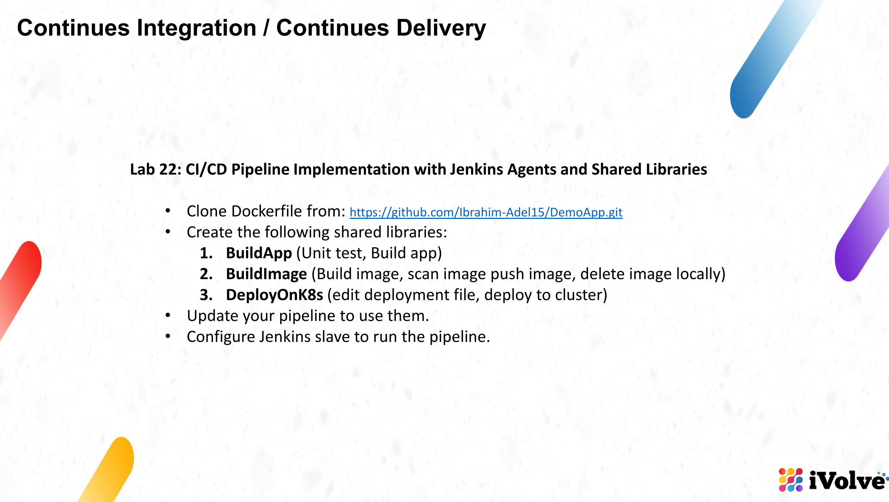

The assignment asks to clone the application from `https://github.com/Ibrahim-Adel15/DemoApp.git`, create three shared libraries, update the pipeline to use them and run it on a Jenkins slave. We used our own fork, [`neiorz/DemoApp`](https://github.com/neiorz/DemoApp) (branch `lab22`), and a separate repository for the library, [`neiorz/jenkins-shared-library`](https://github.com/neiorz/jenkins-shared-library).

## The pipeline at a glance

The job pulls the `Jenkinsfile` from `neiorz/DemoApp` (branch `lab22`), runs on the agent labelled `agent-1`, and calls one shared-library step per stage:

| # | Stage | Library step | What it does |
|---|-------|--------------|--------------|
| — | `Checkout SCM` | — | Checks out branch `lab22` |
| 1 | `1. Build App` | `buildApp()` | `mvn test` (unit tests), then `mvn clean package -DskipTests` |
| 2 | `2. Build Image` | `buildImage(image, tag)` | `docker build`, Trivy scan, `docker push`, `docker rmi` |
| 3 | `3. Deploy on K8s` | `deployOnK8s(image, tag)` | Edits `deployment.yaml` with `sed`, then `kubectl apply` |
| — | `Post Actions` | — | `always` / `success` / `failure` messages |

The image tag is the build number, so build #5 produces **`nourz1/demo-app:5`**.

## Folder contents

| File | Purpose |
|------|---------|
| `Jenkinsfile` | The pipeline that ran as build #5 (uses `@Library` and `agent-1`) |
| `vars/buildApp.groovy` | Shared library step: unit test + build the app |
| `vars/buildImage.groovy` | Shared library step: build, scan, push, delete the image |
| `vars/deployOnK8s.groovy` | Shared library step: edit the deployment file and deploy |
| `images/` | All screenshots embedded in this report |

The `vars/` folder is also published in its own repository (`neiorz/jenkins-shared-library`), because Jenkins looks for `vars/` at the root of the library repository.

---

## Step 1: Prepare the agent machine

The agent runs directly on the host, which already has Java, Maven, Docker, kubectl and Trivy installed. Create a dedicated user, a work folder and an SSH key:

```bash
sudo useradd -m -s /bin/bash jenkins-agent
sudo usermod -aG docker jenkins-agent
sudo mkdir -p /home/jenkins-agent/agent-workspace
sudo chown -R jenkins-agent:jenkins-agent /home/jenkins-agent/agent-workspace

ssh-keygen -t ed25519 -f ~/jenkins_agent_key -N "" -C "jenkins-master-to-agent"
sudo mkdir -p /home/jenkins-agent/.ssh
sudo cp ~/jenkins_agent_key.pub /home/jenkins-agent/.ssh/authorized_keys
sudo chown -R jenkins-agent:jenkins-agent /home/jenkins-agent/.ssh
sudo chmod 700 /home/jenkins-agent/.ssh
sudo chmod 600 /home/jenkins-agent/.ssh/authorized_keys
```

Give the agent a flattened kubeconfig so `kubectl` works for the new user:

```bash
sudo mkdir -p /home/jenkins-agent/.kube
kubectl config view --flatten --minify | sudo tee /home/jenkins-agent/.kube/config > /dev/null
sudo chown -R jenkins-agent:jenkins-agent /home/jenkins-agent/.kube
sudo chmod 600 /home/jenkins-agent/.kube/config
```

Verify the tools work as the new user:

```bash
sudo -u jenkins-agent docker ps
sudo -u jenkins-agent kubectl get nodes
sudo -u jenkins-agent mvn -version
sudo -u jenkins-agent trivy --version
```

## Step 2: Add the agent (node) in Jenkins

**1. Plugin.** The **SSH Build Agents** plugin is required (it was already installed).

**2. Credential.** **Manage Jenkins → Credentials → System → Global credentials → Add Credentials**:

- **Kind:** SSH Username with private key
- **ID:** `jenkins-agent-ssh-key`
- **Username:** `jenkins-agent`
- **Private Key:** the content of `~/jenkins_agent_key`

**3. Known hosts.** Register the host key inside the Jenkins container so the first connection is trusted:

```bash
docker exec jenkins bash -c 'mkdir -p /var/jenkins_home/.ssh && ssh-keyscan -H 192.168.1.3 >> /var/jenkins_home/.ssh/known_hosts'
```

**4. Node.** **Manage Jenkins → Nodes → New Node** (name `agent-1`, Permanent Agent):

| Field | Value |
|-------|-------|
| Number of executors | `2` |
| Remote root directory | `/home/jenkins-agent/agent-workspace` |
| Labels | `agent-1` |
| Usage | Only build jobs with label expressions matching this node |
| Launch method | Launch agents via SSH |
| Host | `192.168.1.3` |
| Credentials | `jenkins-agent` (SSH key) |
| Host Key Verification Strategy | Known hosts file Verification Strategy |

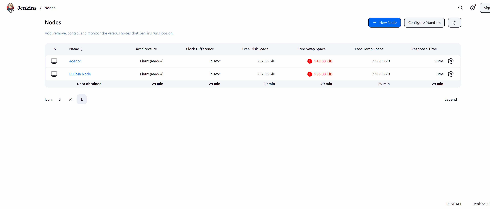

The agent log ends with **`Agent successfully connected and online`**:

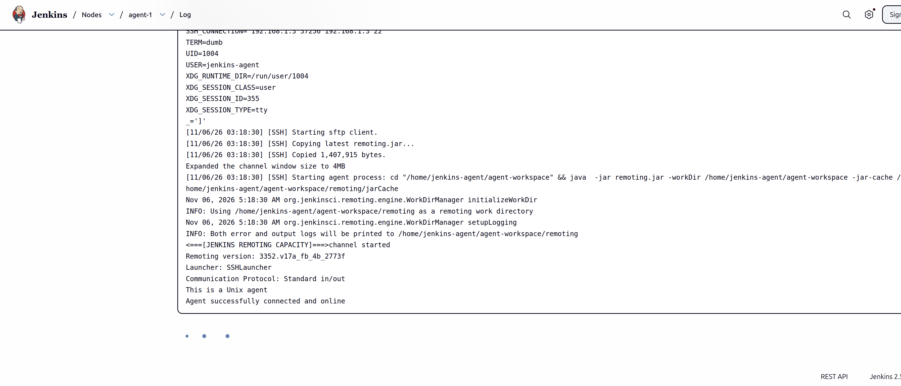

## Step 3: Create the shared libraries

The libraries live in `vars/`. The **file name is the step name** used in the Jenkinsfile, so the files use camelCase.

### `vars/buildApp.groovy`

```groovy
def call() {
    echo "Running unit tests..."
    sh "mvn test"
    echo "Building the application..."
    sh "mvn clean package -DskipTests"
}
```

### `vars/buildImage.groovy`

```groovy
def call(String imageName, String imageTag) {
    echo "Building Docker image ${imageName}:${imageTag}"
    sh "docker build -t ${imageName}:${imageTag} ."

    echo "Scanning image with Trivy"
    sh "trivy image --exit-code 0 --severity HIGH,CRITICAL ${imageName}:${imageTag}"

    echo "Pushing image to Docker Hub"
    withCredentials([usernamePassword(credentialsId: 'docker-hub-credentials',
                                      usernameVariable: 'DOCKER_USER',
                                      passwordVariable: 'DOCKER_PASS')]) {
        sh 'echo $DOCKER_PASS | docker login -u $DOCKER_USER --password-stdin'
        sh "docker push ${imageName}:${imageTag}"
    }

    echo "Deleting local image"
    sh "docker rmi ${imageName}:${imageTag}"
}
```

### `vars/deployOnK8s.groovy`

```groovy
def call(String imageName, String imageTag, String deploymentFile = 'deployment.yaml') {
    echo "Updating image in ${deploymentFile}"
    sh "sed -i 's|image:.*|image: ${imageName}:${imageTag}|g' ${deploymentFile}"

    echo "Deploying to Kubernetes cluster"
    sh "kubectl apply -f ${deploymentFile}"
}
```

Push them to their own repository:

```bash
cd ~/Desktop/jenkins-shared-library
git init && git branch -M main
git add .
git commit -m "Add shared library: buildApp, buildImage, deployOnK8s"
git remote add origin git@github.com:neiorz/jenkins-shared-library.git
git push -u origin main
```

## Step 4: Register the library in Jenkins

**Manage Jenkins → System → Global Trusted Pipeline Libraries → Add**:

| Field | Value |
|-------|-------|
| Name | `my-shared-lib` |
| Default version | `main` |
| Load implicitly | off |
| Allow default version to be overridden | on |
| Retrieval method | Modern SCM → Git |
| Project Repository | `https://github.com/neiorz/jenkins-shared-library.git` |

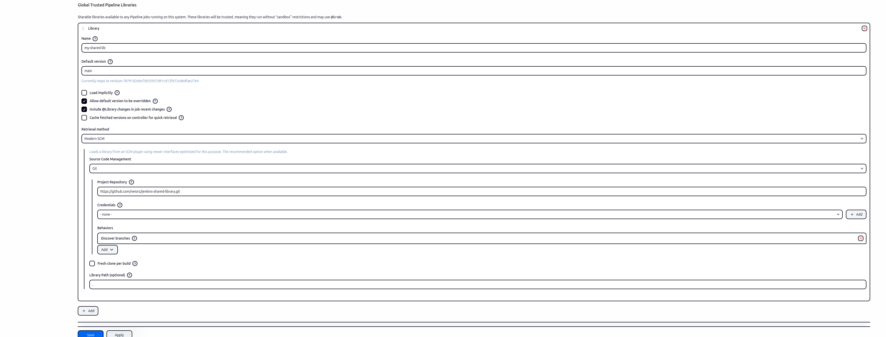

The URL must be HTTPS because the Jenkins container has no GitHub SSH key.

## Step 5: The Jenkinsfile

A new branch `lab22` in `neiorz/DemoApp` holds the updated pipeline, so `main` keeps the Lab 21 pipeline untouched:

```bash
cd ~/Documents/DemoApp/DemoApp
git checkout -b lab22
# write the Jenkinsfile below
git add Jenkinsfile
git commit -m "Lab22: Jenkinsfile using shared library and agent-1"
git push -u origin lab22
```

```groovy
@Library('my-shared-lib') _

pipeline {
    agent { label 'agent-1' }

    environment {
        IMAGE_NAME = 'nourz1/demo-app'
    }

    stages {
        stage('1. Build App') {
            steps {
                buildApp()
            }
        }
        stage('2. Build Image') {
            steps {
                buildImage(env.IMAGE_NAME, env.BUILD_NUMBER)
            }
        }
        stage('3. Deploy on K8s') {
            steps {
                deployOnK8s(env.IMAGE_NAME, env.BUILD_NUMBER)
            }
        }
    }

    post {
        always {
            echo "Pipeline finished execution."
        }
        success {
            echo "Deployment Successful!"
        }
        failure {
            echo "Pipeline Failed!"
        }
    }
}
```

- `@Library('my-shared-lib') _` loads the library registered in Step 4.
- `agent { label 'agent-1' }` runs the whole pipeline on the agent, not on the built-in node.
- Each stage calls one step from `vars/` by file name.

## Step 6: Create the Jenkins job

**New Item → Pipeline**, name **`DemoApp-Lab22`**, then under **Pipeline**:

| Field | Value |
|-------|-------|
| Definition | Pipeline script from SCM |
| SCM | Git |
| Repository URL | `https://github.com/neiorz/DemoApp.git` |
| Branch Specifier | `*/lab22` |
| Script Path | `Jenkinsfile` |
| Lightweight checkout | on |

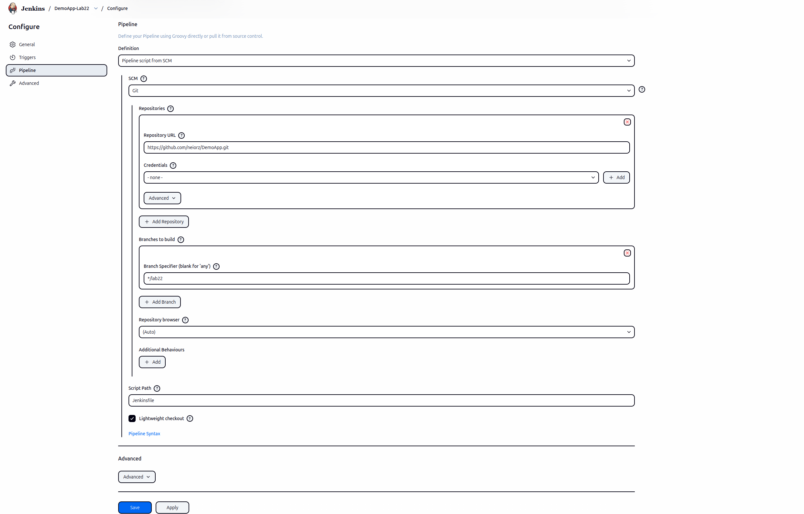

## Step 7: Run the build

Press **Build Now**. Build **#5** finished green, and every stage ran on `agent-1`.

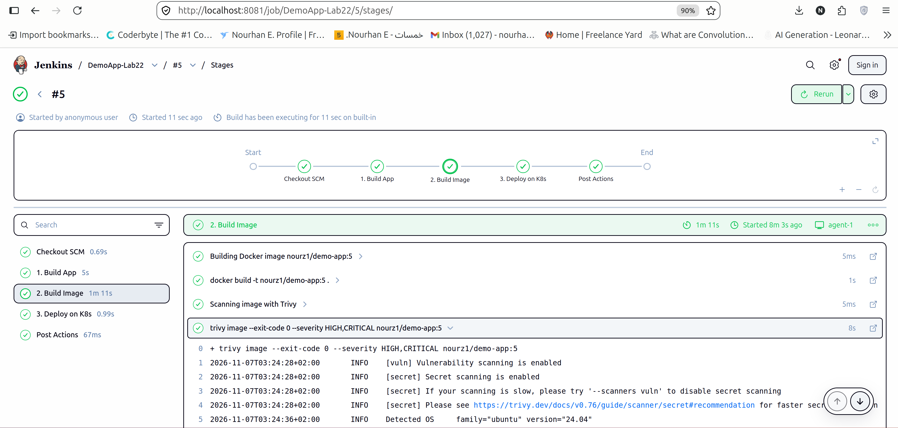

The console shows the two proofs of this lab: the build runs on the agent, and the shared library is loaded.

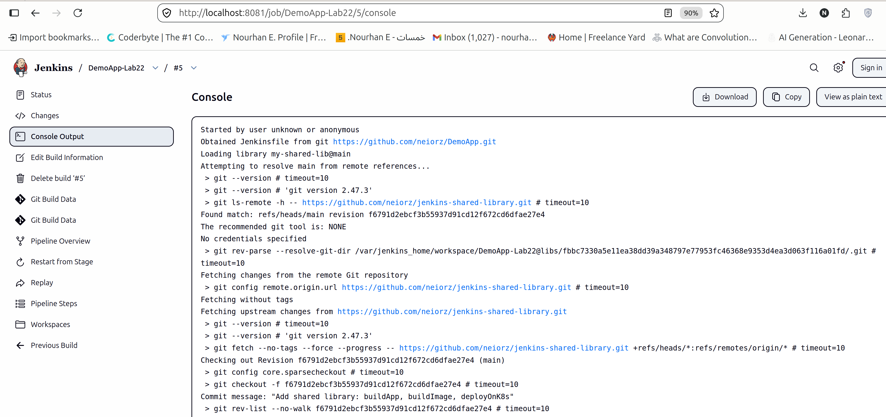

---

## Step 8: What each stage did

### 1. Build App

`buildApp()` runs `mvn test` and then `mvn clean package -DskipTests`.

### 2. Build Image

`buildImage('nourz1/demo-app', '5')` builds the image, scans it with Trivy, logs in with the `docker-hub-credentials` credential, pushes `nourz1/demo-app:5` and deletes the local image.

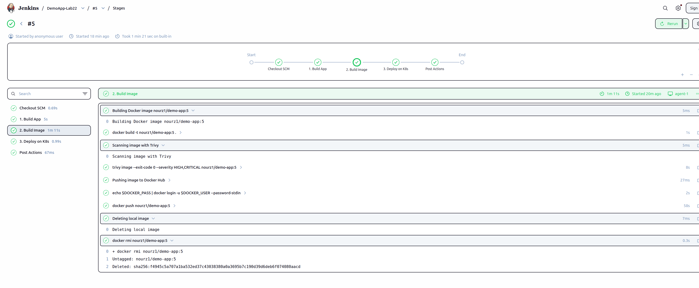

### 3. Deploy on K8s

`deployOnK8s('nourz1/demo-app', '5')` rewrites the `image:` line of `deployment.yaml` and runs `kubectl apply -f deployment.yaml`.

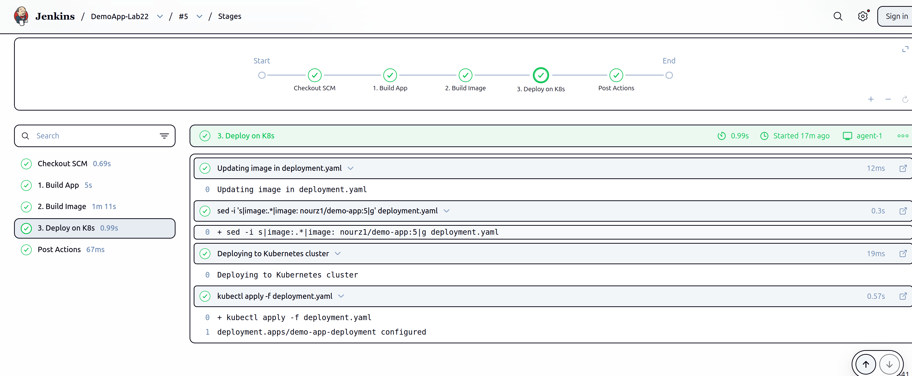

### Post actions

`always` → `Pipeline finished execution.`, `success` → `Deployment Successful!`, `failure` → `Pipeline Failed!`. The console ends with **`Finished: SUCCESS`**.

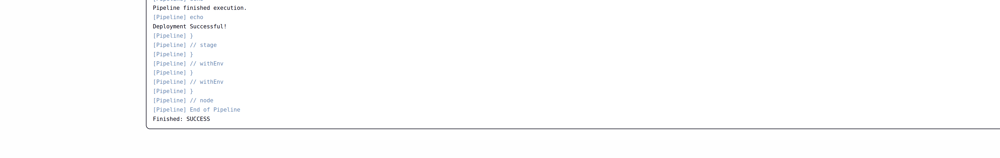

---

## Step 9: Verify the result

**1. The cluster:**

```bash
kubectl get pods
kubectl get deployment demo-app-deployment -o jsonpath='{.spec.template.spec.containers[0].image}{"\n"}'
```

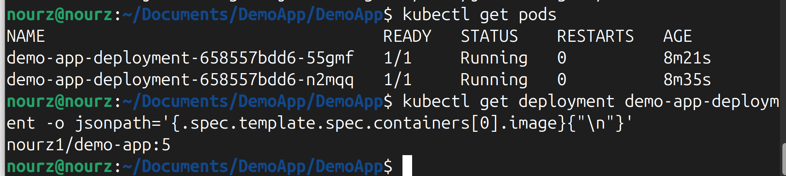

**2. Docker Hub:** the repository [`nourz1/demo-app`](https://hub.docker.com/r/nourz1/demo-app) carries tag **`5`**.

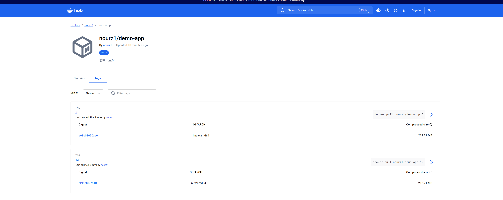

**3. The application:**

```bash
kubectl port-forward deploy/demo-app-deployment 18080:8080
curl http://127.0.0.1:18080/
```

```
Hello from Dockerized Spring Boot!
```

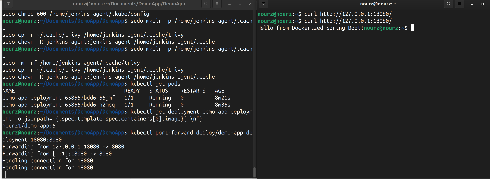

---

## Problems we hit and how we fixed them

| Problem | Symptom | Fix |
|---------|---------|-----|
| minikube was stopped | `kubectl get nodes` as the agent: `no route to host 192.168.49.2:8443` | `minikube start`, then refresh the agent's flattened kubeconfig |
| Trivy could not download its database (build #1) | `failed to download vulnerability DB: context deadline exceeded` at about 100 KiB/s | Pre-download the DB for the agent user: `sudo -u jenkins-agent trivy image --download-db-only --timeout 60m` (and `--download-java-db-only`), after copying `~/.cache/trivy` to `/home/jenkins-agent/.cache/trivy` |
| The agent user has its own Trivy cache | First scan on the agent tries to download everything again | Copy and refresh the cache for `jenkins-agent` (above) |
| Broken `Jenkinsfile` after pasting a heredoc | Commit showed 12 insertions and 34 deletions, file had no `post {}` | Rewrite the file with a Python script, then check it with `cat Jenkinsfile` |
| Shared library must be at the repo root | Jenkins only finds `vars/` at the root of the library repo | A separate repository `jenkins-shared-library` |
| Library URL must be HTTPS | The Jenkins container has no GitHub SSH key | Use `https://github.com/neiorz/jenkins-shared-library.git` |

## Known limitations

1. **The agent shares the host** with the Jenkins master container, so it is not isolated; a production agent would be a separate machine or container.
2. **`containerPort: 7070` in `deployment.yaml`**, but the app listens on 8080. It is only metadata, so the pod works, but it should be corrected.
3. **No Kubernetes Service**; the app is reached with `kubectl port-forward`.
4. **The Trivy scan does not block** (`--exit-code 0`); use `--exit-code 1` for a real gate.
5. **The deploy step does not wait for the rollout** (`kubectl rollout status` is missing).
6. **The library step names are fixed** to this app (image name, credential ID); a reusable library would take them as parameters.

## Cleanup

Remove the deployment:

```bash
kubectl delete deployment demo-app-deployment
```

Remove the agent node in Jenkins (**Manage Jenkins → Nodes → agent-1 → Delete Agent**), then remove the user and the key:

```bash
sudo userdel -r jenkins-agent
rm -f ~/jenkins_agent_key ~/jenkins_agent_key.pub
```

## Summary

- The pipeline now runs on a dedicated Jenkins agent, **`agent-1`**, connected over SSH.
- The three stages call the shared library steps **`buildApp`**, **`buildImage`** and **`deployOnK8s`**, so the `Jenkinsfile` stays short and the logic is reusable.
- Build **#5** went from source to a running Kubernetes deployment with image `nourz1/demo-app:5`, verified by the pods, the Docker Hub tag and the application response.
- Build #1 failed only because Trivy could not download its database in time; pre-downloading the DB for the agent user fixed it.
