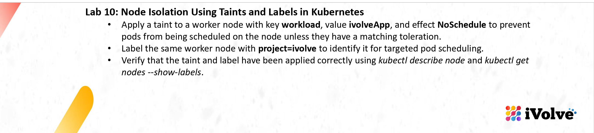
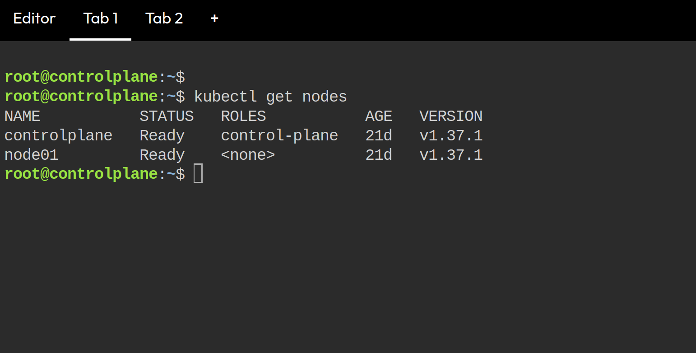
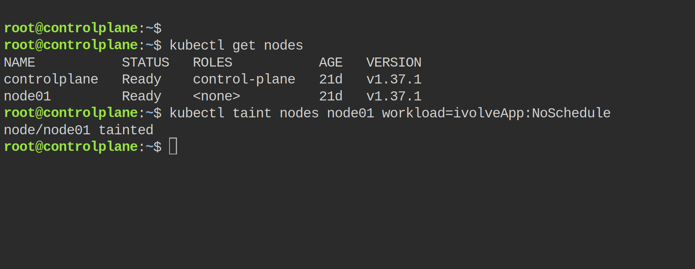
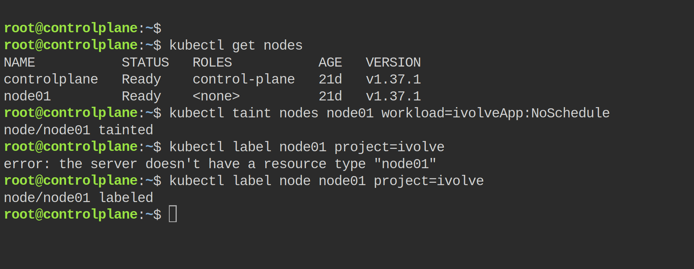
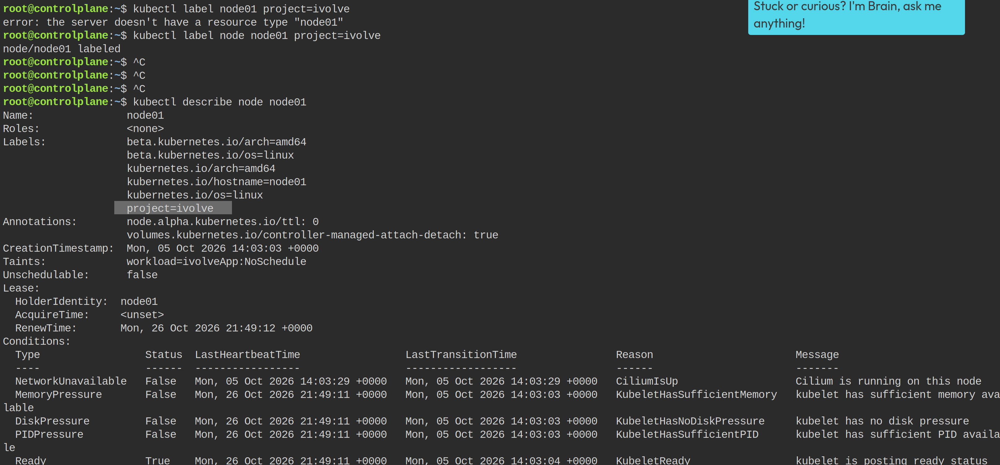
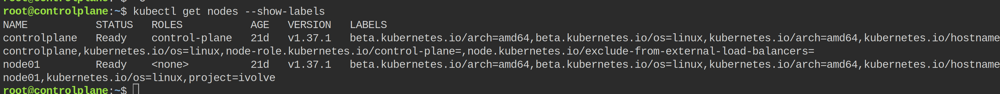

# Lab 10: Node Isolation Using Taints and Labels in Kubernetes



For this lab I opened a new Kubernetes playground on Killercoda. The cluster was already running there, `controlplane` and `node01`, both Ready. I did everything from the controlplane tab with kubectl, working on the worker node `node01`.

## Check the nodes first

```bash
kubectl get nodes
```



Both nodes Ready, Kubernetes v1.37.1.

## Taint the worker node

```bash
kubectl taint nodes node01 workload=ivolveApp:NoSchedule
```



It answered `node/node01 tainted`. From now pods without a matching toleration are not scheduled on node01.

## Label the worker node

```bash
kubectl label node node01 project=ivolve
```



First I forgot the word `node` in the command and got `error: the server doesn't have a resource type "node01"`. I added `node` and then it answered `node/node01 labeled`.

## Verify with kubectl describe node

```bash
kubectl describe node node01
```



In the output I can see both things:
- `Labels:` contains `project=ivolve`
- `Taints:` shows `workload=ivolveApp:NoSchedule`

## Verify with kubectl get nodes --show-labels

```bash
kubectl get nodes --show-labels
```



The labels column for node01 ends with `project=ivolve`, controlplane does not have it.

The taint and the label are both on the worker node, so the node isolation lab is done.
