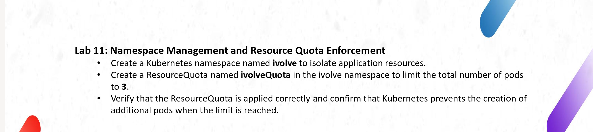
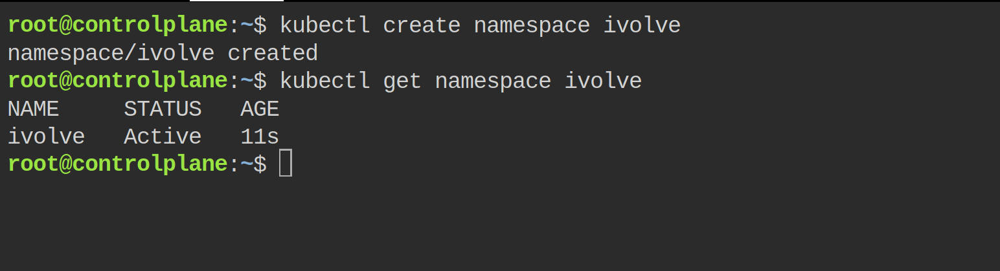
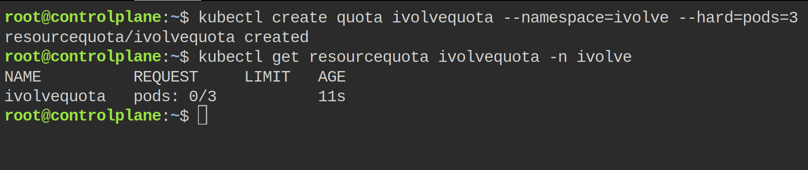
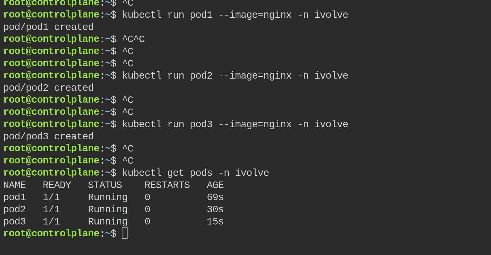
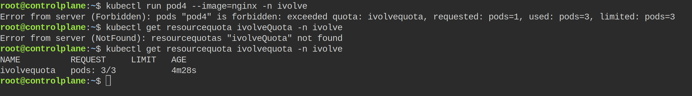

# Lab 11: Namespace Management and Resource Quota Enforcement



I did this lab in a new Kubernetes playground on Killercoda, from the controlplane tab. The idea: one namespace for the project, and a quota so this namespace can never hold more than 3 pods.

## Create the namespace

```bash
kubectl create namespace ivolve
kubectl get namespace ivolve
```



`namespace/ivolve created` and the status is `Active`.

## Create the ResourceQuota

```bash
kubectl create quota ivolvequota --namespace=ivolve --hard=pods=3
kubectl get resourcequota ivolvequota -n ivolve
```



The slide says the name is `ivolveQuota`, but Kubernetes only accepts lowercase names (I got the error `a lowercase RFC 1123 subdomain` when I tried it). So I created it as `ivolvequota`. It shows `pods: 0/3` — the limit is active from the start.

## Fill the quota with 3 pods

```bash
kubectl run pod1 --image=nginx -n ivolve
kubectl run pod2 --image=nginx -n ivolve
kubectl run pod3 --image=nginx -n ivolve
kubectl get pods -n ivolve
```



Three pods, all `Running`. The quota is full now.

## The 4th pod is refused

```bash
kubectl run pod4 --image=nginx -n ivolve
```



Kubernetes answers:

`Error from server (Forbidden): pods "pod4" is forbidden: exceeded quota: ivolvequota, requested: pods=1, used: pods=3, limited: pods=3`

And the quota itself shows `pods: 3/3`. (First I wrote `ivolveQuota` again in the get command and got `not found`, then the lowercase name showed the result.)

The namespace isolates the project and the quota stops it at 3 pods, so the lab is done.
