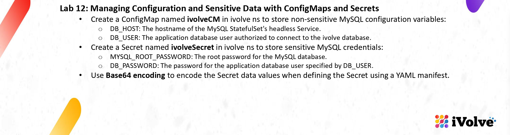
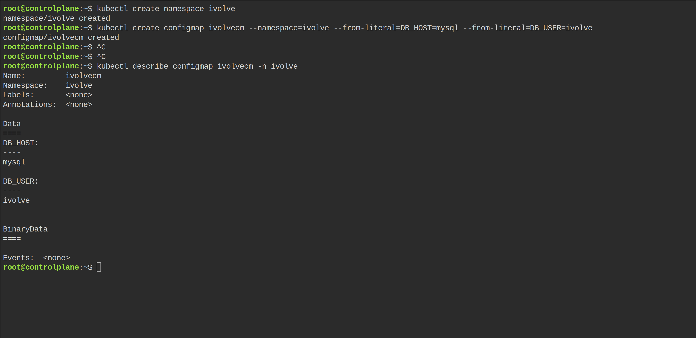
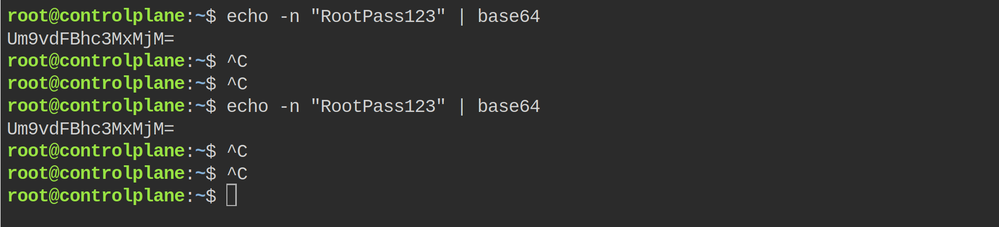
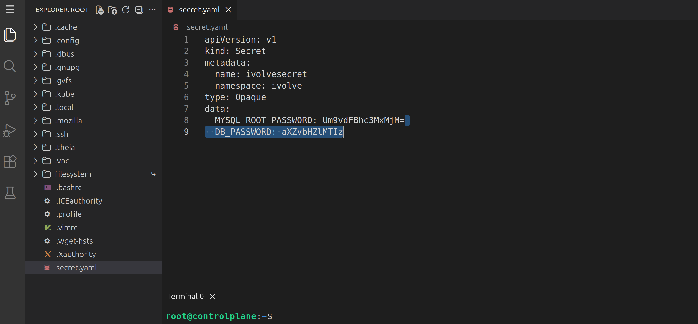
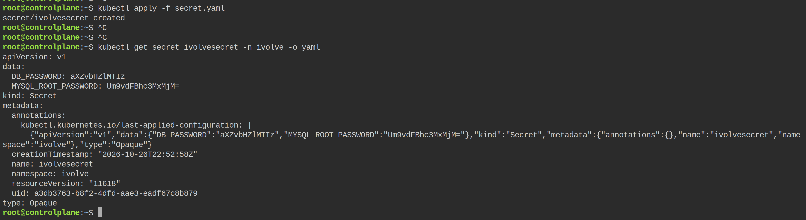

# Lab 12: Managing Configuration and Sensitive Data with ConfigMaps and Secrets



This playground was new, so I created the namespace first (`kubectl create namespace ivolve`, you can see it in the first picture). Then: the normal configuration goes into a ConfigMap, the passwords go into a Secret, and the Secret is written as a YAML file with Base64 values like the slide says.

## The ConfigMap

```bash
kubectl create configmap ivolvecm --namespace=ivolve --from-literal=DB_HOST=mysql --from-literal=DB_USER=ivolve
kubectl describe configmap ivolvecm -n ivolve
```



The `Data:` section shows:

- `DB_HOST: mysql` — the hostname of the headless Service of the MySQL StatefulSet
- `DB_USER: ivolve` — the application database user

The slide writes the name `ivolveCM`, but Kubernetes only accepts lowercase names, so the object is `ivolvecm`.

## Encode the passwords with Base64

```bash
echo -n "RootPass123" | base64
echo -n "ivolve123" | base64
```



The root password prints `Um9vdFBhc3MxMjM=`. The second command prints `aXZvbHZlMTIz`. These two strings are what go into the Secret file. (`-n` is important, without it the output would contain a hidden newline.)

## The Secret YAML manifest

I wrote the file `secret.yaml` in the editor of Killercoda:

```yaml
apiVersion: v1
kind: Secret
metadata:
  name: ivolvesecret
  namespace: ivolve
type: Opaque
data:
  MYSQL_ROOT_PASSWORD: Um9vdFBhc3MxMjM=
  DB_PASSWORD: aXZvbHZlMTIz
```



Both data values are Base64, not plain text — that is the difference with the ConfigMap. Again lowercase: the slide says `ivolveSecret`, the file says `ivolvesecret`.

## Create the Secret and verify

```bash
kubectl apply -f secret.yaml
kubectl get secret ivolvesecret -n ivolve -o yaml
```



`secret/ivolvesecret created`, and `-o yaml` shows the data back with exactly the same Base64 strings I put in the file, in the namespace `ivolve`, type `Opaque`.

ConfigMap holds the plain values, Secret holds the encoded passwords, both live in the `ivolve` namespace — lab done.
