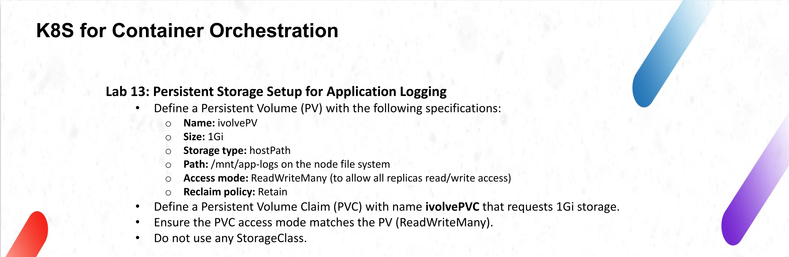
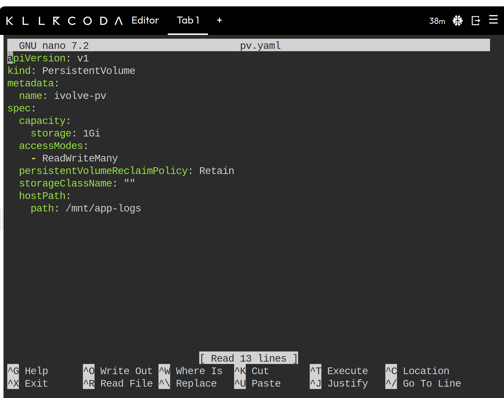
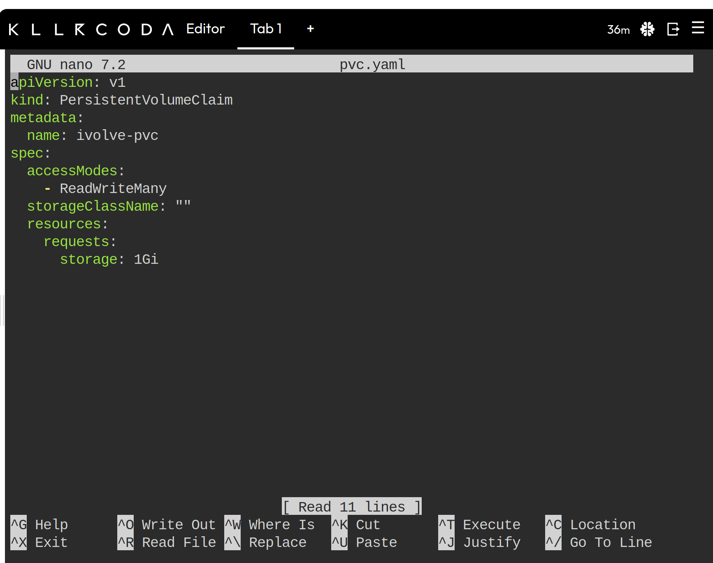
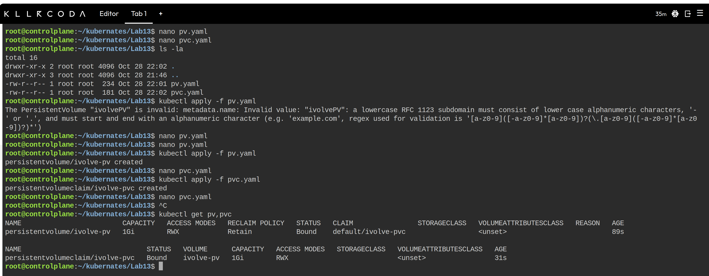

# Lab 13: Persistent Storage Setup for Application Logging



## Objective

Provision static storage for application logs using a PersistentVolume (PV) and bind it to a workload request through a PersistentVolumeClaim (PVC), as specified in the lab instructions above.

- Define a PV with the following specifications:
  - Size: 1Gi
  - Storage type: `hostPath`
  - Path: `/mnt/app-logs` on the node file system
  - Access mode: ReadWriteMany (RWX), to allow all replicas read/write access
  - Reclaim policy: Retain
- Define a PVC that requests 1Gi of storage.
- Ensure the PVC access mode matches the PV (ReadWriteMany).
- Do not use any StorageClass.
- Verify that the PVC binds to the PV and that both objects report a `Bound` status.

### Resource names

The lab instructions name the resources `ivolvePV` and `ivolvePVC`. Kubernetes rejects these names because resource names must be lowercase RFC 1123 subdomains (no uppercase characters). The resources were therefore created as:

| Lab instruction | Name used |
|-----------------|-----------|
| `ivolvePV` | `ivolve-pv` |
| `ivolvePVC` | `ivolve-pvc` |

## Concepts

| Resource | Scope | Purpose |
|----------|-------|---------|
| PersistentVolume | Cluster-wide | Represents a piece of storage provisioned by an administrator. It exists independently of any Pod. |
| PersistentVolumeClaim | Namespaced | A request for storage by a user or workload. The control plane matches it to a suitable PV. |

Binding is a one-to-one relationship. Once a PV is bound to a PVC, no other claim can use it until the claim is deleted and the PV is released and reclaimed according to its reclaim policy.

For a claim to bind to a PV, the following must match or be satisfied:

- The PV capacity must be greater than or equal to the PVC request.
- The PV must offer every access mode requested by the PVC.
- The `storageClassName` of both objects must be identical.

## Working Directory

All manifests were created in the lab directory on the control plane node:

```bash
root@controlplane:~/kubernates/Lab13$ ls -la
```

The directory contains two manifests:

- `pv.yaml`
- `pvc.yaml`

## Configuration Files

### pv.yaml

```yaml
apiVersion: v1
kind: PersistentVolume
metadata:
  name: ivolve-pv
spec:
  capacity:
    storage: 1Gi
  accessModes:
    - ReadWriteMany
  persistentVolumeReclaimPolicy: Retain
  storageClassName: ""
  hostPath:
    path: /mnt/app-logs
```



Field breakdown:

| Field | Value | Description |
|-------|-------|-------------|
| `kind` | `PersistentVolume` | Cluster-scoped storage resource. No namespace is set in the metadata. |
| `metadata.name` | `ivolve-pv` | Name of the volume. Must be a valid lowercase RFC 1123 subdomain (see the note on the first apply attempt below). |
| `spec.capacity.storage` | `1Gi` | Size of the volume. The claim must request this amount or less. |
| `spec.accessModes` | `ReadWriteMany` | The volume can be mounted read-write by multiple nodes at the same time. |
| `spec.persistentVolumeReclaimPolicy` | `Retain` | When the claim is deleted, the PV and its data are kept. The PV moves to `Released` and must be reclaimed manually before reuse. |
| `spec.storageClassName` | `""` | Empty string. The PV belongs to no StorageClass, so it is only eligible for claims that also set an empty class. |
| `spec.hostPath.path` | `/mnt/app-logs` | Directory on the node filesystem that backs the volume. |

Notes on this configuration:

- `hostPath` volumes are tied to a single node filesystem. They are suitable for single-node labs and testing, not for production multi-node clusters. In production, use a network-backed or CSI-backed storage type (NFS, CephFS, a cloud provider disk, and so on).
- The `ReadWriteMany` access mode is accepted by the API for a `hostPath` volume, but it does not provide cross-node sharing. All Pods using the volume must be scheduled on the node that hosts `/mnt/app-logs`.
- No `hostPath.type` is set, so no check is performed on the path before mounting.

### pvc.yaml

```yaml
apiVersion: v1
kind: PersistentVolumeClaim
metadata:
  name: ivolve-pvc
spec:
  accessModes:
    - ReadWriteMany
  storageClassName: ""
  resources:
    requests:
      storage: 1Gi
```



Field breakdown:

| Field | Value | Description |
|-------|-------|-------------|
| `kind` | `PersistentVolumeClaim` | Namespaced storage request. It was created in the `default` namespace. |
| `metadata.name` | `ivolve-pvc` | Name of the claim. Pods reference this name in `spec.volumes[].persistentVolumeClaim.claimName`. |
| `spec.accessModes` | `ReadWriteMany` | Must be offered by the target PV. |
| `spec.storageClassName` | `""` | Empty string. This disables dynamic provisioning and restricts the claim to PVs with no StorageClass. If the field were omitted, the cluster default StorageClass (if one exists) would be applied and the claim would not bind to `ivolve-pv`. |
| `spec.resources.requests.storage` | `1Gi` | Requested capacity. It matches the PV capacity exactly. |

## Implementation Steps

### 1. Create the PersistentVolume manifest

```bash
nano pv.yaml
```

Add the content shown in the `pv.yaml` section above.

### 2. Create the PersistentVolumeClaim manifest

```bash
nano pvc.yaml
```

Add the content shown in the `pvc.yaml` section above.

### 3. Confirm the files exist

```bash
ls -la
```

Observed output:

```text
total 16
drwxr-xr-x 2 root root 4096 Oct 28 22:02 .
drwxr-xr-x 3 root root 4096 Oct 28 21:46 ..
-rw-r--r-- 1 root root  234 Oct 28 22:01 pv.yaml
-rw-r--r-- 1 root root  181 Oct 28 22:02 pvc.yaml
```

### 4. Apply the PersistentVolume

```bash
kubectl apply -f pv.yaml
```

The first attempt failed. The PV name had been set to `ivolvePV`, which contains uppercase characters:

```text
The PersistentVolume "ivolvePV" is invalid: metadata.name: Invalid value: "ivolvePV": a lowercase RFC 1123 subdomain must consist of lower case alphanumeric characters, '-' or '.', and must start and end with an alphanumeric character (e.g. 'example.com', regex used for validation is '[a-z0-9]([-a-z0-9]*[a-z0-9])?(\.[a-z0-9]([-a-z0-9]*[a-z0-9])?)*')
```

Kubernetes resource names must be lowercase alphanumeric characters, `-` or `.`, and must start and end with an alphanumeric character. The name was changed to `ivolve-pv` in `pv.yaml`:

```bash
nano pv.yaml
```

The apply was then repeated:

```bash
kubectl apply -f pv.yaml
```

Output:

```text
persistentvolume/ivolve-pv created
```

### 5. Apply the PersistentVolumeClaim

```bash
kubectl apply -f pvc.yaml
```

Output:

```text
persistentvolumeclaim/ivolve-pvc created
```

## Verification

List both resources in a single command:

```bash
kubectl get pv,pvc
```

Observed output:

```text
NAME                          CAPACITY   ACCESS MODES   RECLAIM POLICY   STATUS   CLAIM                STORAGECLASS   VOLUMEATTRIBUTESCLASS   REASON   AGE
persistentvolume/ivolve-pv    1Gi        RWX            Retain           Bound    default/ivolve-pvc                  <unset>                          89s

NAME                               STATUS   VOLUME      CAPACITY   ACCESS MODES   STORAGECLASS   VOLUMEATTRIBUTESCLASS   AGE
persistentvolumeclaim/ivolve-pvc   Bound    ivolve-pv   1Gi        RWX                           <unset>                 31s
```



Interpretation of the output:

| Check | Observed | Result |
|-------|----------|--------|
| PV status | `Bound` | The PV has been claimed. |
| PV `CLAIM` column | `default/ivolve-pvc` | The PV is bound to the claim `ivolve-pvc` in the `default` namespace. |
| PVC status | `Bound` | The claim has been matched to a volume. |
| PVC `VOLUME` column | `ivolve-pv` | The claim points back to the PV, confirming a two-way binding. |
| Capacity | `1Gi` on both | Request and provisioned size match. |
| Access modes | `RWX` on both | ReadWriteMany is satisfied. |
| Reclaim policy | `Retain` | Data is preserved if the claim is deleted. |
| StorageClass | empty on both | Static binding, no dynamic provisioning involved. |

The PVC moved to `Bound` immediately after creation because a PV with matching capacity, access mode, and storage class was already available.

## Useful Commands

Inspect the details and events of each object:

```bash
kubectl describe pv ivolve-pv
kubectl describe pvc ivolve-pvc
```

Delete the resources. The claim must be deleted before the volume. With the `Retain` policy, the PV remains in the `Released` state afterwards and must be removed or reclaimed manually:

```bash
kubectl delete pvc ivolve-pvc
kubectl delete pv ivolve-pv
```

## Summary

- A statically provisioned 1Gi `hostPath` PersistentVolume (`ivolve-pv`) was created with RWX access and the `Retain` reclaim policy.
- A PersistentVolumeClaim (`ivolve-pvc`) requesting 1Gi with RWX access was created in the `default` namespace.
- Both objects use an empty `storageClassName`, which forces static binding.
- `kubectl get pv,pvc` confirmed that both resources are in the `Bound` state.
- An invalid resource name (`ivolvePV`) was rejected by API validation and corrected to `ivolve-pv`.
