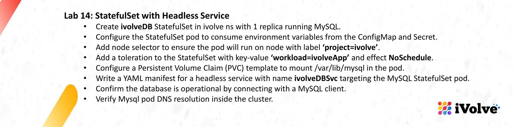
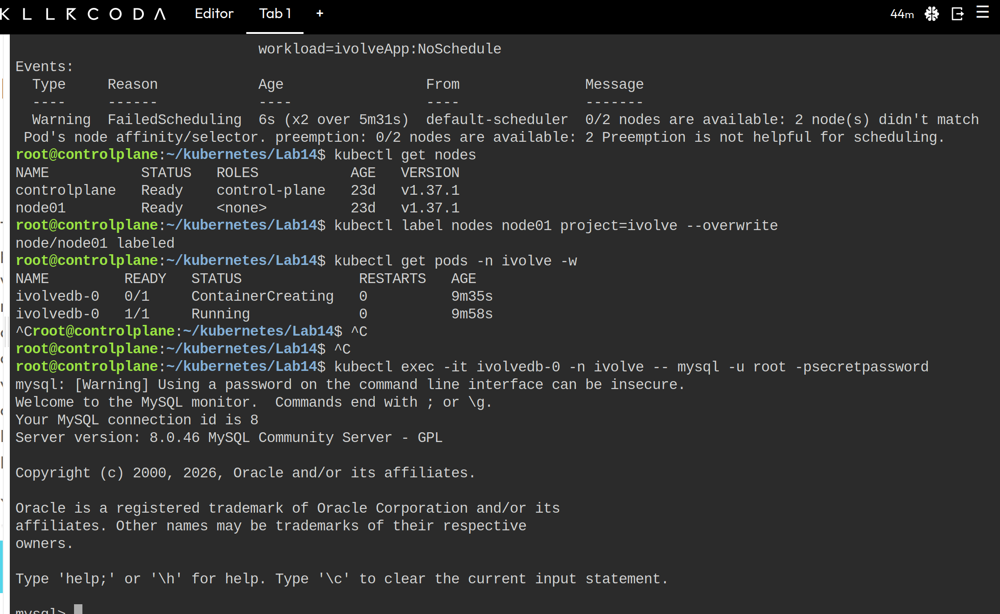

# Lab 14: StatefulSet with Headless Service



## Objective

Deploy a single-replica MySQL StatefulSet in the `ivolve` namespace with:

- Environment variables sourced from the ConfigMap and Secret created in Lab 12
- A `nodeSelector` pinning the pod to nodes labeled `project=ivolve`
- A toleration for `workload=ivolveApp:NoSchedule`
- A `volumeClaimTemplate` mounted at `/var/lib/mysql`
- A headless Service targeting the StatefulSet pod

Then confirm the database accepts client connections and that the pod resolves through cluster DNS.

## Prerequisites

The ConfigMap and Secret from Lab 12 must exist in the `ivolve` namespace:

```bash
kubectl get configmap,secret -n ivolve
```

This lab assumes the names `ivolvecm` and `ivolvesecret`. Adjust the manifest if yours differ. The Secret must contain `MYSQL_ROOT_PASSWORD`, which the MySQL image requires on first start.

Kubernetes names must be lowercase, so `ivolveDB` and `ivolveDBSvc` from the lab instructions are created as `ivolvedb` and `ivolvedbsvc`.

## Manifest

All resources are defined in a single file, `mysql-statefulset.yaml`.

```yaml
apiVersion: v1
kind: Service
metadata:
  name: ivolvedbsvc
  namespace: ivolve
spec:
  clusterIP: None
  selector:
    app: ivolve-mysql
  ports:
    - name: mysql
      port: 3306
---
apiVersion: apps/v1
kind: StatefulSet
metadata:
  name: ivolvedb
  namespace: ivolve
spec:
  serviceName: ivolvedbsvc
  replicas: 1
  selector:
    matchLabels:
      app: ivolve-mysql
  template:
    metadata:
      labels:
        app: ivolve-mysql
    spec:
      nodeSelector:
        project: ivolve
      tolerations:
        - key: workload
          operator: Equal
          value: ivolveApp
          effect: NoSchedule
      containers:
        - name: mysql
          image: mysql:8.0
          envFrom:
            - configMapRef:
                name: ivolvecm
            - secretRef:
                name: ivolvesecret
          ports:
            - name: mysql
              containerPort: 3306
          volumeMounts:
            - name: mysql-data
              mountPath: /var/lib/mysql
  volumeClaimTemplates:
    - metadata:
        name: mysql-data
      spec:
        accessModes: ["ReadWriteOnce"]
        resources:
          requests:
            storage: 1Gi
```

| Section | Purpose |
|---------|---------|
| `Service` with `clusterIP: None` | Headless Service. No virtual IP is allocated. DNS returns the pod IPs directly and gives each StatefulSet pod a stable name. |
| `serviceName` | Links the StatefulSet to the headless Service. Required for per-pod DNS records. |
| `envFrom` | Injects every key of the ConfigMap and Secret as environment variables. `MYSQL_ROOT_PASSWORD` is consumed by the MySQL image. Other keys (such as `DB_HOST`) are injected but ignored by the image. |
| `nodeSelector` | Restricts scheduling to nodes labeled `project=ivolve`. |
| `tolerations` | Allows scheduling on nodes tainted with `workload=ivolveApp:NoSchedule`. A toleration permits scheduling on a tainted node but does not force it. |
| `volumeClaimTemplates` | Creates one PVC per replica (`mysql-data-ivolvedb-0`) that is retained across pod restarts. |

## Implementation

Create the namespace if it does not already exist:

```bash
kubectl create namespace ivolve --dry-run=client -o yaml | kubectl apply -f -
```

Create the manifest and apply it:

```bash
nano mysql-statefulset.yaml
kubectl apply -f mysql-statefulset.yaml
```

At this point the pod stays `Pending`. No node carries the `project=ivolve` label, so the `nodeSelector` cannot be satisfied. Confirm the reason in the pod events:

```bash
kubectl describe pod ivolvedb-0 -n ivolve
```

Label the worker node and watch the pod start:

```bash
kubectl get nodes
kubectl label nodes node01 project=ivolve --overwrite
kubectl get pods -n ivolve -w
```

## Verification

### Pod, PVC, and Service

```bash
kubectl get pods,pvc,svc -n ivolve
```

Expected result: `ivolvedb-0` is `1/1 Running`, `mysql-data-ivolvedb-0` is `Bound`, and `ivolvedbsvc` has `CLUSTER-IP` set to `None`.

### MySQL client connection

The root password is read from the container environment, which confirms it was injected from the Secret:

```bash
kubectl exec -it ivolvedb-0 -n ivolve -- sh -c 'mysql -u root -p"$MYSQL_ROOT_PASSWORD"'
```



### DNS resolution

Resolve the pod through the headless Service from a temporary pod inside the cluster:

```bash
kubectl run dns-test -n ivolve --rm -it --image=busybox:1.28 --restart=Never -- nslookup ivolvedb-0.ivolvedbsvc.ivolve.svc.cluster.local
kubectl run dns-test -n ivolve --rm -it --image=busybox:1.28 --restart=Never -- nslookup ivolvedbsvc.ivolve.svc.cluster.local
```

Expected result: both lookups return the IP address of `ivolvedb-0`. The pod-specific name resolves to that one pod. The Service name resolves to the set of ready pod IPs because the Service is headless.

The pod FQDN follows the format `<pod>.<service>.<namespace>.svc.cluster.local`.

## Notes

- The PVC template does not set `storageClassName`, so the cluster default StorageClass provisions the volume dynamically. Setting `storageClassName: ""` disables dynamic provisioning, and the PVC stays `Pending` unless a matching PersistentVolume already exists.
- The StatefulSet does not delete its PVCs when scaled down or deleted. Remove `mysql-data-ivolvedb-0` manually when the data is no longer needed.
- Lab 12 sets `DB_HOST=mysql` in the ConfigMap. Clients that read this value will not reach this database unless it is changed to `ivolvedbsvc`.
