# Lab 15: Node.js Application Deployment with ClusterIP Service

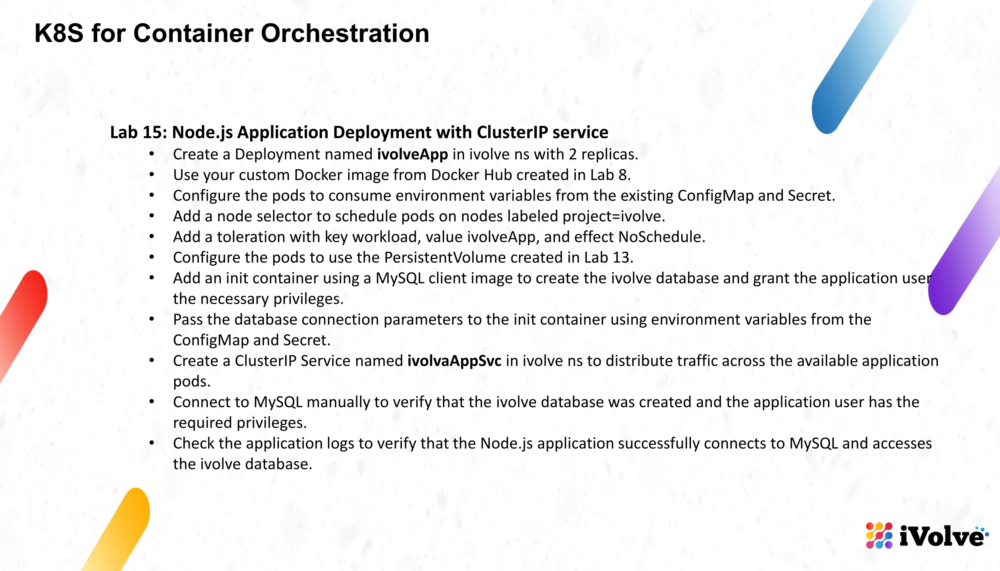

This is the last lab of the Kubernetes track, and it brings everything from labs 10 to 14 together: the isolated node, the namespace with its quota, the ConfigMap and Secret, the PersistentVolume and the MySQL StatefulSet. On top of that it adds the actual application Deployment and a ClusterIP Service in front of it.

The playground where the earlier labs were done had already expired, so the state of labs 10-14 was rebuilt first, using the two manifests in this folder, and then lab 15 was applied on top of it.

## Objective

- Create a Deployment named `ivolveApp` in the `ivolve` namespace with 2 replicas.
- Use the custom Docker image from Docker Hub built in lab 8 (`nourz1/ivolve-app`).
- Feed the pods with environment variables from the existing ConfigMap and Secret.
- Add a node selector for nodes labeled `project=ivolve`.
- Add a toleration for `workload=ivolveApp` with effect `NoSchedule`.
- Mount the PersistentVolume from lab 13 so the application logs land on it.
- Add an init container with a MySQL client image that creates the `ivolve` database and gives the application user the privileges it needs.
- Pass the connection parameters to that init container through the ConfigMap and the Secret.
- Create a ClusterIP Service named `ivolveAppSvc` that spreads traffic over the application pods.
- Connect to MySQL manually to confirm the database and the grants.
- Check the application logs to confirm the Node.js app reaches MySQL and finds the `ivolve` database.

## Folder contents

| File | Purpose |
|------|---------|
| `prereqs.yaml` | Namespace, ResourceQuota, ConfigMap, Secret, PersistentVolume and PersistentVolumeClaim (labs 11, 12 and 13) |
| `mysql.yaml` | MySQL StatefulSet and its headless Service (lab 14) |
| `app.yaml` | The lab 15 Deployment and ClusterIP Service |
| `rebuild.sh` | Applies everything above in the right order |

## 1. Rebuilding the prerequisites

### 1.1 Node taint and label (lab 10)

The node was isolated in lab 10 and nothing else can run on it without the matching toleration, so the node setup comes first. The commands run on `controlplane`.

```bash
kubectl taint nodes node01 workload=ivolveApp:NoSchedule --overwrite
kubectl label node node01 project=ivolve --overwrite
```

### 1.2 The prerequisite manifest (labs 11, 12 and 13)

One file holds the objects from the three labs: the `ivolve` namespace, the `ivolvequota` limit of 3 pods, the `ivolvecm` ConfigMap, the `ivolvesecret` Secret, the `ivolve-pv` hostPath volume and the `ivolve-pvc` claim. It was written in the editor as `prereqs.yaml`.

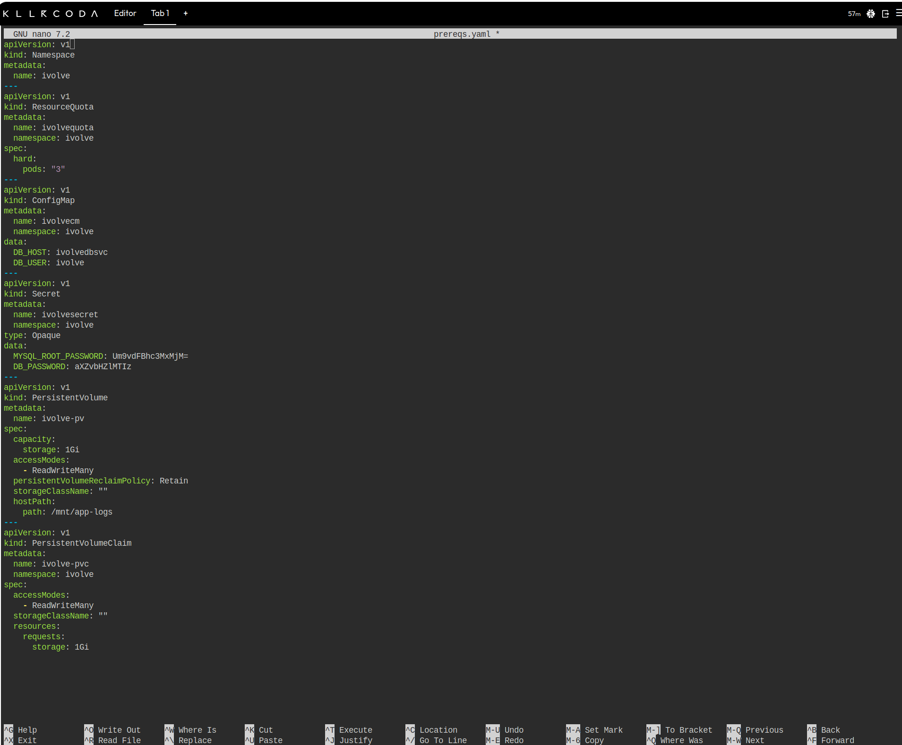

Two details changed compared to the older labs, both on purpose:

- `DB_HOST` is now `ivolvedbsvc`, the headless Service of the database, instead of `mysql`. That is the name that actually resolves inside the cluster (this was already noted at the end of lab 14).
- `ivolve-pvc` now lives in the `ivolve` namespace instead of `default`. A claim is namespaced and a pod can only mount a claim from its own namespace, so the claim had to move. The volume itself is cluster-wide, so it is still the same `ivolve-pv` from lab 13, and it binds to the new claim because the capacity, the access mode and the empty storage class all match.

### 1.3 MySQL StatefulSet (lab 14)

The database comes back exactly as in lab 14, from `mysql.yaml`: the headless Service `ivolvedbsvc` and the one-replica StatefulSet `ivolvedb` with the selector, the toleration, the environment from the ConfigMap and Secret, and the claim template mounted at `/var/lib/mysql`.

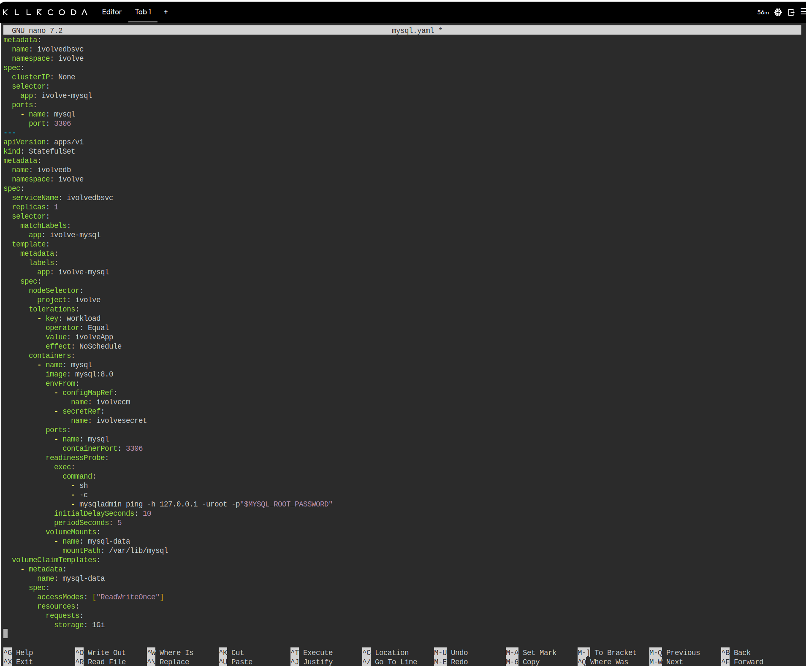

It is applied before the application because the init container of the deployment needs a running database.

```bash
kubectl apply -f prereqs.yaml
kubectl apply -f mysql.yaml
kubectl rollout status statefulset/ivolvedb -n ivolve --timeout=240s
```

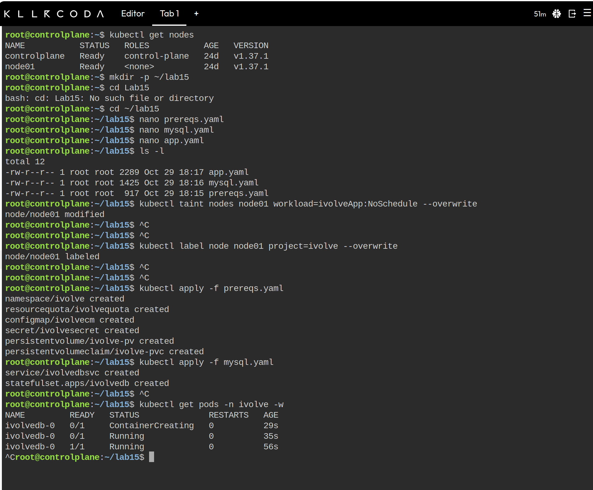

The first line of that frame is a small mistake worth keeping: `cd Lab15` failed because the folder did not exist yet, the next command created it as `~/lab15`. After that the taint and the label returned `node/node01 modified` and `node/node01 labeled`, the six prerequisite objects were created in one apply, and the StatefulSet went from `ContainerCreating` to `1/1 Running` in under a minute.

### 1.4 Result of the rebuild

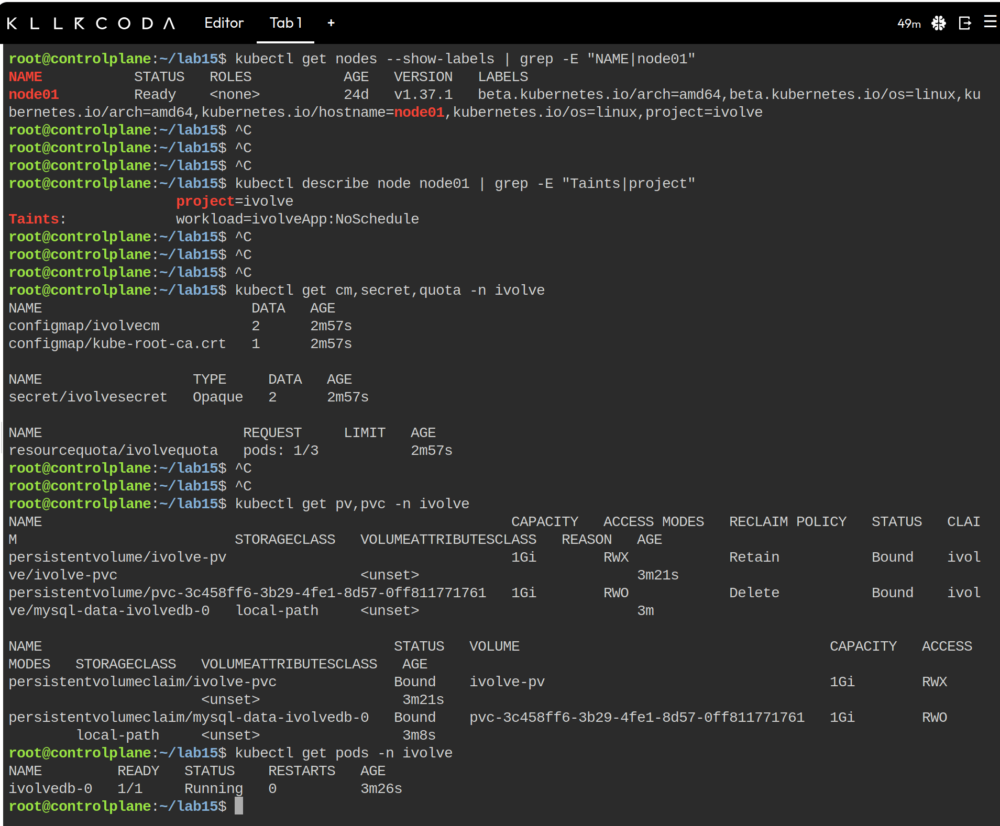

In that frame the namespace already holds the six objects from the apply: `ivolvecm` with two keys, `ivolvesecret` with two, the quota counter at `pods: 1/3`, `ivolve-pvc` bound to `ivolve-pv`, and `mysql-data-ivolvedb-0` bound through the default `local-path` class. `ivolvedb-0` is `1/1 Running`, which is the signal that the database is ready for the application.

## 2. The Deployment

Everything for this lab is in `app.yaml`. The names are lowercased (`ivolveapp`, `ivolveappsvc`) because Kubernetes does not accept the camel case spelling used on the slide.

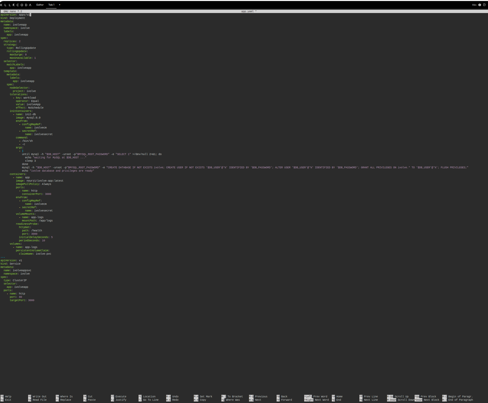

Key parts of the manifest:

| Part | What it does |
|------|--------------|
| `replicas: 2` | Two application pods, as the slide asks. |
| `strategy.maxSurge: 0` | A rolling update must not create a fourth pod. The quota in the namespace is 3 pods and the database already uses one of them, so a surge pod would be rejected. |
| `initContainers.init-db` | Runs before the application container. It uses `mysql:8.0` as the client (the same image as the server, so nothing new is pulled) and loops until the database accepts connections. |
| init container `envFrom` | Gets `DB_HOST`, `DB_USER`, `MYSQL_ROOT_PASSWORD` and `DB_PASSWORD` from the ConfigMap and the Secret. Nothing is hardcoded. |
| init container commands | `CREATE DATABASE IF NOT EXISTS ivolve`, then `CREATE USER`/`ALTER USER` for `DB_USER` with `DB_PASSWORD`, then `GRANT ALL PRIVILEGES ON ivolve.*` and `FLUSH PRIVILEGES`. |
| `nodeSelector` | `project: ivolve` - only nodes carrying that label. |
| `tolerations` | `workload=ivolveApp:NoSchedule` - allows the pods on the tainted node. |
| `envFrom` on the app container | The same ConfigMap and Secret, which is exactly the set of variables the Node.js code reads. |
| `volumes` / `volumeMounts` | `ivolve-pvc` is mounted at `/app/logs`, the path morgan writes `access.log` to. |
| `readinessProbe` | Hits `/health` on port 3000, which runs a real query through the app's database connection. |
| Service `ivolveappsvc` | Type `ClusterIP`, port 80 forwarded to the container port 3000, selected by `app: ivolveapp`. |

## 3. Create the Deployment and the Service

```bash
kubectl apply -f app.yaml
kubectl rollout status deployment/ivolveapp -n ivolve --timeout=240s
```

Both pods go through the init container, then start the application. The expected layout in the namespace is:

- `ivolvedb-0` - the database
- `ivolveapp-...` two pods - the application
- three pods in total, which is exactly the quota limit

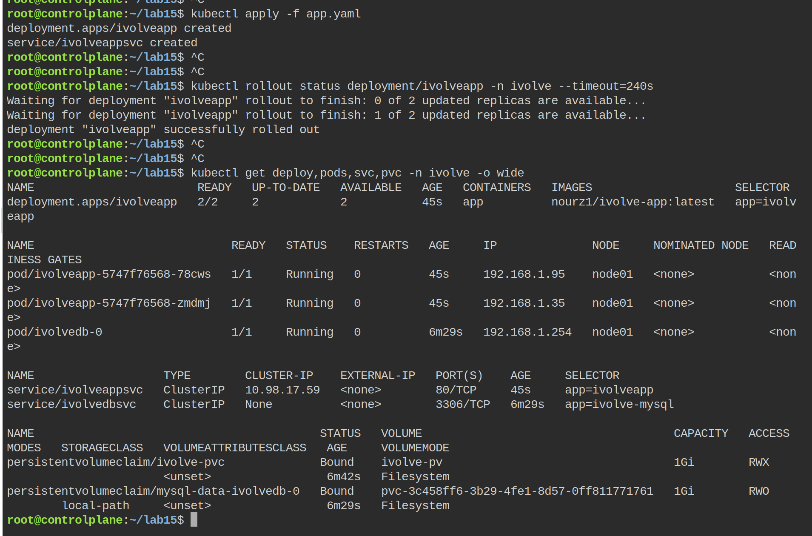

The `kubectl get` output confirms three things at once: the Deployment shows `2/2` ready, both application pods are `Running` on `node01` (the only node that satisfies the selector and the toleration), and `ivolveappsvc` has a real cluster IP while `ivolvedbsvc` still shows `None` because it is headless.

## 4. The init container

```bash
kubectl get pod -n ivolve -l app=ivolveapp
kubectl logs -n ivolve -l app=ivolveapp -c init-db --prefix
```

The pod names contain a random suffix, so the second command selects the pods by label instead of by name, and `--prefix` keeps the output of the two init containers apart.

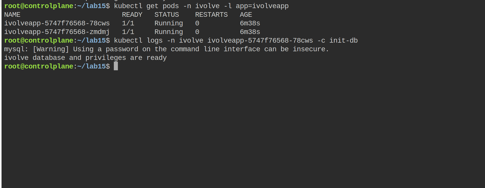

The first line is the `mysql` client warning about the password on the command line, not an error. Then the last line confirms that the whole block ran: the database was created and the privileges were granted. The `waiting for MySQL at ivolvedbsvc ...` line only appears when the database pod is still starting; here the StatefulSet was already ready, so the loop was skipped and the init container finished in one pass. The `Restarts` column of both application pods stays at `0`, which is the sign that the init container succeeded before the app started.

## 5. Verify MySQL manually

Log into the database with the application user, using the password that the Secret puts into the environment:

```bash
kubectl exec -it ivolvedb-0 -n ivolve -- sh -c \
  'mysql -u "$DB_USER" -p"$DB_PASSWORD" -e "SHOW DATABASES; SHOW GRANTS;"'
```

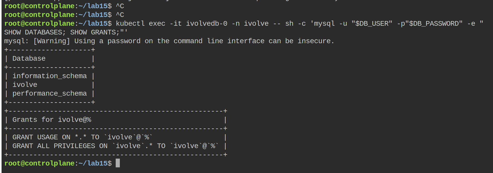

Two results are important here: `ivolve` is listed, so the init container really created it, and `SHOW GRANTS` lists `GRANT ALL PRIVILEGES ON \`ivolve\`.* TO \`ivolve\`@\`%\``, which is the privilege the application needs to create its own tables.

## 6. Application logs

```bash
kubectl logs -n ivolve deploy/ivolveapp --tail=20
```

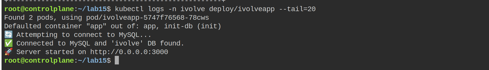

The Node.js app tries the connection, finds the `ivolve` database and only then starts listening on port 3000. If the database were missing, the same log would repeat the "database not found, retrying" message every five seconds instead.

## 7. The ClusterIP Service

The Service is only reachable inside the cluster, so the port is forwarded to the controlplane and tested from there:

```bash
kubectl port-forward -n ivolve svc/ivolveappsvc 8080:80 &
curl -s http://localhost:8080/health
kubectl get endpoints ivolveappsvc -n ivolve
```

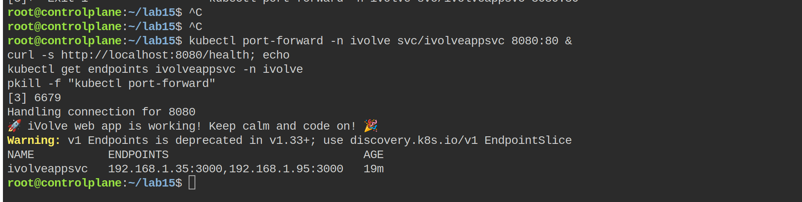

`/health` executes `SELECT 1` on the application's own connection, so a positive answer proves the whole chain: Service, pod, Node.js and MySQL. The endpoints object lists the two pod IPs behind the service, which is what makes the ClusterIP spread the requests over both replicas.

On Kubernetes 1.33 and newer, `kubectl get endpoints` also prints `Warning: v1 Endpoints is deprecated in v1.33+; use discovery.k8s.io/v1 EndpointSlice`. It is only a deprecation notice; the same two addresses are listed with `kubectl get endpointslice -n ivolve -l kubernetes.io/service-name=ivolveappsvc`.

The port-forward runs in the background, so it has to be stopped before the next test. `kill %1` only works when it is the first background job of that shell; otherwise use `pkill -f "kubectl port-forward"`.

## 8. Logs on the PersistentVolume

The application writes its access log to `/app/logs`, which is the claim from lab 13:

```bash
kubectl exec -n ivolve deploy/ivolveapp -- ls -l /app/logs
kubectl exec -n ivolve deploy/ivolveapp -- tail -3 /app/logs/access.log
```

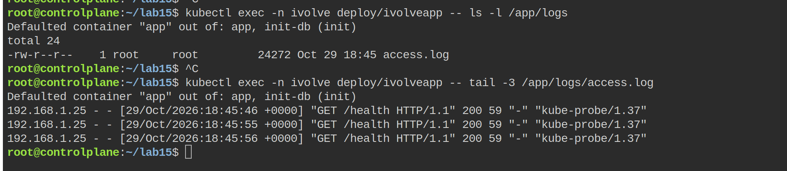

The file persists outside the container, on the node at `/mnt/app-logs`. Both replicas mount the same ReadWriteMany claim, so the entries from both pods land in the same file, which is exactly why lab 13 asked for RWX. The three visible lines are the readiness probe calls to `/health`, arriving every ten seconds from the kubelet (`kube-probe/1.37`); the browser and curl requests from the service test are in the same file further up.

## 9. Final state

```bash
kubectl get all -n ivolve
kubectl describe pod -n ivolve -l app=ivolveapp | grep -E "Node:|Node-Selectors|Tolerations"
```

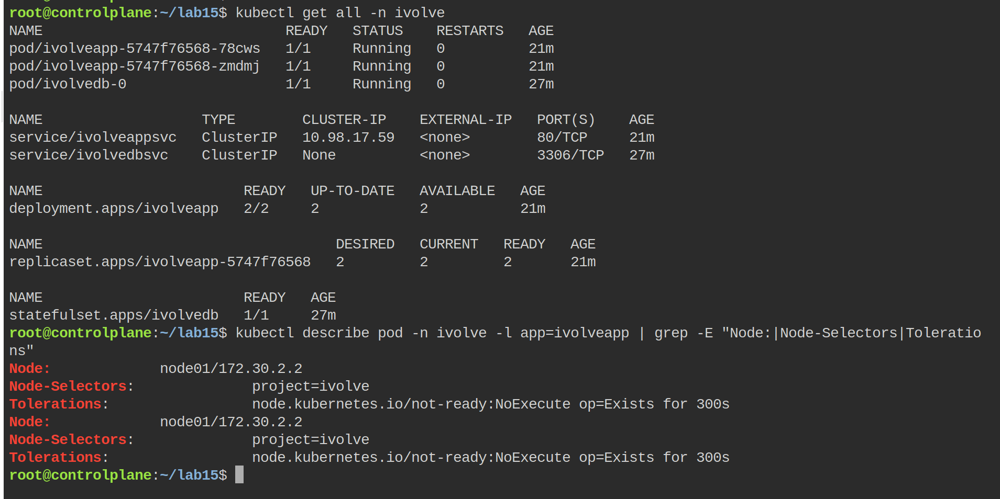

The pods sit on `node01` and the `Node-Selectors` line shows `project=ivolve`, which is the label added in lab 10. The `grep` only prints the first line of the tolerations block, the kubelet's own `not-ready` entry; `grep -A3 "Tolerations"` prints the whole block, and the last line of it is `workload=ivolveApp:NoSchedule`, the toleration from the manifest.

The `get all` output also shows the two ReplicaSets and the StatefulSet, so the whole chain of objects created across labs 12 to 15 is visible in one frame.

## Problems and notes

- The quota allows exactly 3 pods, and the lab uses all 3. That also means no extra pod can be started in the namespace, so quick test pods (the `dns-test` and `curl` containers used in earlier labs) are rejected. The health check was done with `port-forward` and with `wget` from inside an existing pod instead.
- A Deployment update would normally start a new pod before removing the old one. With a 3-pod quota that fourth pod is refused and the rollout stalls, so `maxSurge` is set to `0`.
- The init container connects as `root` from another pod, which needs `root@'%'` in MySQL. The official image creates that account when `MYSQL_ROOT_PASSWORD` is set, and lab 14 already proved the root password arrives through the Secret. If a database were created without that account, the init container would fail with an access denied error and the grant would have to be made from inside the database pod.
- `mysql:8.0` is used for the init container so the image is already present on the node from lab 14 and the pods start faster.
- The `hostPath` directory `/mnt/app-logs` does not have to exist beforehand; the kubelet creates it on the node when the first pod mounts the volume, and the containers run as root so they can write to it.
- The image on Docker Hub must stay public, otherwise the pods stop in `ImagePullBackOff` and an image pull secret has to be added to the pod template.

## Cleanup

```bash
kubectl delete -f app.yaml
kubectl delete -f mysql.yaml
kubectl delete -f prereqs.yaml
```

The claims are deleted with the manifests, but the `Retain` policy keeps `ivolve-pv` and its data. It has to be removed separately:

```bash
kubectl delete pv ivolve-pv
```

## Summary

- The state from labs 10-14 was rebuilt first: tainted and labeled node, namespace with a 3-pod quota, ConfigMap and Secret, PV and PVC, MySQL StatefulSet behind a headless Service.
- The Deployment `ivolveapp` runs two replicas of `nourz1/ivolve-app`, pinned to `node01` by the selector and allowed there by the toleration, with all its configuration coming from the ConfigMap and the Secret.
- An init container creates the `ivolve` database and grants the application user full rights on it before the app starts.
- The application logs prove the Node.js process connects to MySQL and finds the database, and `/health` through the ClusterIP Service proves the traffic path from the Service to the pods.
- The access log lives on the PersistentVolume from lab 13, shared by both replicas.
