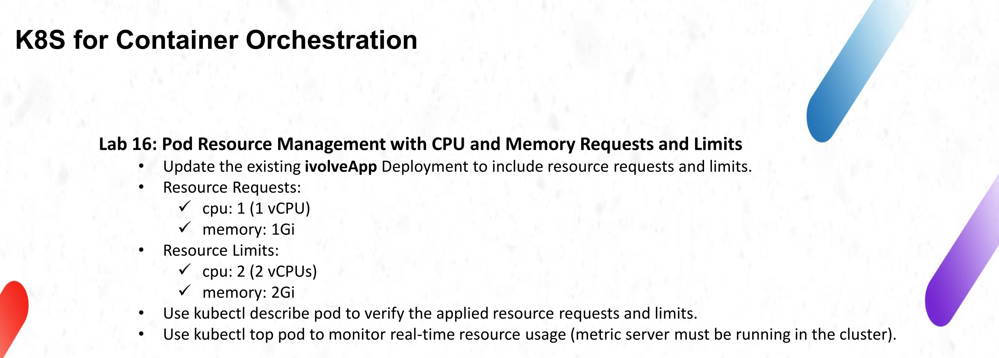
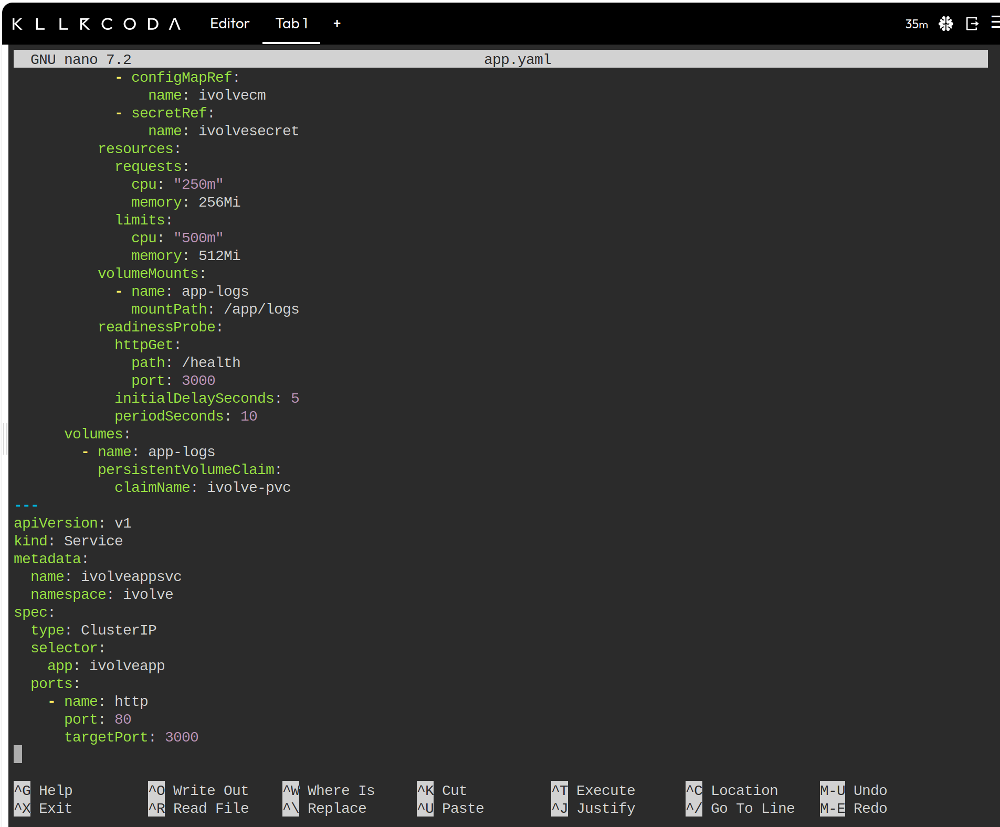
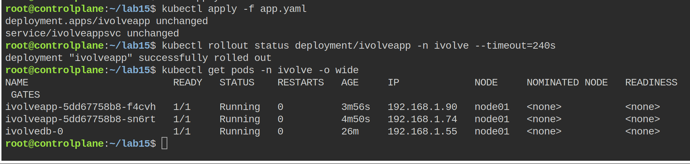
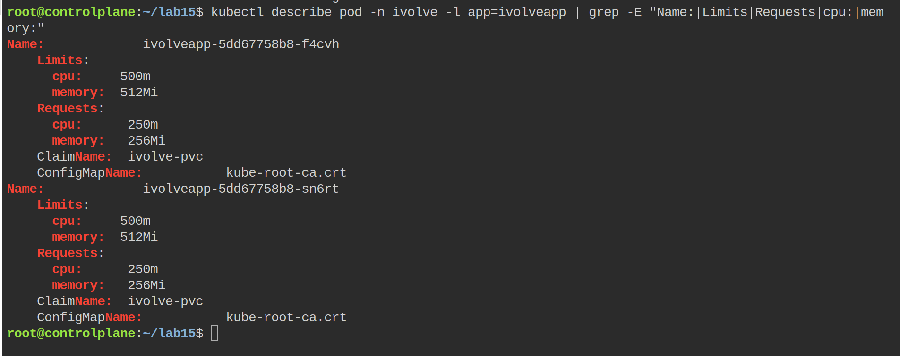
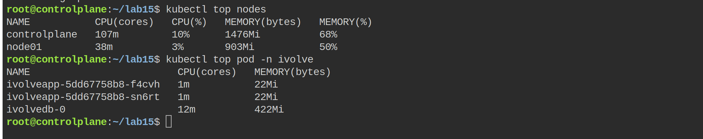
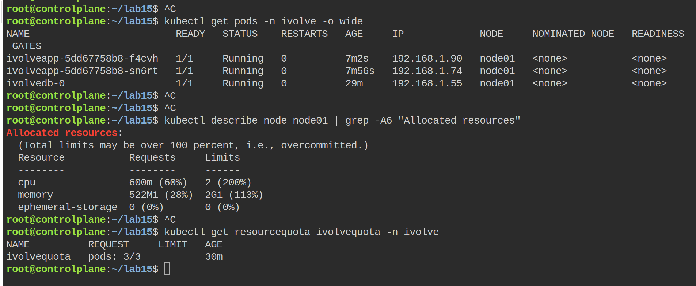

# Lab 16: Pod Resource Management with CPU and Memory Requests and Limits



The Deployment from lab 15 was already running, so this lab is an update instead of a new workload: the same `ivolveapp` pods get explicit CPU and memory requests and limits, then the result is checked with `kubectl describe pod` and `kubectl top pod`.

The slide asks for `1` CPU and `1Gi` of requests, and `2` CPU and `2Gi` of limits. Those numbers do not fit the Killercoda cluster used for this track, so they were scaled down by a factor of four and the ratio between requests and limits was kept at 2x. The reasoning is in the first section below.

## The size problem on this playground

The worker node is small:

```text
Capacity:
  cpu:                1
  memory:             1948912Ki
Allocatable:
  cpu:                1
  memory:             1846512Ki
```

The node also already has about `100m` of CPU reserved by the CNI daemonset, so roughly `900m` are free. One pod with a `1` CPU request does not fit in `900m`, and two replicas would need `2` CPU and `2Gi` on a node that has `1` CPU and `1.76Gi` in total. With the exact numbers from the slide both pods would stay `Pending` with `Insufficient cpu` and the application would go offline, which proves nothing about the limits.

The same values scaled by four:

| | Slide | Applied here | Ratio kept |
|---|---|---|---|
| `requests.cpu` | `1` | `250m` | 1/4 of a vCPU |
| `requests.memory` | `1Gi` | `256Mi` | 1/4 |
| `limits.cpu` | `2` | `500m` | 2x the request |
| `limits.memory` | `2Gi` | `512Mi` | 2x the request |

Two replicas now request `500m` and `512Mi` in total, which fits the node, and each container can still burst to twice its request before it is throttled, exactly like the slide describes on a bigger machine.

## Where the block goes

The values are added under the application container in the pod template, next to `envFrom`. The init container keeps no requests: it only runs once, before the app starts.

```yaml
          resources:
            requests:
              cpu: "250m"
              memory: 256Mi
            limits:
              cpu: "500m"
              memory: 512Mi
```



What each field means for this pod:

| Field | Value | Effect |
|-------|-------|--------|
| `requests.cpu` | `250m` | The scheduler reserves a quarter of a vCPU per pod. Two pods need `500m`, which the node has. |
| `requests.memory` | `256Mi` | A quarter of a gibibyte is reserved on the node before the pod is placed. |
| `limits.cpu` | `500m` | The container can use up to half a vCPU and is then throttled. CPU is compressible, so the process is slowed down, not killed. |
| `limits.memory` | `512Mi` | Going over half a gibibyte kills the container, which shows up as `OOMKilled`. |

`250m` is a millicpu: `1000m` equals one vCPU, so `250m` is a quarter of a core. The quotes around `"250m"` and `"500m"` keep them as string quantities; `256Mi` and `512Mi` are strings already because of the suffix.

## Apply the change

The existing `app.yaml` from lab 15 is edited with the block above and applied again. `kubectl apply` patches the live Deployment, and the rollout replaces the two pods one at a time (`maxSurge: 0` from lab 15, because the namespace quota is 3 pods in total).

```bash
nano app.yaml
kubectl apply -f app.yaml
kubectl rollout status deployment/ivolveapp -n ivolve --timeout=240s
```



The first attempt in this session failed before it reached the cluster, with `error parsing app.yaml: error converting YAML to JSON: yaml: line 14: mapping values are not allowed in this context`. The Deployment had already been applied, but the Service part of the file was broken by a bad paste in the editor. The file was rewritten from scratch and applied again, which is why the screenshot shows `unchanged` for both objects instead of `configured`.

The pod list then shows two replicas with different ages (`3m56s` and `4m50s`), both `1/1 Running` on `node01`. That is `maxSurge: 0` at work: the old pod is removed first and its replacement is created after it, so the two pods are never the same age. The setting comes from lab 15, where the 3-pod quota leaves no room for a surge pod.

## Verify with kubectl describe pod

```bash
kubectl describe pod -n ivolve -l app=ivolveapp | grep -E "Name:|Limits|Requests|cpu:|memory:"
```



The important part of the output is:

```text
    Limits:
      cpu:     500m
      memory:  512Mi
    Requests:
      cpu:        250m
      memory:     256Mi
```

If these lines are missing, the pods that are visible are still the old ones and the rollout has not finished.

## Verify with kubectl top pod

`kubectl top` reads from the metrics API, so the metrics server has to be running. A quick check:

```bash
kubectl top nodes
kubectl top pod -n ivolve
```



The `CPU(cores)` column shows the current usage, not the request, and `MEMORY(bytes)` the working set. In the screenshot both replicas sit at `1m` and `22Mi`, which is a Node.js process that only wakes up when a request arrives, while the MySQL pod uses `12m` and `422Mi` without having any request of its own. The node summary above the pod list reports `38m` of CPU and `903Mi` of memory used on `node01`, so the `500m` and `512Mi` of requests held by the two replicas are a reservation, not a consumption target.

If the command answers `error: Metrics API not available`, the metrics server is missing. It can be installed on the playground with:

```bash
kubectl apply -f https://github.com/kubernetes-sigs/metrics-server/releases/latest/download/components.yaml
kubectl patch deployment metrics-server -n kube-system --type=json \
  -p='[{"op":"add","path":"/spec/template/spec/containers/0/args/-","value":"--kubelet-insecure-tls"}]'
kubectl rollout status deployment/metrics-server -n kube-system
```

Wait about a minute after the rollout before `kubectl top` returns data.

## Check the node and the quota at the same time

```bash
kubectl get pods -n ivolve -o wide
kubectl describe node node01 | grep -A6 "Allocated resources"
kubectl get resourcequota ivolvequota -n ivolve
```



The node section lists the requests of everything scheduled on `node01` next to the allocatable capacity. The requests column shows `600m` and `522Mi`: the two application pods account for `500m` and `512Mi`, and the `100m`/`10Mi` difference is the daemonset that runs on every node. The limits column shows `2` CPU and `2Gi`, which is more than the node has, and `kubectl describe` prints the note about overcommit right above the table. The quota still shows three pods used out of three, because resource requests and the pod count are two separate limits.

## Problems and notes

- Requests are what the scheduler uses. The limit only matters at runtime, so a pod with `requests.cpu: 250m` and `limits.cpu: 500m` can use the extra quarter of a core when the node has it free, but is not guaranteed to get it.
- Memory is not compressible. Going above the limit kills the container, which shows up as `OOMKilled` in `kubectl describe pod` and as a rising `RESTARTS` count.
- The CPU limits of the two replicas add up to `1` full core, which is the whole node. Limits are allowed to overcommit, scheduling is decided by requests only.
- On a node with more capacity the values from the slide can be applied as they are; the manifest only needs the four numbers changed back. The block is in the same place either way.
- Raising the limits does not raise the node capacity and does not affect the quota, which only counts pods in this namespace.

## Cleanup

```bash
kubectl apply -f ../Lab15/app.yaml
```

That reverts the Deployment to the lab 15 version without the resources block, which is the state the earlier report describes.
