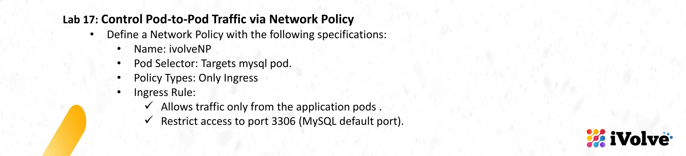
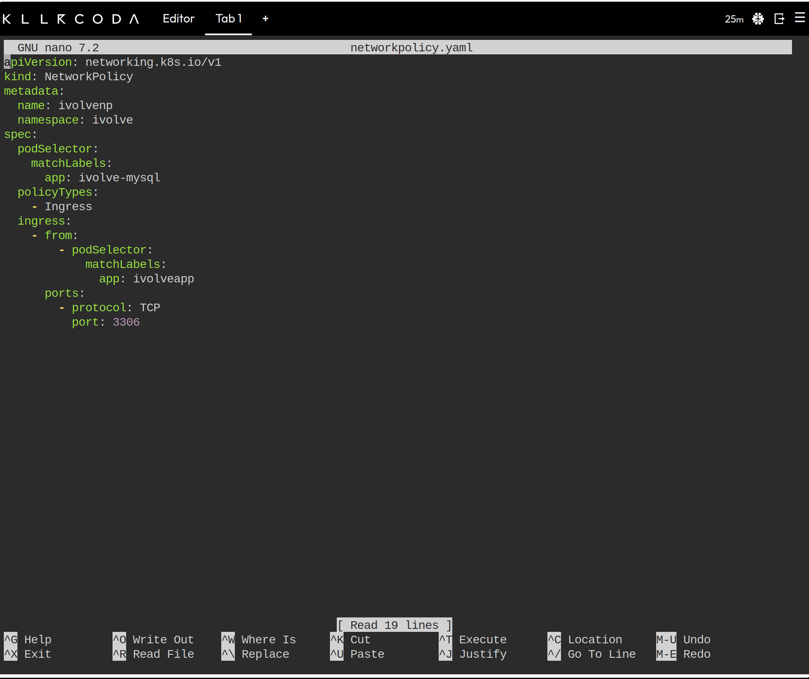
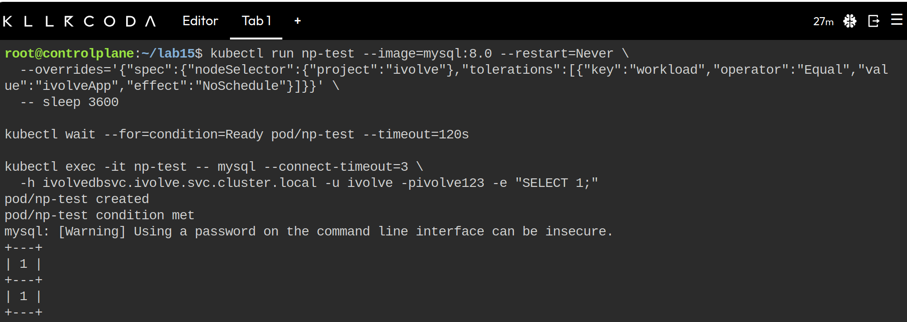
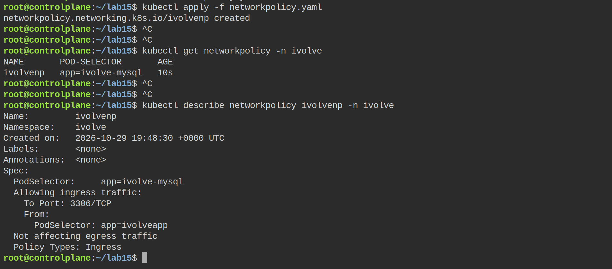
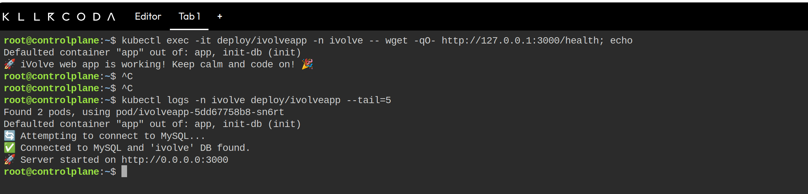
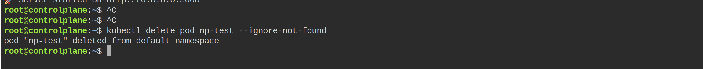

# Lab 17: Control Pod-to-Pod Traffic via Network Policy



This lab closes the door on the database. Until now any pod in the cluster could open port 3306 on the MySQL pod, including the temporary pods used in labs 14 and 15. A NetworkPolicy is supposed to limit that traffic to the application pods only.

## Objective

- Define a NetworkPolicy named `ivolveNP` in the `ivolve` namespace.
- Selector: the MySQL pod.
- Policy types: `Ingress` only.
- Ingress rule: allow traffic from the application pods, on port 3306.

Kubernetes does not accept the camel case spelling, so the object is named `ivolvenp`.

## The manifest

```yaml
apiVersion: networking.k8s.io/v1
kind: NetworkPolicy
metadata:
  name: ivolvenp
  namespace: ivolve
spec:
  podSelector:
    matchLabels:
      app: ivolve-mysql
  policyTypes:
    - Ingress
  ingress:
    - from:
        - podSelector:
            matchLabels:
              app: ivolveapp
      ports:
        - protocol: TCP
          port: 3306
```



Reading it from the outside in:

| Part | Meaning |
|------|---------|
| `podSelector` | The policy applies to pods labeled `app=ivolve-mysql`, which is exactly the StatefulSet pod `ivolvedb-0`. |
| `policyTypes: Ingress` | Only incoming traffic is controlled. The database can still reach out normally, so no egress rule is needed. |
| `ingress.from.podSelector` | Only pods in the same namespace with `app=ivolveapp` are allowed. A `podSelector` without a `namespaceSelector` means the policy's own namespace, so a pod carrying the same label in `default` would still be refused. |
| `ingress.ports` | Only TCP 3306. Every other port on the database pod is closed to other pods. |

Once a pod is selected by a policy that has `Ingress` in `policyTypes`, all ingress traffic is denied by default and only what the rules allow gets through. The policy therefore has to list the application explicitly instead of "blocking" something: the block is the default, the rule is the exception.

## Before the policy

A test pod in the `default` namespace shows that the database is reachable from anywhere right now. It needs the toleration from the application manifest, otherwise it cannot be scheduled on the tainted `node01`.

```bash
kubectl run np-test --image=mysql:8.0 --restart=Never \
  --overrides='{"spec":{"nodeSelector":{"project":"ivolve"},"tolerations":[{"key":"workload","operator":"Equal","value":"ivolveApp","effect":"NoSchedule"}]}}' \
  -- sleep 3600

kubectl wait --for=condition=Ready pod/np-test --timeout=120s

kubectl exec -it np-test -- mysql --connect-timeout=3 \
  -h ivolvedbsvc.ivolve.svc.cluster.local -u ivolve -pivolve123 -e "SELECT 1;"
```



The query returned the small table with a `1`, which means the database accepted a connection from a pod that has nothing to do with the application. The `np-test` pod lives in `default` and only borrows the node toleration, so its labels are `run=np-test`, not `app=ivolveapp`.

## Apply the policy

```bash
nano networkpolicy.yaml
kubectl apply -f networkpolicy.yaml
kubectl get networkpolicy -n ivolve
kubectl describe networkpolicy ivolvenp -n ivolve
```



`kubectl get networkpolicy` prints `POD-SELECTOR app=ivolve-mysql`, and the description lists `Policy Types: Ingress`, the `Allowing ingress traffic` rule with the app selector and `To Port: 3306/TCP`, plus the expected `Not affecting egress traffic` line.

The selector also has to match a real pod, otherwise the policy would exist and do nothing:

```bash
kubectl get pods -n ivolve --show-labels | grep -E "NAME|ivolvedb"
```

## Why the test pod still connects on this playground

The same command from `np-test` after the apply still returns the table with `1`, and that is a property of the cluster, not of the manifest. A NetworkPolicy is only a description of the desired rules; the enforcement is done by the CNI plugin, and the default network plugin of this Killercoda image does not implement NetworkPolicy at all. The API server accepts and stores the object, and the kubelet keeps the pod running, but nothing filters the packets.

The plugin in use is visible in `kube-system`:

```bash
kubectl get pods -n kube-system | grep -Ei "calico|cilium|flannel|weave"
```

On a cluster with Calico or Cilium the same command behaves like the slide expects: it answers `ERROR 2003 (HY000): Can't connect to MySQL server on 'ivolvedbsvc.ivolve.svc.cluster.local:3306' (110)` after the three second timeout, because the packets are dropped rather than refused, and only a pod with `app=ivolveapp` in the `ivolve` namespace can reach the port.

This is also why lab 9 built its own cluster with Calico: a policy-aware CNI is a prerequisite for this lab, not part of it.

## The application is untouched

```bash
kubectl exec -it deploy/ivolveapp -n ivolve -- wget -qO- http://127.0.0.1:3000/health; echo
kubectl logs -n ivolve deploy/ivolveapp --tail=5
```



`/health` runs `SELECT 1` through the application's own MySQL connection, so a positive answer is proof that the app pods reach the database at the same time as the unrelated pod is supposedly cut off. The log shows the connection and the listening message from the same pod, and the access log on the volume keeps growing.

## Cleanup

```bash
kubectl delete pod np-test --ignore-not-found
```



```bash
kubectl delete -f networkpolicy.yaml
```

Keeping the policy does no harm on this cluster, but deleting it is the right habit: on an enforcing CNI the default deny for the database pod only exists while a policy selects it.

## Requirements and notes

- NetworkPolicy needs a CNI that supports it. Calico, Cilium, Antrea and Weave Net do; flannel on its own does not. Without one, `kubectl describe networkpolicy` is the only verification available.
- Lab 15 used a temporary `busybox` and `curl` pod inside the `ivolve` namespace. After a policy that works, those pods would still be allowed if they carried the app label, and refused otherwise. This is why the test pod here runs in `default`: the quota in `ivolve` is full with the three application pods.
- The MySQL readiness probe is an `exec` probe inside the container, so the policy does not interfere with it.
- If the application pods are restarted, their init container connects to the same database as `root` from a pod labelled `app=ivolveapp`, so the rule covers that path too.
- Pods keep their connections once established; a new connection is the thing to test after changing a policy.

## Summary

- `ivolvenp` selects the MySQL pod and controls ingress only, so the database keeps its own outbound traffic.
- The rule allows TCP 3306 from pods labelled `app=ivolveapp` in the `ivolve` namespace and nothing else.
- `kubectl describe networkpolicy` confirms the selector, the policy type, the port and the source selector.
- On this playground the default CNI does not enforce the policy, which is a cluster limitation; on a Calico or Cilium cluster the same test from an unrelated pod fails with `ERROR 2003` while the application keeps working.
