# Lab 18: Node-Wide Pod Management with DaemonSet

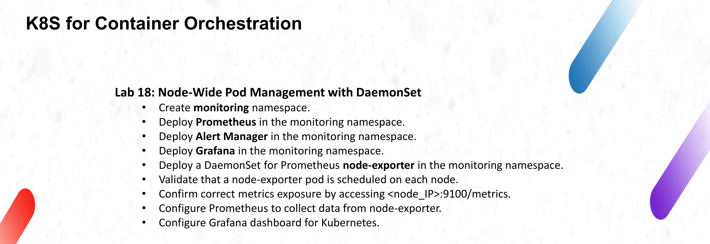

Until now every workload in the track ran on a single node and was concerned with the application itself. This lab turns the cluster into something observable: a DaemonSet that puts one exporter on every node, a Prometheus instance that scrapes it, an Alertmanager that receives the alerts, and a Grafana dashboard that shows the result.

## Objective

- Create the `monitoring` namespace.
- Deploy Prometheus in that namespace.
- Deploy Alertmanager in that namespace.
- Deploy Grafana in that namespace.
- Deploy a DaemonSet for the Prometheus `node-exporter` in the same namespace.
- Validate that one node-exporter pod is scheduled on each node.
- Confirm that metrics are exposed on `<node_IP>:9100/metrics`.
- Configure Prometheus to collect data from node-exporter.
- Configure a Grafana dashboard for Kubernetes.

## Folder contents

| File | Purpose |
|------|---------|
| `monitoring.yaml` | Namespace, node-exporter DaemonSet and Service, Prometheus, Alertmanager, kube-state-metrics and its RBAC |
| `grafana.yaml` | Grafana datasource, dashboard provider, the dashboard itself, the Deployment and the NodePort Service |

## 1. Cluster and namespace

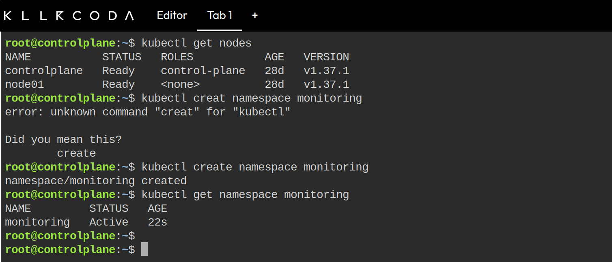

The session is a two-node cluster on Kubernetes 1.37.1 (`controlplane` and `node01`). The frame starts with a small typo, `kubectl creat namespace monitoring`, which kubectl rejects with a suggestion, and the command is repeated correctly right after it. The namespace exists a moment later and `kubectl get namespace monitoring` shows it as `Active`.

## 2. The monitoring manifest

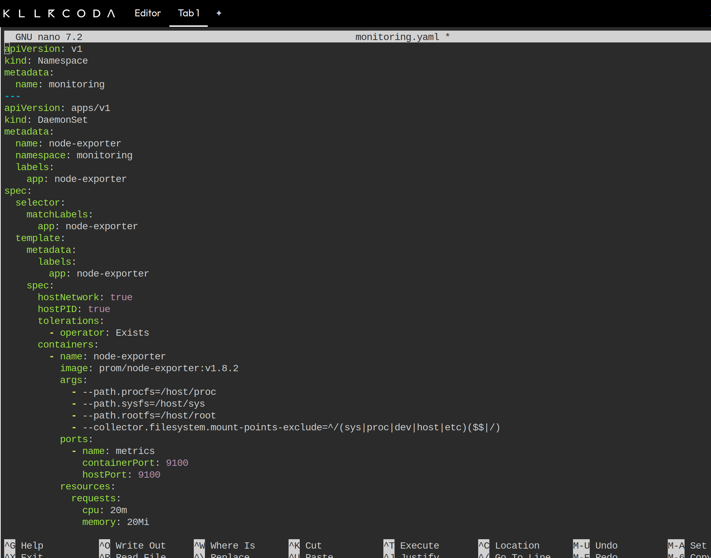

The file starts with the namespace and then the DaemonSet. The part that matters for a DaemonSet is that there is no replica count: the controller creates one pod per node that matches the selector, and adds or removes pods when nodes join or leave.

| Part | What it does |
|------|--------------|
| `hostNetwork: true` | The pod uses the node network stack, so the exporter listens on the node IP and not on a pod IP. |
| `hostPID: true` | Lets the exporter read the host process list through `/host/proc`. |
| `tolerations: operator: Exists` | Tolerates every taint, which is what makes the pod land on both nodes, including the control plane. |
| `port 9100` with `hostPort: 9100` | Publishes the metrics on the node itself, which is exactly the `<node_IP>:9100/metrics` the lab asks for. |
| `prom/node-exporter:v1.8.2` | The exporter image, with explicit paths to the host `/proc`, `/sys` and `/`. |

The rest of the file is the Prometheus side. The `prometheus-config` ConfigMap holds two keys: `prometheus.yml`, with three scrape jobs (`prometheus`, `node-exporter`, `kube-state-metrics`) and the Alertmanager target, and `alerts.yml`, with two rules, `NodeExporterDown` and `NodeHighMemory`. The node-exporter job uses `dns_sd_configs` against the headless `node-exporter` Service instead of a static list, so Prometheus discovers both pods by itself.

Prometheus and Alertmanager run as single-replica Deployments with `strategy: Recreate` and an `emptyDir` for their data. Both tolerate the control-plane taint and the `workload=ivolveApp` taint left on `node01` by the earlier labs. Their Services are `NodePort` on 30090 and 30093.

The last block is `kube-state-metrics`: a ServiceAccount, a ClusterRole with read-only access to the object types it reports on, a ClusterRoleBinding, the Deployment and a `ClusterIP` Service on port 8080. The dashboard needs this component because data such as the number of ready nodes or available deployments is not in the node metrics; it comes from the Kubernetes API.

## 3. The Grafana manifest

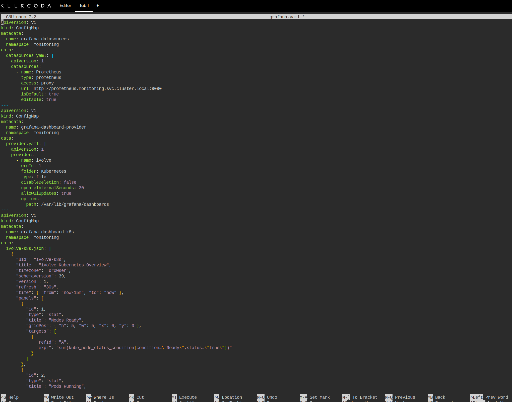

Everything Grafana needs is provisioned, so the dashboard is not created by hand in the UI:

- `grafana-datasources` adds Prometheus as the default datasource, pointing at `http://prometheus.monitoring.svc.cluster.local:9090`.
- `grafana-dashboard-provider` tells Grafana to load JSON dashboards from `/var/lib/grafana/dashboards` every 30 seconds.
- `grafana-dashboard-k8s` contains that JSON: uid `ivolve-k8s`, title `iVolve Kubernetes Overview`, four stat panels (nodes ready, pods running, node-exporter targets, deployments available), a CPU panel and a memory panel.

The Deployment mounts the three ConfigMaps into the provisioning paths and runs `grafana/grafana:11.2.0` behind a `NodePort` Service on 30300. Anonymous access is enabled with the Admin role only to keep the lab simple; the admin/admin account works as well.

## 4. Applying both files

```bash
kubectl apply -f monitoring.yaml
kubectl apply -f grafana.yaml
kubectl get pods -n monitoring -w
```

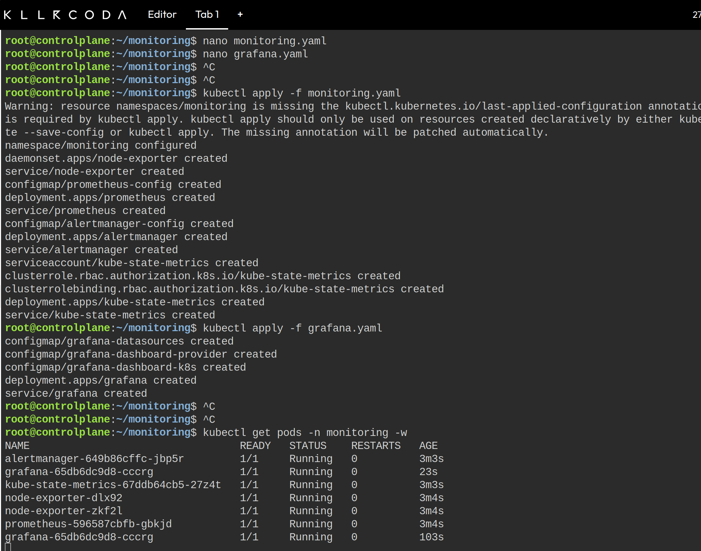

The first apply prints a warning about the `kubectl.kubernetes.io/last-applied-configuration` annotation on the namespace. It is expected, because the namespace was created with `kubectl create` and not with `apply`, and kubectl patches the annotation itself. After that the objects are created in order, and the second apply adds the three Grafana ConfigMaps, the Deployment and the Service.

The watch at the bottom shows the final state: `alertmanager`, `grafana`, `kube-state-metrics`, `prometheus` and the two `node-exporter` pods, all `1/1` and `Running`. The image pull is the slow part on a fresh node; Prometheus and kube-state-metrics took about three minutes.

## 5. One exporter per node

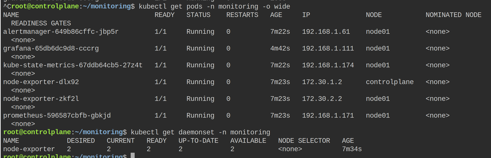

`kubectl get pods -o wide` shows the spread directly:

- `node-exporter-dlx92` on `controlplane`, address `172.30.1.2`
- `node-exporter-zkf2l` on `node01`, address `172.30.2.2`

Those are node addresses, not pod addresses, because of `hostNetwork`. The other pods run on `node01` with addresses from the pod network (`192.168.1.x`), which is the expected split: the exporter follows the node, the applications follow the scheduler.

`kubectl get daemonset` confirms the bookkeeping: `DESIRED 2`, `CURRENT 2`, `READY 2`, `AVAILABLE 2`, and `NODE SELECTOR <none>`, so the two pods cover every node in the cluster.

## 6. Metrics directly from the nodes

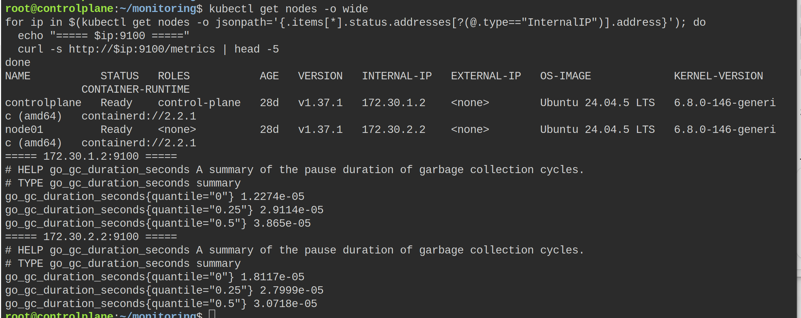

The lab asks for the metrics endpoint to be reached on the node IP, so the test loops over the internal addresses of all nodes:

```bash
for ip in $(kubectl get nodes -o jsonpath='{.items[*].status.addresses[?(@.type=="InternalIP")].address}'); do
  echo "===== $ip:9100 ====="
  curl -s http://$ip:9100/metrics | head -5
done
```

Both addresses answer with the standard exporter output, starting with the `go_gc_duration_seconds` family. The `curl` runs on the controlplane, so this also proves the `hostPort` mapping works from a different machine than the one being scraped.

## 7. Prometheus targets

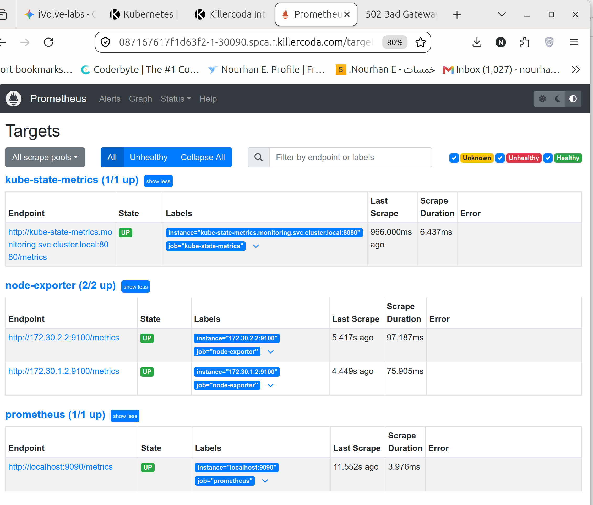

`Status` then `Targets` in the Prometheus UI (NodePort 30090) is the frame that proves the scrape configuration:

- `kube-state-metrics (1/1 up)` - `kube-state-metrics.monitoring.svc.cluster.local:8080`
- `node-exporter (2/2 up)` - `172.30.2.2:9100` and `172.30.1.2:9100`
- `prometheus (1/1 up)` - `localhost:9090`

The two node-exporter targets were found through the headless Service, so the `dns_sd_configs` block did its job. All errors are empty and the last scrape is a few seconds old.

## 8. A first query

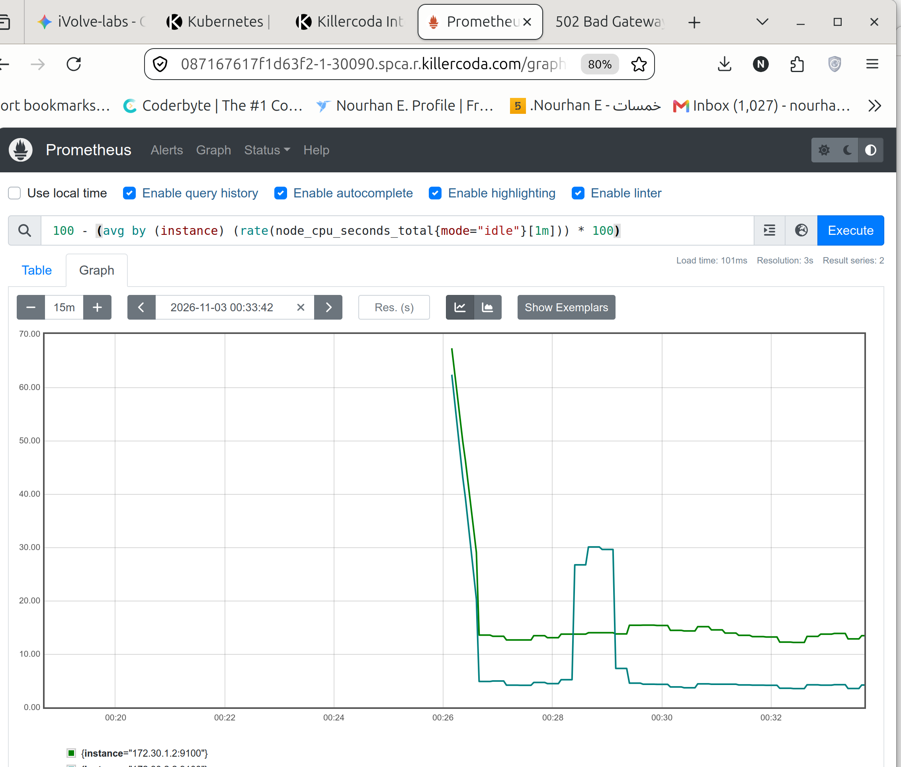

The query used in the lab, and the same one the Grafana CPU panel runs:

```promql
100 - (avg by (instance) (rate(node_cpu_seconds_total{mode="idle"}[1m])) * 100)
```

It turns the idle counter into a percentage of busy CPU per node. The graph shows two series, one per exporter: the control plane sits around 14 percent, the worker around 4 percent, with a short spike at the beginning of the range where the counter had just started. `Result series: 2` at the top right is the confirmation that both nodes are reporting.

## 9. Alertmanager

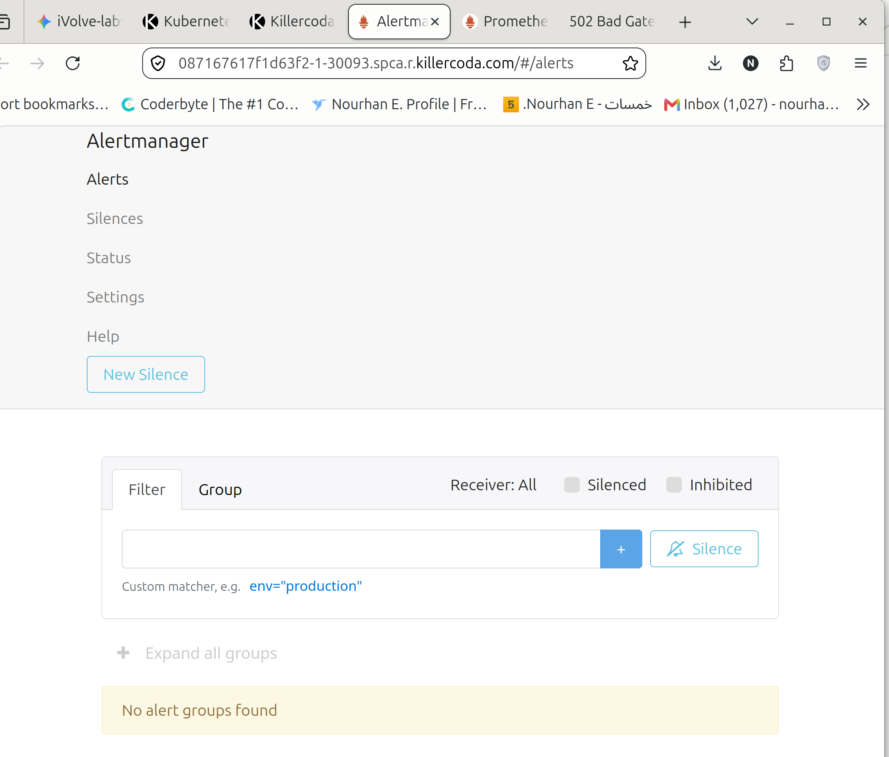

Alertmanager is reachable on NodePort 30093. The `Alerts` view shows `No alert groups found`, which is the healthy state here: Prometheus sends its alerts to `alertmanager.monitoring.svc.cluster.local:9093`, the two rules from the ConfigMap are loaded, and none of them is firing because both exporters are up and memory is below the 85 percent threshold.

The default route has only the `default` receiver, with no email or webhook behind it. The lab is about wiring the components together, so an alert would appear in this UI but would not be delivered anywhere.

## 10. The Grafana dashboard

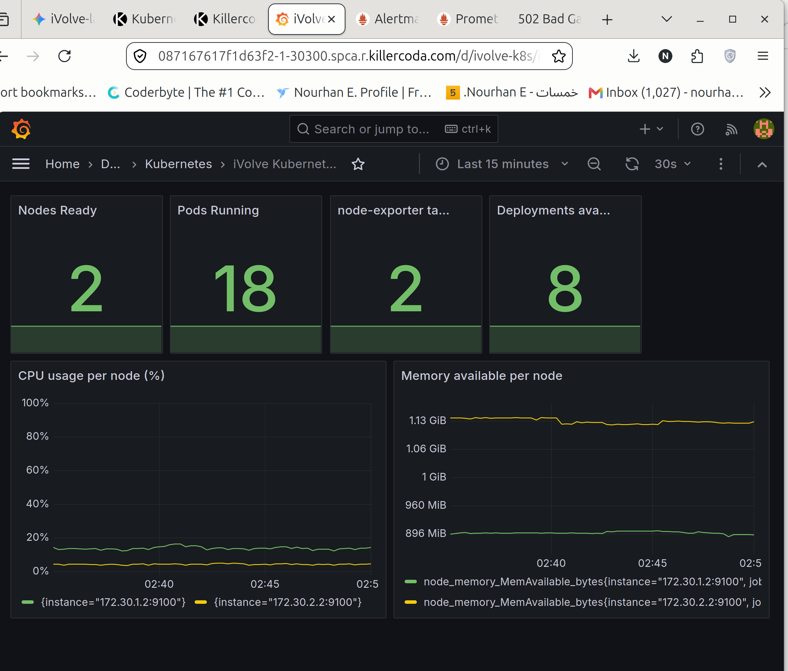

Grafana is on NodePort 30300, and the dashboard is already there under the `Kubernetes` folder, with no manual import: `iVolve Kubernetes Overview`, uid `ivolve-k8s`. The frame shows the four stat panels and the two time series.

- Nodes Ready `2`
- Pods Running `18` (all namespaces, including the monitoring stack itself)
- node-exporter targets up `2`
- Deployments available `8`

The CPU panel draws the same two lines as the Prometheus query, and the memory panel shows the real difference between the machines: about 1.13 GiB available on the control plane, which is otherwise busy with the API server and etcd, against roughly 860 MiB on the worker that runs most of the pods.

## 11. Final state

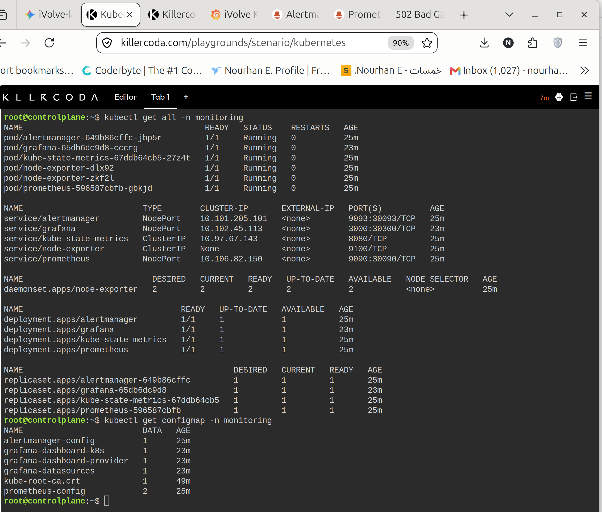

`kubectl get all -n monitoring` collects the whole stack in one frame. Six pods are `Running` with zero restarts, the three Services that need to be reached from the browser are `NodePort` (9093 to 30093, 3000 to 30300, 9090 to 30090), `kube-state-metrics` is `ClusterIP` on 8080, and the node-exporter Service is headless. The DaemonSet still reports `2/2` and the four Deployments are all available.

The `kubectl get configmap` output at the bottom lists the configuration the stack is running on: `prometheus-config` with two keys (`prometheus.yml` and `alerts.yml`), `alertmanager-config`, and the three Grafana ConfigMaps. `kube-root-ca.crt` is added by Kubernetes itself to every namespace.

## Problems and notes

- The control plane carries the standard `node-role.kubernetes.io/control-plane:NoSchedule` taint, and the worker may still carry `workload=ivolveApp:NoSchedule` from lab 10. Prometheus, Alertmanager, kube-state-metrics and Grafana tolerate both, otherwise they could end up with no schedulable node. node-exporter uses `operator: Exists`, which tolerates everything by design, because a per-node agent must run everywhere.
- `hostPort: 9100` only works because no other process uses that port on the nodes. A second exporter on the same node would fail to bind. The headless Service exists so Prometheus can find the pods without a static node list; it does not route traffic.
- `kube-state-metrics` is a cluster-scoped name. The ClusterRole and the ClusterRoleBinding live outside the namespace even though the file is applied with the rest, and a second copy of this lab in the same cluster would collide with them.
- Prometheus keeps its data in an `emptyDir`, with retention set to two hours. Restarting the pod loses the history. A real installation would use a PersistentVolume, the same way lab 13 did for the application.
- Grafana also writes to an `emptyDir`, but that only affects users, annotations and sessions. The dashboard comes from the ConfigMap and is re-read every 30 seconds, which is why the dashboard survives a pod restart.
- Anonymous access with the Admin role is a lab shortcut. On a real installation the anonymous role would be `Viewer` at most, and the admin password would not be `admin`.
- The Killercoda "Traffic / Ports" tab has to expose 30090, 30093 and 30300 before the Prometheus, Alertmanager and Grafana pages open in the browser.
- The `-w` watch in section 4 is the reason the same pod appears twice in the frame, once as `ContainerCreating` and once as `Running`.

## Cleanup

```bash
kubectl delete -f grafana.yaml
kubectl delete -f monitoring.yaml
```

The last apply also removes the namespace, the two ClusterRole objects and the ClusterRoleBinding, because they are all part of the same file.

## Summary

- `monitoring.yaml` brings up the namespace, a node-exporter DaemonSet with one pod per node, Prometheus, Alertmanager and kube-state-metrics.
- The DaemonSet uses `hostNetwork` and `hostPort` so the metrics answer on `<node_IP>:9100`, and a headless Service so Prometheus can discover both exporters.
- Prometheus scrapes itself, the two exporters and kube-state-metrics, and forwards alerts to Alertmanager; the targets page shows every job up.
- Grafana is fully provisioned from ConfigMaps: datasource, dashboard provider and the `iVolve Kubernetes Overview` dashboard, which shows nodes, pods, deployments, CPU and memory without any manual setup.
- The frame that closes the lab is `kubectl get all -n monitoring`, with six running pods, the two-node DaemonSet and the three NodePorts that serve the UIs.
