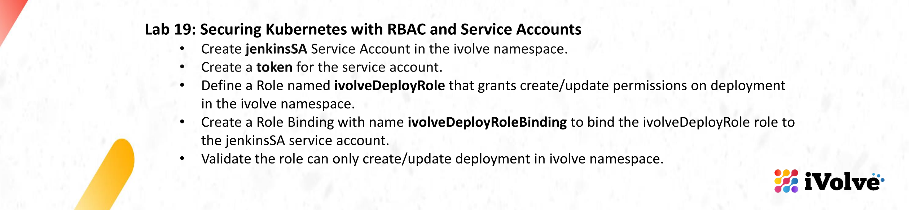
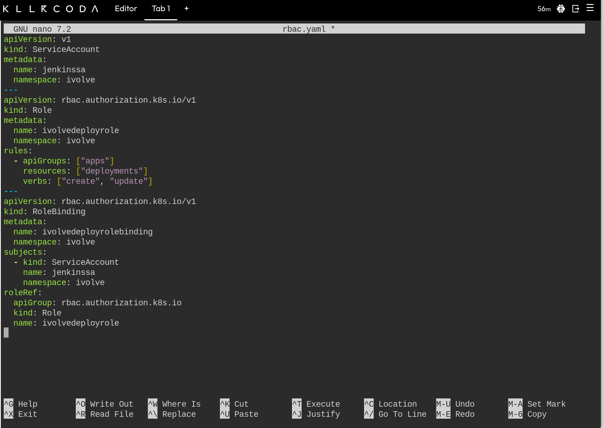
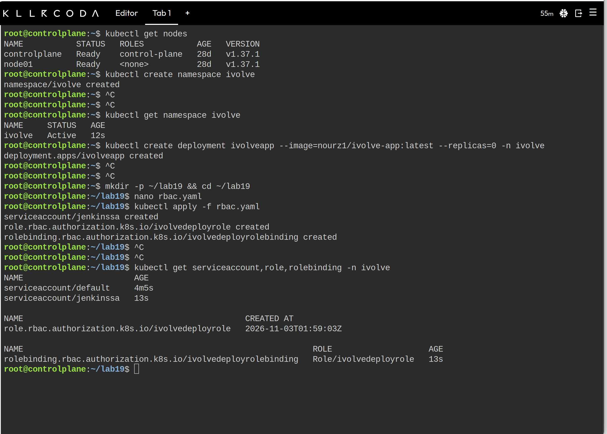
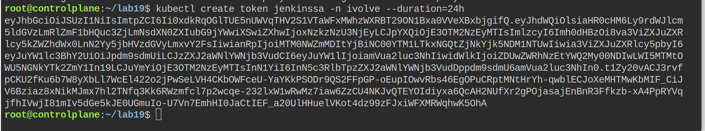
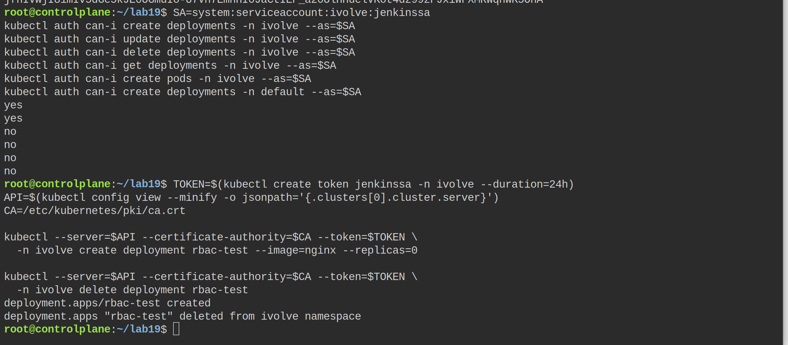
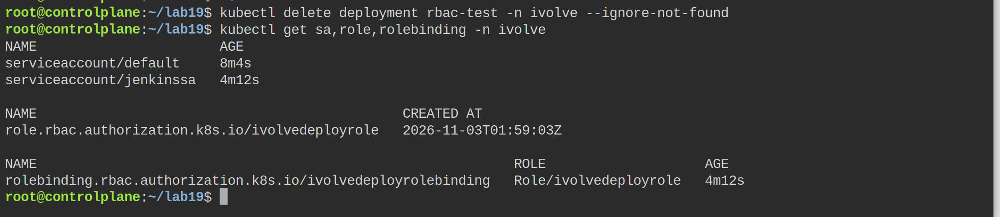

# Lab 19: Securing Kubernetes with RBAC and Service Accounts



The previous labs gave a workload an identity through a ServiceAccount implicitly, because every pod gets one. This lab creates an identity on purpose and limits it: a ServiceAccount for Jenkins, a Role that only allows creating and updating Deployments, and a RoleBinding that joins the two. The last step is proving that the permissions are exactly that narrow.

## Objective

- Create the `jenkinssa` ServiceAccount in the `ivolve` namespace.
- Create a token for the service account.
- Define a Role named `ivolveDeployRole` that grants create and update on Deployments in the `ivolve` namespace.
- Create a RoleBinding named `ivolveDeployRoleBinding` that binds the Role to `jenkinssa`.
- Validate that the identity can only create and update Deployments in the `ivolve` namespace.

## Folder contents

| File | Purpose |
|------|---------|
| `rbac.yaml` | ServiceAccount, Role and RoleBinding for the Jenkins identity |

## 1. The manifest



The file is three objects in one document. The ServiceAccount is the identity, the Role is the permission set, and the RoleBinding is the link between them.

| Object | Detail |
|--------|--------|
| `ServiceAccount/jenkinssa` | Lives in `ivolve`, which is the namespace the whole lab is scoped to. |
| `Role/ivolvedeployrole` | `apiGroups: ["apps"]`, `resources: ["deployments"]`, `verbs: ["create", "update"]`. Nothing else. |
| `RoleBinding/ivolvedeployrolebinding` | Subject is the ServiceAccount `jenkinssa` in `ivolve`, roleRef points at `ivolvedeployrole`. |

Names are lowercased (`ivolvedeployrole`) because Kubernetes object names do not accept the camel case spelling from the slide; the RoleBinding still refers to the Role by that name, so the pair matches.

## 2. Applying it



This session started from an empty cluster, so the frame begins with `kubectl get nodes` (two nodes on 1.37.1), the creation of the `ivolve` namespace, and one admin-side object to give the Role something to act on:

```bash
kubectl create namespace ivolve
kubectl create deployment ivolveapp --image=nourz1/ivolve-app:latest --replicas=0 -n ivolve
```

`--replicas=0` is deliberate. The lab is about permissions, and a running application would only add pods, image pulls and quota noise. Zero replicas still creates a Deployment object, which is all that `update` needs.

After that the file is applied:

```bash
kubectl apply -f rbac.yaml
kubectl get serviceaccount,role,rolebinding -n ivolve
```

The three objects are created in one pass, and the listing shows `serviceaccount/jenkinssa`, `role.../ivolvedeployrole` with its creation time, and `rolebinding.../ivolvedeployrolebinding` pointing at `Role/ivolvedeployrole`. The `default` ServiceAccount next to `jenkinssa` is created automatically by Kubernetes in every namespace; the pods use it unless a pod template sets `serviceAccountName`, which is why it is always there.

## 3. A token for the service account



```bash
kubectl create token jenkinssa -n ivolve --duration=24h
```

Since Kubernetes 1.24 a ServiceAccount no longer gets a token Secret automatically. The token is requested when it is needed, it is a signed JWT with an expiry (24 hours in this run, which is within the maximum the API server allows), and it is not stored in the cluster as a readable Secret. The long string in the frame is that JWT.

The token is the credential a CI system would use. Jenkins would store it in a credential of type "Secret text" and call the API with `--token`, or put it in a kubeconfig file.

## 4. Checking the permissions



The first half of the frame asks the API server what the identity may do, without creating anything:

```bash
SA=system:serviceaccount:ivolve:jenkinssa
kubectl auth can-i create deployments -n ivolve --as=$SA
kubectl auth can-i update deployments -n ivolve --as=$SA
kubectl auth can-i delete deployments -n ivolve --as=$SA
kubectl auth can-i get deployments    -n ivolve --as=$SA
kubectl auth can-i create pods        -n ivolve --as=$SA
kubectl auth can-i create deployments -n default --as=$SA
```

The answers match the Role exactly:

| Question | Answer |
|---|---|
| create deployments in `ivolve` | yes |
| update deployments in `ivolve` | yes |
| delete deployments in `ivolve` | no |
| get deployments in `ivolve` | no |
| create pods in `ivolve` | no |
| create deployments in `default` | no |

The `--as` flag is impersonation: the admin's own credentials send the request, and the API server evaluates it as if it came from that identity. It is the quickest way to read an RBAC decision, and it needs the `impersonate` permission, which the admin has.

The second half of the frame is the real test with the token itself: the deployment `rbac-test` is created with `--token`, and then a delete is attempted with the same token.

## 5. Why the delete went through

The delete should have been refused, and the frame shows it succeeding. That is not a bug in the Role: the `can-i` answers above already prove the Role has no `delete` verb. The problem is in the command used for the test.

`kubectl --server ... --token ...` adds the token to the request, but it does not remove the admin client certificate that is still in the kubeconfig. The API server authenticates the TLS client certificate before it looks at the bearer token, so the request was evaluated as the cluster admin, not as `jenkinssa`. Both the create and the delete were admin actions.

The clean way to test a token is a kubeconfig that contains nothing else:

```bash
API=$(kubectl config view --minify -o jsonpath='{.clusters[0].cluster.server}')
CA=/etc/kubernetes/pki/ca.crt
TOKEN=$(kubectl create token jenkinssa -n ivolve --duration=24h)

cat > /tmp/jenkinssa.kubeconfig <<EOF
apiVersion: v1
kind: Config
clusters:
  - name: lab
    cluster:
      server: $API
      certificate-authority: $CA
users:
  - name: jenkinssa
    user:
      token: $TOKEN
contexts:
  - name: jenkinssa
    context:
      cluster: lab
      user: jenkinssa
current-context: jenkinssa
EOF

kubectl --kubeconfig=/tmp/jenkinssa.kubeconfig -n ivolve create deployment rbac-test --image=nginx --replicas=0
kubectl --kubeconfig=/tmp/jenkinssa.kubeconfig -n ivolve delete deployment rbac-test
```

With this file there is no certificate to fall back on. The create returns `deployment.apps/rbac-test created`, and the delete returns `Error from server (Forbidden): deployments.apps "rbac-test" is forbidden: User "system:serviceaccount:ivolve:jenkinssa" cannot delete resource "deployments" in API group "apps" in the namespace "ivolve"`.

That error message is the actual deliverable of the lab, and it is what the `can-i` matrix predicted. The test object is removed with the admin account afterwards:

```bash
kubectl delete deployment rbac-test -n ivolve --ignore-not-found
```

## 6. Final state



The cleanup of the test Deployment produces no output because it was already gone, and the last listing shows the end state: the namespace contains only the RBAC objects, `jenkinssa` next to the automatic `default` account, the Role with its creation time, and the RoleBinding still pointing at it. Nothing was left behind from the test.

## Problems and notes

- A `Role` is namespaced, a `ClusterRole` is not. Everything here is scoped to `ivolve`, so a `Role` plus a `RoleBinding` in that namespace is the smallest correct choice. Granting the same verbs with a `ClusterRoleBinding` would allow deployments in every namespace, which is the opposite of the lab.
- The Role has no `get` and no `list`. That is what the slide asks for, but it has a consequence worth knowing: `kubectl apply` as this identity fails, because client-side apply reads the live object before it patches it. Creating with `kubectl create` works, and a CI system that owns the full manifest would normally need `get` as well.
- `delete` is missing on purpose. A pipeline that can deploy but cannot remove its own deployment is the intended split; removal is an admin action.
- The token is short-lived. A Jenkins credential that stores one JWT will stop working after 24 hours. The usual setup is a long-lived token Secret (`kubectl create token` with a longer duration, or a manually created `kubernetes.io/service-account-token` Secret) or a kubeconfig with a client certificate for the service account.
- `kubectl auth can-i` answers the policy question, but it does not prove the token works. The token test proves the credential, and both are needed for a complete validation.
- The `default` ServiceAccount in the listing is not part of the manifest. It is created by the namespace controller and every pod that does not name another account uses it.

## Cleanup

```bash
kubectl delete -f rbac.yaml
kubectl delete deployment ivolveapp -n ivolve --ignore-not-found
kubectl delete namespace ivolve
```

Deleting the namespace removes anything left in it, including the ServiceAccount and the RoleBinding.

## Summary

- `jenkinssa` is a dedicated identity in the `ivolve` namespace, and its token is requested on demand because ServiceAccount token Secrets no longer exist by default.
- `ivolvedeployrole` grants exactly `create` and `update` on `apps/deployments` in that namespace, and `ivolvedeployrolebinding` attaches it to the account.
- The `can-i` matrix returns yes for create and update in `ivolve`, and no for delete, get, pods and other namespaces.
- The token test creates a Deployment successfully; the delete must be tested with a kubeconfig that carries only the token, because otherwise the admin certificate in the kubeconfig authenticates the request instead.
- The namespace is left with the three RBAC objects and nothing else.
