# Lab 9: Deploy Kubernetes cluster using Kubeadm

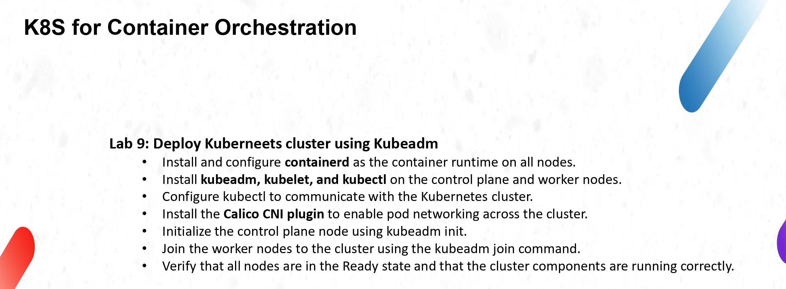

I have no cloud account yet, so I did this lab on the Killercoda playground. I signed in with my GitHub account. The playground gives two machines in the browser: `controlplane` and `node01`. I built the cluster on them with kubeadm.

- Kubernetes version: v1.37.1
- containerd version: v2.2.1
- Calico version: v3.29.1
- One control plane node (172.30.1.2) and one worker node (172.30.2.2)

## The two terminals

The two tabs in Killercoda both open `controlplane`. So I used `ssh node01` in Tab 1 to work on the worker machine.

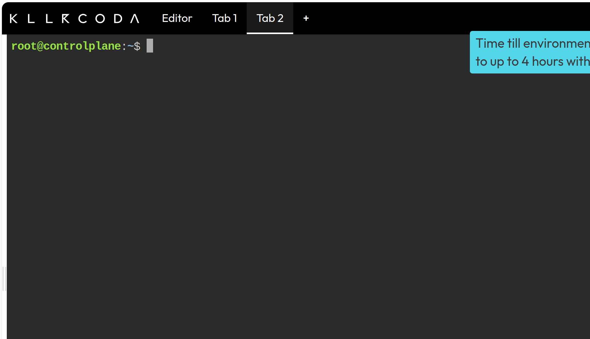

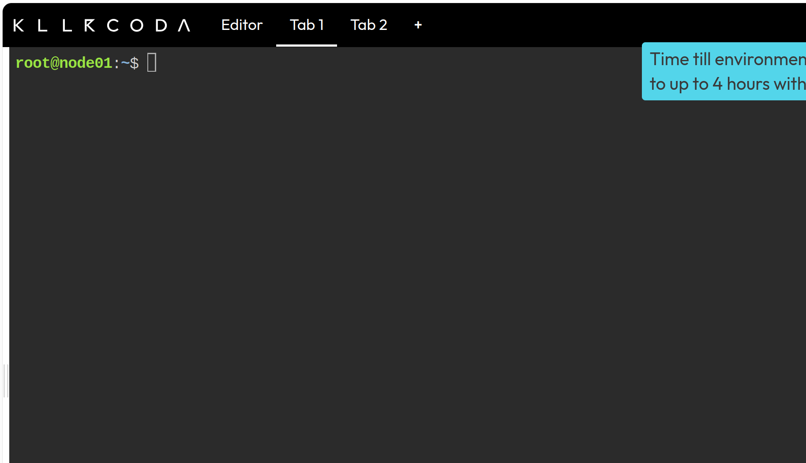

## Clean the old cluster

The playground already has an old cluster inside it. So I cleaned it first on the controlplane:

```bash
kubeadm reset -f
rm -rf /etc/cni/net.d /root/.kube
iptables -F; iptables -t nat -F; iptables -t mangle -F; iptables -X
```

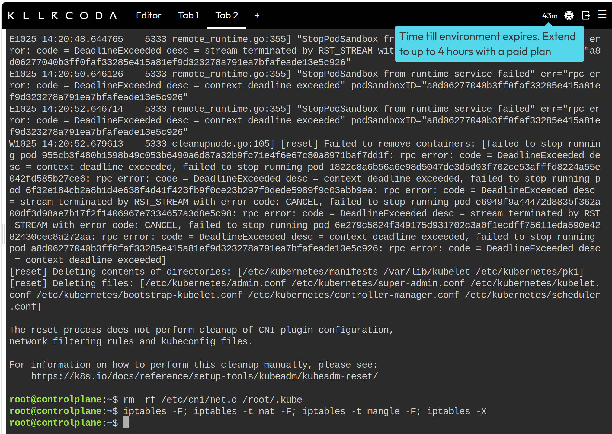

And the same on node01 (without `/root/.kube`):

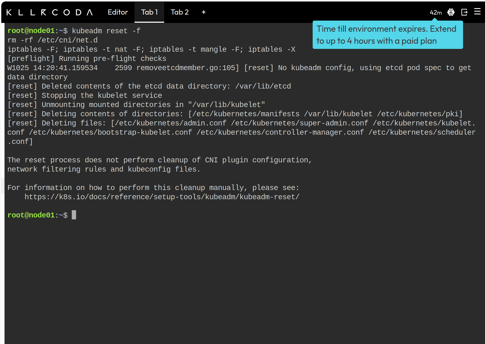

## Install and configure containerd

I ran this on both machines:

```bash
swapoff -a
apt-get update -y
apt-get install -y containerd
mkdir -p /etc/containerd
containerd config default > /etc/containerd/config.toml
sed -i 's/SystemdCgroup = false/SystemdCgroup = true/' /etc/containerd/config.toml
systemctl restart containerd
systemctl enable containerd
modprobe overlay; modprobe br_netfilter
echo -e "overlay\nbr_netfilter" > /etc/modules-load.d/k8s.conf
echo -e "net.bridge.bridge-nf-call-iptables = 1\nnet.bridge.bridge-nf-call-ip6tables = 1\nnet.ipv4.ip_forward = 1" > /etc/sysctl.d/k8s.conf
sysctl --system
containerd --version
```

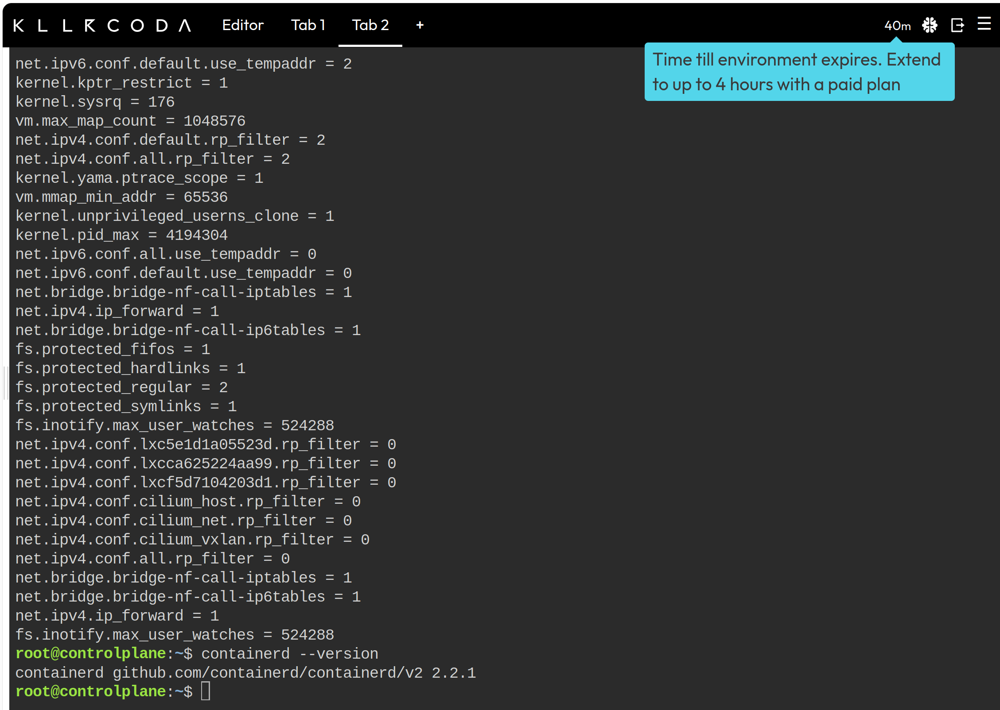

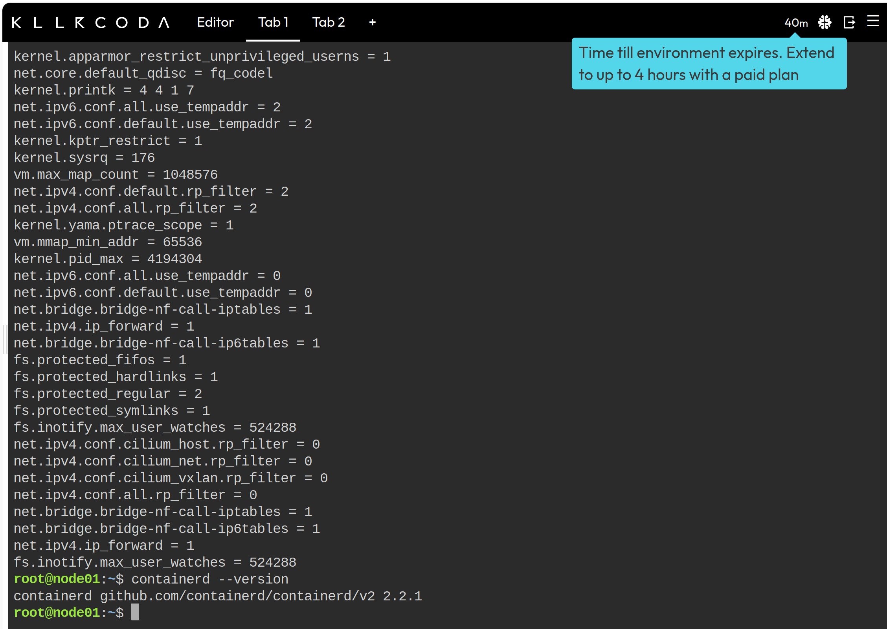

containerd is `2.2.1` on the two machines, and the sysctls for Kubernetes are set.

## Install kubeadm, kubelet, kubectl

I ran this on both machines too:

```bash
apt-get install -y apt-transport-https ca-certificates curl gpg
mkdir -p /etc/apt/keyrings
curl -fsSL https://pkgs.k8s.io/core:/stable:/v1.32/deb/Release.key | gpg --dearmor -o /etc/apt/keyrings/kubernetes-apt-keyring.gpg
echo 'deb [signed-by=/etc/apt/keyrings/kubernetes-apt-keyring.gpg] https://pkgs.k8s.io/core:/stable:/v1.32/deb/ /' > /etc/apt/sources.list.d/kubernetes.list
apt-get update -y
apt-get install -y kubelet kubeadm kubectl
systemctl enable kubelet
kubeadm version
kubectl version --client
```

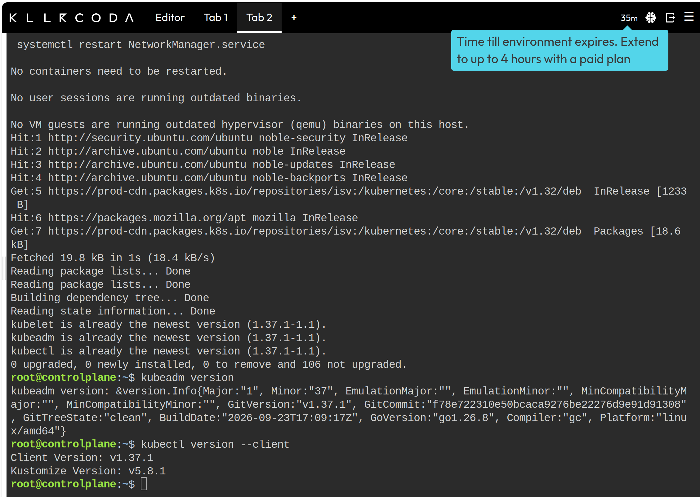

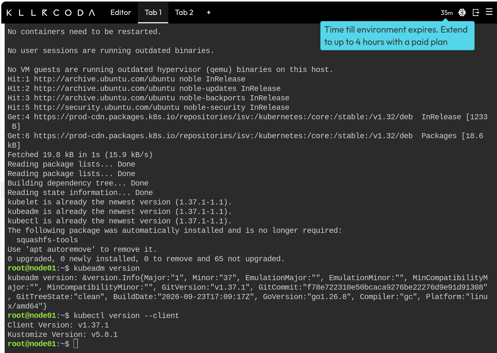

On the playground the newest version was already 1.37.1, so apt kept it. `kubeadm version` and `kubectl version --client` show v1.37.1 on both.

## kubeadm init

The first time it did not start. The preflight said the machine has 1 CPU and it wants 2, the playground machines are small. So I ran it again with that check ignored:

```bash
kubeadm init --pod-network-cidr=192.168.0.0/16 --ignore-preflight-errors=NumCPU
```

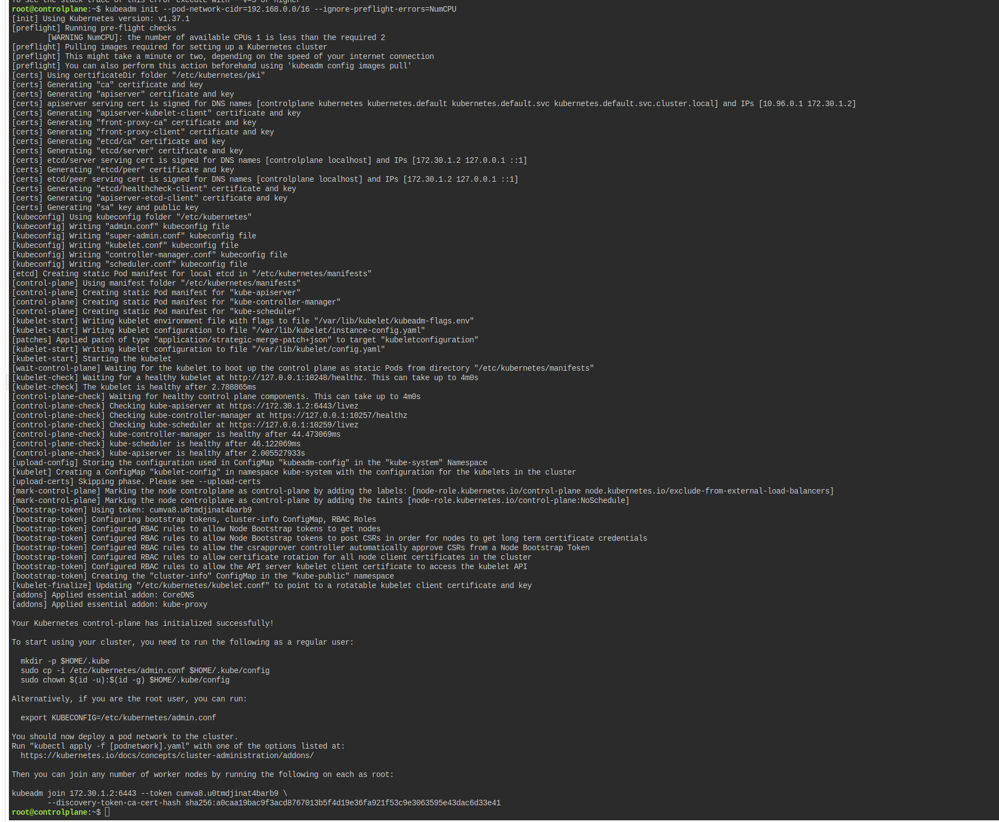

The output ends with `Your Kubernetes control-plane has initialized successfully!`

## Configure kubectl

```bash
mkdir -p $HOME/.kube
cp /etc/kubernetes/admin.conf $HOME/.kube/config
kubectl get nodes
```

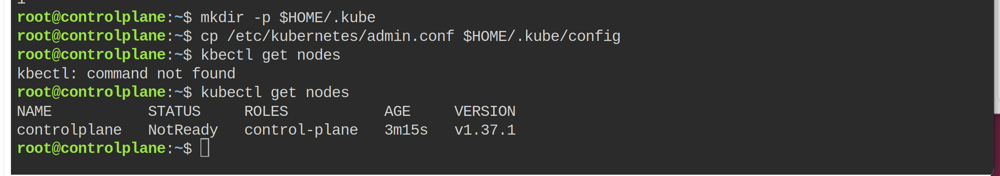

The node was `NotReady` here, because Calico was not installed yet. (I wrote `kbectl` by mistake the first time, then I fixed it.)

## Install Calico

```bash
kubectl apply -f https://raw.githubusercontent.com/projectcalico/calico/v3.29.1/manifests/calico.yaml
```

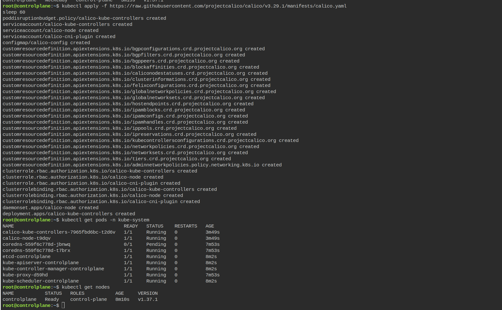

All Calico resources were created. After about one minute the calico pods were `Running` and the node changed to `Ready`. One CoreDNS pod was still `Pending`, it started after the worker joined.

## Join the worker

On controlplane I made a new join command:

```bash
kubeadm token create --print-join-command
```

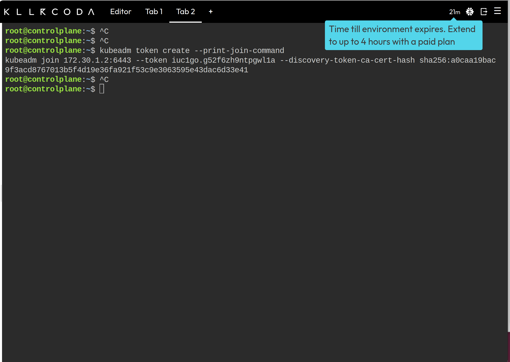

Then on node01 I pasted that `kubeadm join ...` line and it said `This node has joined the cluster`.

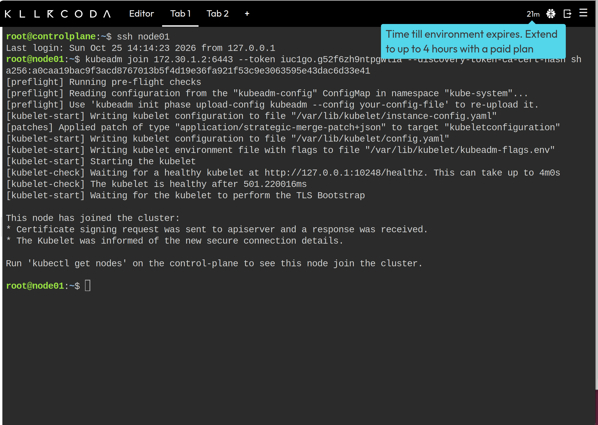

## Verify the cluster

```bash
kubectl get nodes
kubectl get pods -A
```

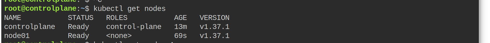

Both nodes are `Ready`, controlplane 13m old and node01 69 seconds old.

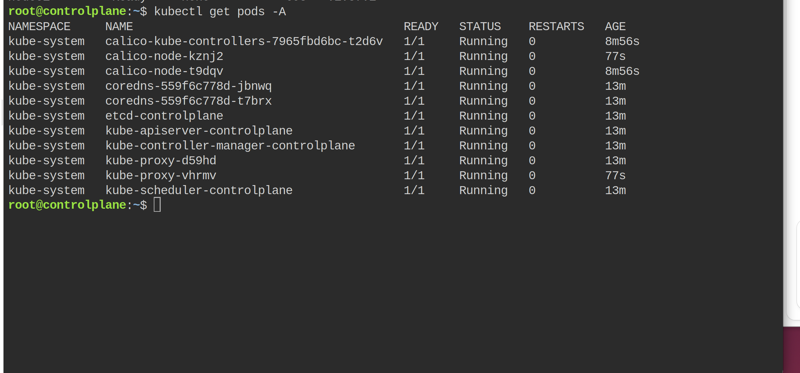

All pods are `Running`: calico on the two nodes, CoreDNS, etcd, apiserver, controller-manager, scheduler and kube-proxy.

